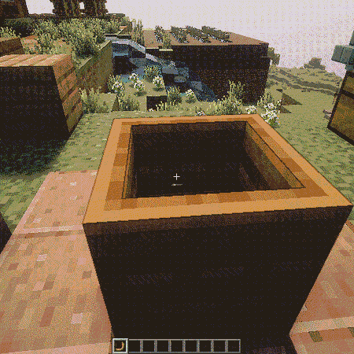

# Distillery Brewing Flow

<figure class="hl-figure">
  
  <figcaption>Start by mashing a suitable ingredient base.</figcaption>
</figure>

1. **Prepare and mash:** add the required number of ingredients to a composter on Granite or Polished Granite, then jump. Before stomping, use **Shears** on the tub to skin its current grapes, or **Flint and Steel** to roast its current grains. Added ingredients begin whole, so prepare again after adding more. These tools do not light a fire or create separate inventory ingredients. The default is six inputs; each original item, its quality and its preparation are retained as ancestry. Canceling refunds the untouched original ingredients once.
2. **Prepare and ferment:** suitable bases, including raw grain and rice wort, can ferment directly. For full grain or rice process-quality credit, first boil the wort in a cauldron over a Campfire; boiling does not change ABV. The Fermentation Station is a cauldron on a Blast Furnace (no fuel required). Bottle the finished beverage.
3. **Distil when making spirits:** build two adjacent columns: Campfire → Cut Copper → Cut Copper Stairs, and Brewing Stand → Lightning Rod → Cut Copper Stairs. Keep the Campfire lit. All oxidation and wax variants of the copper components work. Follow the preferred pass count on the [family reference](families.md). One pass remains usable; further strength gains diminish.
4. **Mature:** place the beverage in a barrel directly on Scaffolding. Choose a [cellar style](cellar-aging.md), its climate and its wood or neutral-resting treatment. Remove the bottle to pause, and return it to resume.

With the bundled defaults, each distillation extracts **20% of the remaining headroom toward 96% ABV**. Starting from a 5% wash, this is 37.8% after 2 passes, 80.7% after 8 passes, 95.2% after 21 passes. Spirytus Rektyfikowany requires at least 95% and prefers 21 passes; Taxi Vodka requires at least 80% and prefers 8 passes. These names depend on actual strength and suitable ingredients. Customized extraction, caps and pass preferences remain effective; previews use the same production calculation. Existing bottles keep their strength; the revised curve applies to subsequent passes.

Ferment grape wine again with **one Sugar and one Brown Mushroom** to make Sparkling Wine. Its own maturation and quality assessment begin after secondary fermentation; earlier still-wine aging remains historical evidence. The fresh Sparkling Wine is already drinkable. This treatment is recorded once; repeating it cannot reset progress, award more points or reroll quality.

Re-distilling keeps the ingredient ancestry and the original batch quality roll, but starts fresh spirit maturation. Earlier aging remains historical evidence. Ordinary fermentation strength and diminishing repeated-distillation gains remain variable; the cellar itself never changes ABV, serving volume or total alcohol.

Genuine beverage profiles determine eligibility. Renamed items, recipe previews, Mixology Gin, liqueurs and finished cocktails are not Distillery rack inputs. Mixology still owns those preparations and recognizes compatible aged spirits by their validated families.
