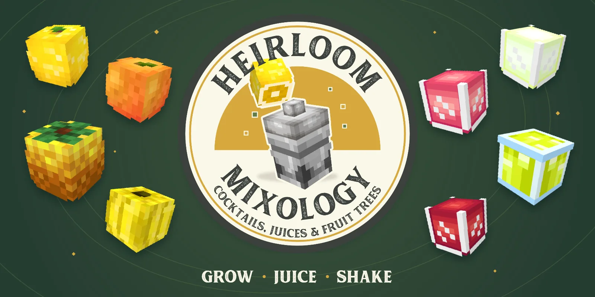

# Heirloom Mixology

<figure class="hl-figure">
  
  <figcaption>Cocktails, Juices & Fruit Trees</figcaption>
</figure>

Grow a fruit grove, blend your harvest into fresh juice, and serve a round of cocktails from a moving, multipart shaker. Heirloom Mixology brings fruit trees, tropical crops, survival discovery and physical drink-making stations to your server. No resource pack is required: the release uses player-head fruit and cocktail visuals, with vanilla bottle models for juices.

## Grow → juice → shake

1. **Grow:** discover plantable fruit in the world or open a starter packet. Tend seven fruit trees and the Pineapple crop; harvest ripe fruit by hand or knock it down with an arrow.
2. **Juice:** add three fruit or vegetable items to the [Juicer](../../stations/juicer.md), blend for ten seconds, then pour **two bottles**. Choose one produce type for pure juice, or mix a blend.
3. **Shake:** bring exact ingredients to the [Mixology Table](../../stations/mixology-table.md). An eight-second batch serves **three finished drinks** in a row; reusable liqueurs and infusions make one bottle. Perfect-quality batches have special shaker motions.

Start with a Virgin Mango Daiquiri or the shaken Piña Colada, then explore the [Mixology recipe catalog](../../recipes/station-mixology-table.md). The [Juicer guide](../../stations/juicer.md) covers blending, nutrition and both pours; the [Mixology Table guide](../../stations/mixology-table.md) covers construction, bottles, ice and optional integrations.

!!! info "Heirloom Mixology 1.0.1"
    The included player-head visuals work without a resource pack. Dates and the deferred dishes are excluded from this release, and provider packages are not included.

## Requirements and installation

Requires **Heirloom Core 2.10.1 or newer**. Use **Core 2.11.0** with this release for the current Juicer, Mixology and licensing updates. Install the addon JAR beside Core in `plugins/` with the server stopped, then start it and check `/hlo info`. Follow [Core installation](../../getting-started/installation.md) for Paper, Java and marketplace licensing requirements. Distillery and Cafe are optional; WorldEdit is not a runtime dependency.

The public name is Heirloom Mixology. The plugin identity, `/hlo` commands, `ORCHARD_*` item IDs, `plugins/HeirloomOrchard/` folder and this `/addons/orchard/` guide URL remain unchanged, so existing saves and administrator edits keep their paths.

The default set contains 7 fruit trees and one Pineapple crop. Its editable sources contain 91 item definitions and 48 recipe definitions, including conditional integrations. Use the active mode table below when counting what a server actually enables.

Finished cocktails and virgin drinks yield **three drinks per eight-second batch**, displayed side by side in a centered row. Left-click collects the row. Liqueurs, Gin, Vermouth, Red Bitter Aperitif, Aromatic Bitters and Absinthe remain one bottle per batch. The recipe browser previews the actual yield. Each serving preserves its original quality, nutrition and alcohol metadata, including after reload. Up to three input bottles are reused; surplus emptied bottles, cans and buckets return once. No additional empty bottles are required.

## Active Content

| Installed content | Mixology items | Authored Mixology recipes |
| --- | --- | --- |
| Mixology | 79 | 43 |
| Mixology + Cafe | 85 | 47 |
| Mixology + compatible Distillery | 81 | 40 |
| Mixology + Cafe + compatible Distillery | 87 | 44 |
| Mixology + unsupported Distillery (with or without Cafe) | 46 | 14 |

These counts include the active fruit foods and exclude all deferred owner-gated content. Every row includes Heirloom Core; optional addons change only the Mixology contribution. Compatible Distillery counts include all five registered grape juices; each missing grape lowers the item count by one. Unsupported Distillery counts exclude optional grapes, so add one item for each grape still registered. The shaken Piña Colada uses the existing `PINA_COLADA` item, so it adds a recipe without a duplicate item.

Jam, Ice Cream and Taco remain Core recipes and do not add to these totals. Their ingredient choices are declared directly in Core's recipe defaults; Mixology ingredients become available while their item definitions are registered.

## Starter packets and survival discovery

**Grove Starter Packet** contains Lemon, Orange and Avocado. **Tropical Starter Packet** contains Mango, Bananas, Coconut and Pineapple. Right-click either packet for 3–5 plantable fruits, selected by weight (repeats are possible). Their heads intentionally reuse Core's Temperate and Tropical packet artwork. The existing Tropical Seed Packet also retains its active fruit additions.

Default discovery routes:

| Source | Mixology rewards | Chance per eligible break |
| --- | --- | --- |
| Natural Oak/Birch leaves in Forest, Birch Forest or Flower Forest | Lemon or Orange | 1% |
| Natural Jungle leaves in Jungle, Sparse Jungle or Bamboo Jungle | Mango, Avocado, Bananas or Coconut | 1% |
| Grass and ferns in those jungle biomes | Pineapple | 0.5% |

Starter packets also join village house/farm and temple chest loot pools. These are weighted additions to Core's existing chest chances, not guaranteed rewards. Existing beach Coconut generation is unchanged. Placed persistent leaves do not provide Mixology discovery drops, and normal protection checks apply.

Edit `plugins/HeirloomOrchard/seed-acquisition-orchard.json`: `enabled_features.block_drops` and `enabled_features.chest_loot` independently disable Mixology's routes. `packet_definitions` controls packet contents and quantities; `block_drops` controls blocks, biomes, probabilities and reward weights; `chest_loot` adds weighted `items` to existing Core groups. Core's global acquisition switches still apply. Reload Mixology after editing. All contributions are owned by Mixology and removed when it is disabled; Core-only installations receive none. New defaults are merged once without replacing existing rules; subsequent administrator removals remain removed.

Ripe tree avocados use a whole-fruit head. Inventory avocados keep the cut-fruit icon, and the growing tree texture remains unchanged. Updates replace only the previous default ripe head, preserving customized tree textures.

Juicer action-bar feedback shows inserted contents, progress toward three ingredients, and remaining bottles after blending. Mixology feedback shows the target drink and missing ingredients using Heirloom's normal muted/highlight palette. These messages appear on interaction and preserve the existing processing bar and completion sounds.

## Plant Fruit Directly

Plant the harvested fruit directly: Lemon, Orange, Mango, and Avocado grow with `tree1.schem`; Coconut and Bananas grow with `palm1.schem`. Plant the Apple tree with a vanilla Apple. Palms plant on Sand; the other fruit trees use vanilla sapling soil rules. Pineapple is a separate five-stage crop: a short fern with an upright fruit. Leave the plant block clear when planting. Its base growth time and source are listed in the [crop reference](../../reference/crops.md#crop-pineapple).

| Plant | Mapping | Harvest |
| --- | --- | --- |
| Lemon, Orange, Mango, Avocado | `tree1.schem` | The same custom fruit used for planting |
| Coconut, Bananas | `palm1.schem` | The same custom fruit used for planting |
| Apple | `tree1.schem` | Vanilla Apple |

Ripe coconuts can generate naturally in Beach biomes using the authored 2% attempt chance. Tree fruit nodes use separate growing and ripe player-head textures and grow progressively larger as they mature. Bonemeal immediately advances their visible size. Regular fruit such as apples and mangoes uses 60% of the coconut/banana scale. Shoot any ripe tree fruit with an arrow, aiming at the hanging fruit itself; forgiving hit bounds extend below the attachment and around its sides. Each hit knocks down one fruit harvest with break particles; the item falls naturally, retains its quality, and the node regrows. Protection checks still apply.

<figure class="hl-figure">
  
  <figcaption>Bow harvesting ripe coconuts from a palm.</figcaption>
</figure>

The bundled Sponge v3 schematics were created with WorldEdit, but Heirloom Core parses them directly. WorldEdit is an authoring tool and is not a runtime dependency.

## Soda Water

Soda Water uses shared Core infrastructure, enabled only while an active recipe consumes it. Mixology and the American Food Pack each enable it; bare Core hides the item and guide and disables filling. It retains `ORCHARD_SODA_WATER` for existing bottles; there is one item and one acquisition guide. Clicking its recipe shows a Soul Sand station icon and the filling instructions in-game. Core imports old Orchard edits once into `custom_items-soda-water.json` and `recipes-soda-water.json`. Mixology counts exclude this Core ingredient.

Use an empty Glass Bottle on the bubbling water above Soul Sand to bottle Soda Water. Ordinary water and downward Magma columns do not work. Fern represents mint. Virgin Mojito becomes Mojito with optional Rum; Sparkling Lemonade becomes John Collins with optional Gin. Americano combines Soda Water, Red Bitter Aperitif and Sweet Vermouth. These recipes accept optional ice and reuse the Soda Water bottle.

Mojito, Collins and Americano use actual ingredient strengths and liquid volumes for their final ABV. Both virgin recipes stay available without alcohol integration. Lime, yellow and red cocktail heads are intentionally reused. Soda itself uses a pale aqua drinkable lingering-style bottle with no alcohol or nutrition.

## Fruit foods

- **Canned Coconut Milk:** Coconut plus a Tin Can on the Cutting Board; drinking returns the can.
- **Banana Pancakes:** the banana-driven visual/name variant of the strengthened Pancakes recipe.
- **Banana Split Sundae:** Bananas, Ice Cream, and Chocolate in the Mixing Bowl; eating returns the bowl.
- **Tropical Fruit Salad:** Pineapple, Bananas, Mango and Orange in the Mixing Bowl.

## Savory fruit dishes

Use exactly one of each listed ingredient. Each recipe yields one dish and returns one Bowl after eating. Missing ingredients, duplicate units and unrelated extras are rejected. These recipes are available in every Mixology mode.

| Recipe | Station | Exact ingredients | Time | Availability |
| --- | --- | --- | --- | --- |
| **Orange Chicken** [`ORCHARD_ORANGE_CHICKEN`](../../recipes/default-recipes.md#recipe-orchard-orange-chicken) Yield: 1 | Frying Pan | 1× Fried Chicken 1× Orange 1× Sugar 1× Vinegar | 160 ticks | All Mixology modes |
| **Yellow Coconut Curry** [`ORCHARD_YELLOW_COCONUT_CURRY`](../../recipes/default-recipes.md#recipe-orchard-yellow-coconut-curry) Yield: 1 | Boiling Pot | 1× Canned Coconut Milk 1× Potato 1× Carrot 1× Onion 1× Cooked Rice 1× Salt | 200 ticks | All Mixology modes |
| **Guacamole** [`ORCHARD_GUACAMOLE`](../../recipes/default-recipes.md#recipe-orchard-guacamole) Yield: 1 | Mixing Bowl | 1× Avocado 1× Tomato 1× Onion 1× Lemon 1× Salt | 80 ticks | All Mixology modes |

## Core recipe compatibility

Core's recipe defaults accept suitable Mixology fruit in Jam and Ice Cream, plus optional Guacamole for Taco. Fruit flavours retain the existing Core output identities and artwork.

| Core recipe | Station | Mixology ingredient choices |
| --- | --- | --- |
| [`JAM`](../../recipes/default-recipes.md#recipe-jam) | Boiling Pot | [Lemon](../../reference/items.md#item-lemon), [Orange](../../reference/items.md#item-orange), [Mango](../../reference/items.md#item-mango), [Pineapple](../../reference/items.md#item-pineapple) |
| [`TACO`](../../recipes/default-recipes.md#recipe-taco) | Oven | [Guacamole](../../reference/items.md#item-orchard-guacamole) |
| [`ICE_CREAM`](../../recipes/default-recipes.md#recipe-ice-cream) | Mixing Bowl | [Bananas](../../reference/items.md#item-bananas), [Coconut](../../reference/items.md#item-coconut), [Lemon](../../reference/items.md#item-lemon), [Mango](../../reference/items.md#item-mango), [Orange](../../reference/items.md#item-orange), [Pineapple](../../reference/items.md#item-pineapple), [Avocado](../../reference/items.md#item-avocado) |

Choices whose item definitions are absent stay unavailable; other ingredients and recipes continue to work without Mixology. The addon does not copy, replace or take ownership of these recipes. Fresh Core installations receive the updated defaults. On existing installations, merge the `JAM`, `ICE_CREAM` and `TACO` ingredient options and flavour rules from the updated bundled `recipes.json` into your editable Core recipe file, preserving your customizations.

## Prepared alcohol-free drinks

**Fresh Coconut Drink** is an alcohol-free drink made from Coconut, Sugar and a Water Bottle in the Mixing Bowl. Crafting returns the empty Glass Bottle. Its existing recipe, nutrition and drink animation are unchanged. The original **Piña Colada** also remains available from Pineapple, Canned Coconut Milk and Sugar in the Mixing Bowl; the Mixology Table has its separate shaken recipe.

## Juicer

### Blend And Bottle

Build an upward-facing `DROPPER`, place clear `GLASS` above it, and finish with any carpet. Heirloom Mixology's juice recipe enables the station. Click the glass with fruit or vegetables to insert exactly three items; repetitions and mixed produce are allowed. Empty-hand right-click starts a 200-tick blend (ten seconds). Ingredients keep the same size while resting and tumbling inside shaking glass. The completed batch appears as a low, flat liquid level until bottled. The recipe GUI has three independent ingredient selectors; its live preview reflects the selected mixture. Compare five private sound previews with `/hl debug juicer 1` through `5`, `all`, or `stop`; each lasts ten seconds. Pulsing Motor (5) is the default blending sound. Right-click the finished batch twice with Glass Bottles to collect two juices, one per click. The juice level halves after the first pour. No Water Bottle or earlier bottle insertion is required.

Before the first pour, left-click refunds original ingredients with their quality and provider data. After a pour, left-click discards the remainder and never returns consumed ingredients. Finished juice waits to be bottled. On interruption, unfinished blending resets; ingredients remain recoverable. The real glass stays in place for collision and protection while nearby players see its moving display.

Juice is drinkable and uses the vanilla lingering-potion appearance without a resource pack. It cannot be thrown and has no alcohol or Distillery brewing profile. Drinking returns one Glass Bottle. Food and saturation are half the combined input nutrition: round food down after summing, retain fractional saturation, and do not apply a second quality multiplier.

Juice inherits food properties and edible effects, including enchanted-apple benefits, Chorus teleport and poisonous-potato poison chance. Repeated ingredients do not multiply the same effect. Pure batches receive the fruit or vegetable name; mixed batches list their contents and blend their colors. Pure recipe ingredients require three matching produce items: adding one tomato to mixed juice does not make Tomato Juice.

Twenty-three base produce choices are available without Distillery. Registered Distillery grapes add up to five more. Existing owner-gated fruit remains gated.

### Suggested Blends

Try apple + beetroot + carrot (ABC), apple + carrot + orange, or pineapple + orange + mango. These use the same dynamic recipe and remain Mixed Juice. Each batch yields two bottles with the current per-bottle nutrition and effects. Original ingredients are refundable only before the first pour; saved half-full batches retain one serving after restart. Older saved single-serving batches stay single-serving. Both new stations play the shared completion bell.

### Cook With Juice

| Drink | Exact shaker ingredients |
| --- | --- |
| Bloody Mary | Vodka, pure Tomato Juice, Lemon, Salt |
| Garibaldi | Red Bitter Aperitif, pure Orange Juice |
| Virgin Mango Daiquiri | Pure Mango Juice, Lemon, Sugar |
| Virgin Banana Daiquiri | Pure Banana Juice, Lemon, Sugar |
| Shaken Piña Colada | Pure Pineapple Juice, Canned Coconut Milk, Sugar |

Every listed quantity is one. Juice supplies the bottle, so no extra empty bottle or Water Bottle is needed. Other input containers return once. The original Mixing Bowl Piña Colada recipe remains unchanged.

## Mixology Table

Build an iron block with any wooden pressure plate directly on top, then interact with the plate. Heirloom Mixology must be active for the station and its recipe-browser entry to appear. Add the exact ingredients, start the shaker, and collect the drink after 160 ticks (eight seconds). The three player-head shaker parts (body, lid, and cap knob) close, shake with sound and ingredient-colored block-break particles, and settle while the progress highlight moves across the filled bar on a 16-tick cycle.

Aim at an empty table and use `/hl debug shaker all` to compare five motions: classic tilt, diagonal, short rapid, rolling, and figure-eight. Use `/hl debug shaker 1` through `5` to replay one, or `/hl debug shaker stop` to cancel. Requires `heirloom.debug`; previews consume no ingredients. Aim at an empty table and use `/hl debug shaker perfect all` to compare Toss and catch and Grand finale. Use `/hl debug shaker perfect 2` or `/hl debug shaker perfect 5` to replay one; `/hl debug shaker stop` cancels either family. Normal batches use short rapid shake 80% of the time and each other normal motion 5%. A fixed-output batch whose expected food quality is Perfect uses one of these two special motions with equal probability, with a small sparkle trail and finishing chime. These animations do not change drink quality, ABV or serving volume.

Finished-drink recipes produce three drinks; reusable precursor recipes produce one bottle. Mixology reuses up to three bottles from bottled inputs for finished drinks, or one for reusable precursors. No extra Glass Bottle is required when a bottled ingredient is listed. Other emptied bottles, cans, and cream buckets are returned once. The shaken Piña Colada reuses its Pineapple Juice bottle; the coconut milk can is returned. Drinking returns one Glass Bottle.

### 8 reusable ingredients

| Recipe | Exact ingredients | Time | Availability |
| --- | --- | --- | --- |
| **Orange Liqueur** [`ORCHARD_ORANGE_LIQUEUR`](../../recipes/default-recipes.md#recipe-orchard-orange-liqueur) Yield: 1 | 1× Orange 1× Vodka 1× Sugar | 160 ticks | Distillery absent or compatible Mixology integration |
| **Irish Cream Liqueur** [`ORCHARD_IRISH_CREAM_LIQUEUR`](../../recipes/default-recipes.md#recipe-orchard-irish-cream-liqueur) Yield: 1 | 1× Whiskey 1× Heavy Cream 1× Sugar 1× Chocolate | 160 ticks | Distillery absent or compatible Mixology integration |
| **Coffee Liqueur** [`ORCHARD_COFFEE_LIQUEUR`](../../recipes/default-recipes.md#recipe-orchard-coffee-liqueur) Yield: 1 | 1× Espresso 1× Rum 1× Sugar | 160 ticks | Distillery absent or compatible Mixology integration; Cafe required |
| **Gin** [`ORCHARD_GIN`](../../recipes/default-recipes.md#recipe-orchard-gin) Yield: 1 | 1× Vodka 1× Sweet Berries 1× Dandelion | 160 ticks | Distillery absent or compatible Mixology integration |
| **Vermouth** [`ORCHARD_SWEET_VERMOUTH`](../../recipes/default-recipes.md#recipe-orchard-sweet-vermouth) Yield: 1 | 1× Vodka 1× Sweet Berries 1× Dandelion 1× Sugar | 160 ticks | Distillery absent or wine capability 2 |
| **Red Bitter Aperitif** [`ORCHARD_RED_BITTER_APERITIF`](../../recipes/default-recipes.md#recipe-orchard-red-bitter-aperitif) Yield: 1 | 1× Vodka 1× Orange 1× Dandelion 1× Sugar | 160 ticks | Distillery absent or compatible Mixology integration |
| **Aromatic Bitters** [`ORCHARD_AROMATIC_BITTERS`](../../recipes/default-recipes.md#recipe-orchard-aromatic-bitters) Yield: 1 | 1× Vodka 1× Orange 1× Dandelion 1× Cocoa Beans | 160 ticks | Distillery absent or compatible Mixology integration |
| **Absinthe** [`ORCHARD_ABSINTHE`](../../recipes/default-recipes.md#recipe-orchard-absinthe) Yield: 1 | 1× Vodka 1× Fern | 160 ticks | Distillery absent or compatible Mixology integration |

Gin uses Vodka, Sweet Berries and Dandelion. Sweet Vermouth is a berry-and-vodka infusion with Dandelion and Sugar in standalone mode; integrated mode replaces Sweet Berries with one genuine Distillery Wine or Champagne bottle. Red Bitter Aperitif combines Vodka, Orange, Dandelion and Sugar. Aromatic Bitters replaces that Sugar with Cocoa Beans. These preparations support multiple finished drinks. Absinthe infuses Vodka with Fern without adding dilution, and is used by Sazerac, Corpse Reviver No. 2 and Death in the Afternoon.

### 26 cocktail and non-alcoholic recipe families

| Recipe | Exact ingredients | Time | Availability |
| --- | --- | --- | --- |
| **Cosmopolitan** [`ORCHARD_COSMOPOLITAN`](../../recipes/default-recipes.md#recipe-orchard-cosmopolitan) Yield: 3 | 1× Vodka 1× Orange Liqueur 1× Sweet Berries 1× Lemon Optional: 0-1× Ice or Packed Ice or Blue Ice | 160 ticks | Distillery absent or compatible Mixology integration |
| **Margarita** [`ORCHARD_MARGARITA`](../../recipes/default-recipes.md#recipe-orchard-margarita) Yield: 3 | 1× Tequila 1× Orange Liqueur 1× Lemon 1× Salt Optional: 0-1× Ice or Packed Ice or Blue Ice | 160 ticks | Distillery absent or compatible Mixology integration |
| **Bloody Mary** [`ORCHARD_BLOODY_MARY`](../../recipes/default-recipes.md#recipe-orchard-bloody-mary) Yield: 3 | 1× Vodka 1× Tomato Juice 1× Lemon 1× Salt Optional: 0-1× Ice or Packed Ice or Blue Ice | 160 ticks | Distillery absent or compatible Mixology integration |
| **Virgin Mango Daiquiri / Virgin Banana Daiquiri** [`ORCHARD_VIRGIN_MANGO_DAIQUIRI`](../../recipes/default-recipes.md#recipe-orchard-virgin-mango-daiquiri) Yield: 3 | 1× Mango Juice or Banana Juice 1× Lemon 1× Sugar Optional: 0-1× Ice or Packed Ice or Blue Ice | 160 ticks | All Mixology modes; non-alcoholic |
| **Shaken Piña Colada** [`ORCHARD_SHAKEN_PINA_COLADA`](../../recipes/default-recipes.md#recipe-orchard-shaken-pina-colada) Yield: 3 | 1× Pineapple Juice 1× Canned Coconut Milk 1× Sugar Optional: 0-1× Ice or Packed Ice or Blue Ice | 160 ticks | All Mixology modes; non-alcoholic |
| **Irish Cream Milkshake** [`ORCHARD_IRISH_CREAM_MILKSHAKE`](../../recipes/default-recipes.md#recipe-orchard-irish-cream-milkshake) Yield: 3 | 1× Irish Cream Liqueur 1× Ice Cream 1× Chocolate Optional: 0-1× Ice or Packed Ice or Blue Ice | 160 ticks | Distillery absent or compatible Mixology integration |
| **Espresso Martini** [`ORCHARD_ESPRESSO_MARTINI`](../../recipes/default-recipes.md#recipe-orchard-espresso-martini) Yield: 3 | 1× Vodka 1× Coffee Liqueur 1× Espresso 1× Sugar Optional: 0-1× Ice or Packed Ice or Blue Ice | 160 ticks | Distillery absent or compatible Mixology integration; Cafe required |
| **Black Russian / White Russian / Mudslide** [`ORCHARD_BLACK_RUSSIAN`](../../recipes/default-recipes.md#recipe-orchard-black-russian) Yield: 3 | 1× Vodka 1× Coffee Liqueur Optional: 0-1× Heavy Cream or Irish Cream Liqueur Optional: 0-1× Ice or Packed Ice or Blue Ice | 160 ticks | Distillery absent or compatible Mixology integration; Cafe required |
| **B-52** [`ORCHARD_B52`](../../recipes/default-recipes.md#recipe-orchard-b52) Yield: 3 | 1× Coffee Liqueur 1× Irish Cream Liqueur 1× Orange Liqueur | 160 ticks | Distillery absent or compatible Mixology integration; Cafe required |
| **Negroni / Boulevardier** [`ORCHARD_NEGRONI`](../../recipes/default-recipes.md#recipe-orchard-negroni) Yield: 3 | 1× Gin or Whiskey 1× Vermouth 1× Red Bitter Aperitif Optional: 0-1× Ice or Packed Ice or Blue Ice | 160 ticks | Distillery absent or wine capability 2 |
| **Old Fashioned / Rum Old Fashioned** [`ORCHARD_OLD_FASHIONED`](../../recipes/default-recipes.md#recipe-orchard-old-fashioned) Yield: 3 | 1× Whiskey or Rum 1× Sugar 1× Aromatic Bitters Optional: 0-1× Ice or Packed Ice or Blue Ice | 160 ticks | Distillery absent or compatible Mixology integration |
| **Manhattan** [`ORCHARD_MANHATTAN`](../../recipes/default-recipes.md#recipe-orchard-manhattan) Yield: 3 | 1× Whiskey 1× Vermouth 1× Aromatic Bitters Optional: 0-1× Ice or Packed Ice or Blue Ice | 160 ticks | Distillery absent or wine capability 2 |
| **White Lady** [`ORCHARD_WHITE_LADY`](../../recipes/default-recipes.md#recipe-orchard-white-lady) Yield: 3 | 1× Gin 1× Orange Liqueur 1× Lemon Optional: 0-1× Ice or Packed Ice or Blue Ice | 160 ticks | Distillery absent or compatible Mixology integration |
| **Bee's Knees** [`ORCHARD_BEES_KNEES`](../../recipes/default-recipes.md#recipe-orchard-bees-knees) Yield: 3 | 1× Gin 1× Honey Bottle 1× Lemon 1× Orange Optional: 0-1× Ice or Packed Ice or Blue Ice | 160 ticks | Distillery absent or compatible Mixology integration |
| **Garibaldi** [`ORCHARD_GARIBALDI`](../../recipes/default-recipes.md#recipe-orchard-garibaldi) Yield: 3 | 1× Red Bitter Aperitif 1× Orange Juice Optional: 0-1× Ice or Packed Ice or Blue Ice | 160 ticks | Distillery absent or compatible Mixology integration |
| **Virgin Mojito / Mojito** [`ORCHARD_VIRGIN_MOJITO`](../../recipes/default-recipes.md#recipe-orchard-virgin-mojito) Yield: 3 | 1× Soda Water 1× Lemon 1× Sugar 1× Fern Optional: 0-1× Rum Optional: 0-1× Ice or Packed Ice or Blue Ice | 160 ticks | Virgin: all Mixology modes; spirit variant: Distillery absent or compatible integration |
| **Sparkling Lemonade / John Collins** [`ORCHARD_SPARKLING_LEMONADE`](../../recipes/default-recipes.md#recipe-orchard-sparkling-lemonade) Yield: 3 | 1× Soda Water 1× Lemon 1× Sugar Optional: 0-1× Gin Optional: 0-1× Ice or Packed Ice or Blue Ice | 160 ticks | Virgin: all Mixology modes; spirit variant: Distillery absent or compatible integration |
| **Americano** [`ORCHARD_AMERICANO`](../../recipes/default-recipes.md#recipe-orchard-americano) Yield: 3 | 1× Soda Water 1× Red Bitter Aperitif 1× Vermouth Optional: 0-1× Ice or Packed Ice or Blue Ice | 160 ticks | Distillery absent or wine capability 2 |
| **Whiskey Sour** [`ORCHARD_WHISKEY_SOUR`](../../recipes/default-recipes.md#recipe-orchard-whiskey-sour) Yield: 3 | 1× Whiskey 1× Lemon 1× Sugar Optional: 0-1× Ice or Packed Ice or Blue Ice | 160 ticks | Distillery absent or compatible Mixology integration |
| **Classic Daiquiri** [`ORCHARD_CLASSIC_DAIQUIRI`](../../recipes/default-recipes.md#recipe-orchard-classic-daiquiri) Yield: 3 | 1× Rum 1× Lemon 1× Sugar Optional: 0-1× Ice or Packed Ice or Blue Ice | 160 ticks | Distillery absent or compatible Mixology integration |
| **Dry Martini** [`ORCHARD_DRY_MARTINI`](../../recipes/default-recipes.md#recipe-orchard-dry-martini) Yield: 3 | 1× Gin 1× Vermouth Optional: 0-1× Ice or Packed Ice or Blue Ice | 160 ticks | Distillery absent or wine capability 2 |
| **Gin & Tonic** [`ORCHARD_GIN_AND_TONIC`](../../recipes/default-recipes.md#recipe-orchard-gin-and-tonic) Yield: 3 | 1× Gin 1× Soda Water Optional: 0-1× Ice or Packed Ice or Blue Ice | 160 ticks | Distillery absent or compatible Mixology integration |
| **Long Island Iced Tea** [`ORCHARD_LONG_ISLAND_ICED_TEA`](../../recipes/default-recipes.md#recipe-orchard-long-island-iced-tea) Yield: 3 | 1× Vodka 1× Tequila 1× Rum 1× Gin 1× Orange Liqueur 1× Lemon 1× Sugar 1× Soda Water Optional: 0-1× Ice or Packed Ice or Blue Ice | 160 ticks | Distillery absent or compatible Mixology integration |
| **Sazerac** [`ORCHARD_SAZERAC`](../../recipes/default-recipes.md#recipe-orchard-sazerac) Yield: 3 | 1× Whiskey 1× Absinthe 1× Sugar 1× Aromatic Bitters | 160 ticks | Distillery absent or compatible Mixology integration |
| **Corpse Reviver No. 2** [`ORCHARD_CORPSE_REVIVER_NO_2`](../../recipes/default-recipes.md#recipe-orchard-corpse-reviver-no-2) Yield: 3 | 1× Gin 1× Orange Liqueur 1× Vermouth 1× Lemon 1× Absinthe 1× Ice or Packed Ice or Blue Ice | 160 ticks | Distillery absent or wine capability 2 |
| **Death in the Afternoon** [`ORCHARD_DEATH_IN_THE_AFTERNOON`](../../recipes/default-recipes.md#recipe-orchard-death-in-the-afternoon) Yield: 3 | 1× Absinthe 1× Sparkling Wine | 160 ticks | Distillery Sparkling Wine capability 3 required |

The Virgin Mango Daiquiri, Virgin Banana Daiquiri and shaken Piña Colada are non-alcoholic. The original Mixing Bowl Piña Colada is preserved as a separate recipe.

Dynamic families keep their named results in the item catalog and open the owning recipe with the matching ingredient selected:

- **Virgin Daiquiri:** choose pure Mango Juice or Banana Juice, with Lemon and Sugar. The juice supplies the bottle.
- **Russian:** Vodka and Coffee Liqueur make Black Russian; add Heavy Cream for White Russian or Irish Cream Liqueur for Mudslide. The optional slot accepts at most one of those additions.
- **Negroni / Boulevardier:** choose Gin or Whiskey, with Sweet Vermouth and Red Bitter Aperitif.
- **Old Fashioned / Rum Old Fashioned:** choose Whiskey or Rum, with Sugar and Aromatic Bitters.
- **Virgin Mojito / Mojito:** Fern, Lemon, Sugar and Soda Water; optional Rum selects Mojito.
- **Sparkling Lemonade / John Collins:** Lemon, Sugar and Soda Water; optional Gin selects John Collins.

The catalog includes Negroni, Boulevardier, Old Fashioned, Rum Old Fashioned, Manhattan, White Lady, Bee’s Knees and Garibaldi alongside classic, coffee and non-alcoholic drinks. Including reusable ingredients, there are 34 authored Mixology recipes. Unlisted extras never form part of these exact contracts.

### Standalone spirits

Without Distillery, Mixology supplies these Boiling Pot recipes. Each takes 400 ticks (20 seconds). The Water Bottle supplies the finished spirit's container; it is not also returned empty when the spirit is made.

| Recipe | Exact ingredients | Time | Availability |
| --- | --- | --- | --- |
| **Vodka** [`ORCHARD_VODKA`](../../recipes/default-recipes.md#recipe-orchard-vodka) Yield: 1 | 4× Potato 1× Sugar 1× Water Bottle | 400 ticks | Distillery absent |
| **Tequila** [`ORCHARD_TEQUILA`](../../recipes/default-recipes.md#recipe-orchard-tequila) Yield: 1 | 3× Cactus 1× Sugar 1× Water Bottle | 400 ticks | Distillery absent |
| **Rum** [`ORCHARD_RUM`](../../recipes/default-recipes.md#recipe-orchard-rum) Yield: 1 | 3× Sugar Cane 1× Sugar 1× Water Bottle | 400 ticks | Distillery absent |
| **Whiskey** [`ORCHARD_WHISKEY`](../../recipes/default-recipes.md#recipe-orchard-whiskey) Yield: 1 | 3× Wheat 1× Sugar 1× Water Bottle | 400 ticks | Distillery absent |

### Distillery and Cafe

When compatible Distillery is enabled, all four fallback spirit definitions and recipes are hidden. Mixology uses genuine distilled vodka, tequila, rum and whiskey instead, including valid older Distillery bottles. Renaming a potion does not make it a spirit. Existing standalone bottles remain in inventories but cannot substitute for genuine integrated ingredients.

Wine integration requires capability 2 and the `DISTILLERY_WINE` recognizer. It accepts genuine non-distilled Wine or Champagne profiles, including valid legacy bottles, and rejects Cider, Beer, Mead, malformed profiles and renamed impostors. Spirit capability 1 remains supported: Sweet Vermouth, Negroni/Boulevardier, Manhattan, Americano, Dry Martini and Corpse Reviver No. 2 are hidden without wine support. Corpse Reviver No. 2 also follows Vermouth availability. Death in the Afternoon additionally requires capability 3 and the `distillery:sparkling_wine` qualifier: genuine Sparkling Wine still has the ordinary `DISTILLERY_WINE` identity, but its recorded secondary fermentation must validate. Ordinary Wine, renamed bottles and metadata-free previews cannot substitute. The integrated counts above assume capability 3; Death is omitted in standalone mode and with older integration.

When enabled Distillery lacks even the spirit Mixology capability, the alcoholic recipes and fallback spirits stay hidden. An administrator diagnostic asks for the matching update; the four non-alcoholic Mixology recipes still produce five named drinks. Cafe independently enables Coffee Liqueur, Espresso Martini, Black Russian, White Russian, Mudslide and B52. Standalone Rum does not require Cafe.

### Alcohol Strength

Standalone Mixology does not add drunkenness behavior. With Distillery, mixed drinks retain diluted ABV and use the same Core quality for their lore, later crafting and quality-dependent alcohol effects. Retired brewing powers are not inherited, and mixed drinks cannot be fed back into distillation or used as genuine spirits.

### Alcohol servings and quality

Recipe previews show an **Average** alcohol estimate, calculated through the selected recipe and its linked source recipes. Both ABV and equivalent-40%-cl reflect ingredient amounts, intermediate volumes and the number of output drinks. Actual crafted drinks show their real values. Clicking a logical spirit such as Vodka opens its Distillery production preview; Back returns to your Mixology recipe. Editing that separate brewing preview does not silently change the parent recipe.

Spirit ingredient cards, including Rum, show the tint and brewing guidance of their linked Distillery production preview. They keep the recipe's required quantities. These are display previews; actual brewing and mixing still require genuine ingredients.

Drinks show their alcohol dose as the equivalent amount of a 40% spirit, for example `🪣Alcohol: 20% ABV · 4 cl`, and one Quality row using Heirloom's existing dice and names. The displayed cl is `actual liquid cl × ABV / 40`: an 8 cl drink at 20% has a 4 cl equivalent dose. Mocktails show 0 cl. Plain juices and Soda Water have no alcohol row. This is alcohol dose, not the physical amount in the glass.

Brewing profiles also show `◾Sugar`, `⚗Acid` and `♣Tannins`. Symbols touch their labels with no space: Alcohol uses cyan, Sugar cream, Acid yellow and Tannins green. Only the symbols receive these colors; labels retain the normal Heirloom theme.

Core quality controls the displayed quality, later crafting and quality-dependent alcohol effects. Station and ice bonuses improve this same quality without changing ABV or serving volume. Legacy beverages seed Core quality from their old alcohol quality only when Core quality is absent; an existing precise Core value is preserved.

One default liquid or squeezed-produce portion is 4 cl. Produced drinks remember their actual volume, so a liqueur made from two 4 cl liquids contains 8 cl. Gin, Aromatic Bitters and Absinthe infuse botanicals without adding juice; dry ingredients and ice add no modeled liquid. No item-definition volume fields are required.

Every mix uses the stored actual liquid volumes: batch alcohol is the sum of each input's volume × ABV / 100, final ABV is batch alcohol / total liquid × 100, and each output receives total liquid / output count. Mixing and splitting preserve the total equivalent alcohol dose; juice lowers ABV without removing alcohol. Fresh Juicer batches produce two 6 cl servings of actual juice; their actual volume contributes to later mixing, but juice itself has no alcohol row. Stored volume remains actual liquid volume and is never reinterpreted as equivalent cl. Missing legacy volume defaults to 4 cl actual volume, preserving the old ABV and quality; malformed explicit volume is rejected.

With Distillery, lore and intake use the same equivalent-alcohol conversion. The default meter holds 40 cl: a 10 cl dose fills one quarter before player sensitivity. The drunkenness readout uses a separate 0–4‰ game scale: `/hld drunk` shows ‰, while item lore continues to show equivalent cl. A 10 cl dose raises the default meter by 1‰ before sensitivity. Bare numbers in `/hld setdrunk` and `/hld adddrunk` retain their cl meaning; add an explicit `‰` suffix to use the game scale, for example `/hld setdrunk Alex 1.2‰`. Only presentation is rounded. Fractional amounts persist, and explicit administrator overrides remain effective. Distillery retains variable fermentation strength and emits standard 4 cl servings of actual liquid; its [brewing-flow reference](../distillery/brewing-flow.md) shows the current default extraction curve. Mixing conserves alcohol; distillation remains a game production mechanic. Standalone Mixology adds no drunkenness behavior.

## Included visuals and excluded content

The release uses player-head fruit and cocktail visuals, the supplied shaker body/lid textures, and vanilla bottle models for juices. Some named cocktails intentionally share approved head reuse; the recipe browser still shows each named result and its ingredients. No resource pack is required.

Dates and the deferred dishes are excluded from the release counts and buyer scope. The deferred dishes are Lemonade, Sticky Date Pudding, Mango Sticky Rice, Avocado Toast and the old standalone Orange Juice definition. Pure Orange Juice from the Juicer and Sparkling Lemonade remain active. The deferred editable owner-asset contracts remain gated. Nexo, ItemsAdder and CraftEngine provider packages are not included. No future visual package is required or included in this release.

## Admin operation

`/hlo info` reports the live item/tree counts and remaining owner-head count. `/hlo reload` validates editable files and swaps registrations transactionally. Editable resources live under `plugins/HeirloomOrchard/`; generated runtime files stay under its `.runtime/` child and never overwrite the editable sources.

The current settings are in `plugins/HeirloomOrchard/config.yml`. Core handles the marketplace license, so a normal Voxel installation does not need an addon license key. `warn-on-draft` controls the notice about deferred owner assets without enabling that excluded content. Edit `trees-orchard.json` for fruit trees, `crops-orchard.json` for Pineapple, `juice-produce-orchard.json` for juice choices, and `custom_items-orchard.json` / `recipes-orchard.json` for item and recipe rules. Acquisition controls are described above. Run `/hlo reload` after valid content edits and inspect `/hlo info`.

Defaults are added without replacing administrator edits. Optional-addon changes refresh the selected content and browser entries. Existing ingredients keep their original identity and metadata through station recovery; cosmetic fruit heads and the shaker are not additional refundable items. Verify the physical shaker, Juicer, GUI and fruit harvests in a real client before reporting visual acceptance. Capture requirements are in the [Mixology media brief](../../media-needed.md#heirloom-mixology-capture-brief).
