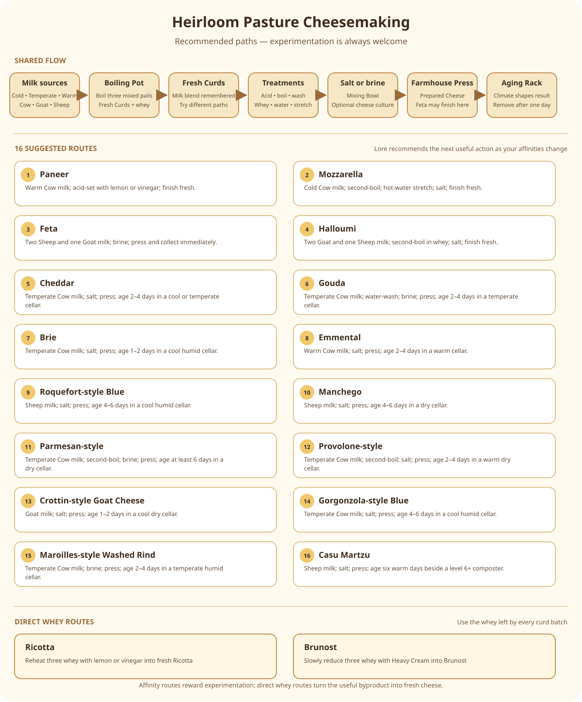

# Heirloom Pasture

This development candidate targets Java 25, Paper 26.2, and the matching Heirloom 2.10.1 build. The complete dairy loop uses built-in
Minecraft player-head visuals for cheeses; Nexo, ItemsAdder, and CraftEngine visuals remain optional.

## Milk And Grazing

Adult cows, goats, and sheep hold milk charges. A managed animal recovers for four active minutes
after its final charge is used, then seeks grass to replenish milk. Optional wishes,
brushing, and hand-feeding cannot delay this recovery or manufacture milk. Only protected grass grazing
restores dairy charges: `mobGriefing`, protection plugins, and cancellable block changes are respected.
Unmanaged cows and goats retain their slow vanilla-inspired random grazing opportunity, and sheep retain
native grazing. Milk refills one to three charges according to milk-yield genetics and current care.

Cold-climate cows provide Cold Cow milk, temperate cows provide vanilla milk buckets, and warm-climate
cows provide Warm Cow milk; goats and sheep provide Goat Milk and Sheep Milk. The five menu choices are
Temperate Cow, Cold Cow, Warm Cow, Goat and Sheep. These are real vanilla milk buckets: drinking one
clears effects and returns the empty bucket. A natural animal's milk has Normal quality. Managed milk
quality reflects its milk-quality trait and current care. Buckets retain their animal source,
`Contains: Milk`, Vegetarian, and Gluten-Free metadata.

Vanilla milk is Temperate Cow milk. Both vanilla and legacy Dairy Milk use the existing Dairy
affinities in new curd batches. Old Dairy Milk stacks remain accepted and unchanged; already-created
cheese profiles retain their historical milk affinities.

Read the practical [Animal Care guide](animal-care.md) for your first farm, brush readings and troubleshooting.

## Autonomous Animal Care

Build a comfortable home and animals take care of their basic needs themselves. Managed cows, goats,
sheep, pigs, chickens, and frogs have nourishment, water, rest, company, and comfort needs. A suitable
habitat keeps them healthy without compulsory daily chores. Brushing, hand-feeding, and occasional
optional wishes reward extra attention with better production and better-developed offspring.
Ignoring a wish never causes a failed need, starvation damage, or death.

Player-bred cows, goats, sheep, pigs, and chickens join care automatically. Naturally spawned animals
remain wild by default. `husbandry.manage-all-animals: true` also enrolls supported animals at startup,
spawn, or load; administrators can also enroll a target using `/hlp debug husbandry enroll` when debug
helpers are enabled. Frogspawn and egg-hatch ancestry/enrollment are deferred; frogs and egg-hatched
chicks enrolled through these management tools receive founder genetics.

### Build A Self-Sustaining Habitat

Use ordinary blocks, without registering pens or placing special furniture:

| Species | Forage | Comfort and enrichment |
| --- | --- | --- |
| Cow | Grass blocks | Hay or moss bedding |
| Goat | Grass blocks | Hay or moss bedding |
| Sheep | Grass blocks | Hay or moss bedding |
| Pig | Mud or muddy mangrove roots | Hay or moss bedding |
| Chicken | A planted crop over farmland | Hay or moss bedding |
| Frog | Firefly bushes | Moss blocks or moss carpet |

Provide still water sources or non-empty water cauldrons with a clear standing edge, accessible roofs, and same-species company. Drinking starts only close to the actual resource; a nearby bowl behind a wall does not count.
Ordinary forage, drinking, and enrichment are non-destructive; milk regeneration still consumes grass
through the protected dairy system. Young animals prefer an accessible known mother; if she is missing
or unreachable they can keep company with another animal of the same species. This never erases ancestry.

Food and water reserves last ten active minutes. Animals act before reserves run out and remain with
an activity until satisfied. At night they seek cover and rest for the entire night. On reaching safe
cover, a sleeping animal can make one short move two blocks farther beneath a continuous roof. This
helps it settle inside a barn instead of just under the entrance. The move needs a reachable, unclaimed
spot; a blocked path leaves the current safe cover available immediately. If the first decision runs
out of time, the animal can wait briefly under that cover for at most two fresh attempts, bounded to
30 ticks, before settling there. Animals already settled inside keep their resting place. Resting animals are quiet, with floating Zs drifting up from
their face; waking or interruption restores their previous sound setting. Sleeping preserves food, water, company, comfort and attention; rest restores energy. Crowding remains visible and caps mood while sleeping.
Exhausted animals can also nap during the day. Missing bedding reduces comfort but does not prevent
sleep. If cover is unreachable, safe outdoor rest is a fallback.

Managed goats with a current **Happy**, **Delighted**, or **Thriving** mood do not ram, including during
the day or while meeting other needs. This uses the visible mood, including any overcrowding reduction.
Rest and shelter routines also pause ramming at lower moods while they control movement. Outside those
routines, goats below Happy retain their ordinary ramming behaviour. Their other AI remains active. A scoped native ram guard also prevents happy goats from causing ram damage or knockback, including when a target is already in its damage cooldown.

Exposed animals seek shelter in actual rain and leave when the storm clears; dry biomes do not produce
false rain complaints. Panic, temptation, breeding, transport, and player control take precedence.
Interrupted animals can resume their previous destination. During a rainy night, critically hungry or
thirsty animals can use reachable covered resources before returning to rest. Slabs, stairs, and carpets
use their actual surface height; gates and entrances must still allow the animal through.

Shelter and company searches reach sixteen horizontal blocks; water, forage, and comfort searches reach
eight, with eight blocks of vertical allowance. Keep paths, gateways, and entrances wide enough for the
animal. No search loads distant chunks. Nearby animals share discovered places, and changed or blocked
places are rechecked. Server work waiting in a queue is never treated as poor care. Newly discovered
shortages receive a one-active-minute grace period. Unloaded or inactive time does not accumulate neglect.

Each managed animal has a lasting preference for brushing or treats. Successful care can reveal that
preference; pigs and chickens can also have different favourite foods from their usual common foods.
Hover the animal's name in sneak-brush inspection to remember discoveries. These preferences belong
to the animal and remain through restarts; they are separate from inherited production traits.
Optional wishes vary between eligible brushing and feeding and remain until fulfilled, including
through sleep, urgent care, chunk unloads and restarts. The next wish waits at least one active day
after completion. Completing one gives a short acknowledgement and the existing attention reward,
subject to its normal daily limits. Skipping wishes adds no penalty.

Happy, relaxed pigs already standing on mud or muddy mangrove roots occasionally take a short playful
pause, with small directional mud sprays and quiet squelches. They immediately yield to needs, sleep
or player interaction. Mud play does not damage blocks or change production, and it does not search
for a destination. The ambient-effects setting controls its particles and sounds.

Give livestock room to spread out. More than ten other supported animals within four horizontal blocks
and two vertical blocks gradually lowers comfort, visible mood, and current production; the crowding
pressure reaches its maximum at twenty neighbors. Other species and wild animals count, but players
and animals on distant floors do not. A roof or bedding cannot cancel overcrowding. The brush reports
“Overcrowded: needs more space”; thinning or spreading the herd removes the mood cap and lets comfort
recover normally. Brief clusters have a small effect. Sustained maximum crowding limits comfort to 70% and caps an
otherwise healthy animal at Happy; crowding alone does not make it Distressed. Crowding never
changes inherited traits or adds hit stress.

Adult pigs also show one Pig Casing in their product row. This fixed drop has Normal quality and no
inherited casing traits. Adult player harvests require meat drops and `doMobLoot` to be enabled;
humane sales also include one casing.

Ordinary single-source eggs and meat keep their vanilla names and omit redundant “Contains” lore.
Their dietary and ingredient metadata remains available to recipes and Food Facts. Mixed foods,
custom items and milk retain their appropriate source labels.

### Animal Care Guide And Brush Lens

Open the main Heirloom hub with `/hl` and select **Animal Care**. Hold a brush for a private husbandry lens:
the nearest twenty-four managed animals within twelve blocks that the player has line of sight to and
can see show contextual item bubbles. Icons are centered above the animal and periodically realigned
as it moves. Each bubble is private to its brush-holding player and never
changes the animal's real passenger list. Labels distinguish looking for a resource, walking toward it, using it, pausing, and
finding no reachable resource nearby. A Barrier marks an actual blocked action;
waiting for a search budget does not. A door represents shelter and rest. Successful care briefly
shows the same contextual item with hearts.

With `husbandry.ambient-effects` enabled, small particles accompany actual foraging, drinking, and
bedding use: grass or mud flecks, crop crumbs, water splashes, and occasional bedding flecks while
resting. They use the resource the animal has reached and stop during searching, travel, or interruption.
Bursts contain only two or three particles, shown to at most eight viewers within sixteen blocks.

Brush normally for care and a ten-second status display. A compact heading gives mood and activity.
Native Minecraft item icons identify food (wheat), water (water bucket), rest/shelter (oak door),
company (lead), and comfort (feather), each beside four coloured squares. Food, water, rest, and
comfort fill as those needs are met. Company is green in the middle and red at the lonely or crowded
ends, without extra labels between the bars. Hover a need for its percentage and a short explanation.
A mixed crowd can still lack same-species company. The icons need no resource pack and the display
uses the warm Heirloom palette. **Wild** identifies unmanaged animals.

Brushing and treats add optional attention bonuses. A good habitat handles everyday care without
daily player attention. Repeated brushing refreshes information without repeatedly awarding care
or consuming durability. At most one optional wish appears per active Minecraft day; already completed
care is not requested again. Wishes stay until fulfilled. Feeding can still satisfy real hunger between
bonus rewards. Sleeping preserves attention.

Managed animals receive stable species-specific farm names at enrollment or birth; name tags take priority.
Sneak-brush to see the name, mood and activity, five need bars, one **Yield / Quality** product row,
and known parents. Food products show their item icon, yield multiplier and quality dice (`⚀`–`⚅`). Wool and leather show yield only.
Hover a product for exact values, permanent breeding traits, and the separate birth-quality bonus.
The same hover compares traits with the immediately previous inspection, if it was a different animal
of the same species within 60 seconds. Logging out or changing worlds clears the comparison. Hover the name for its stable identity.

At most one short tip suggests a useful change, such as opening a route to water or adding more space.
An animal already satisfying its need does not repeat that advice.

Click a known parent's link in the inspection to highlight that parent privately for ten seconds.
Links last 60 seconds and work only for the inspecting player while the parent is loaded, visible to
that player, and within 64 blocks in the same world. Clicking another parent replaces the previous
highlight. This does not load distant chunks or change anyone else's view.

Inspection does not spend brush durability, advance care, or award attention. A first inspection can
record stable founder genes; it does not enroll a wild animal or reroll an existing genome. The breeder
privately receives newborn trait differences from the parental average after a successful birth.
A good pairing can still produce an individual below average; compare several generations.

### First Farm, First Birth, First Harvest

1. Start with two cows, goats, pigs or frogs, or three sheep or chickens of the same species and provide their forage, accessible still water,
   shelter, bedding or enrichment, and room to move. Use the Animal Care guide for that species.
2. Feed the pair their normal breeding food. Directly bred supported newborns become managed even
   when their parents are wild. Keep the youngster near accessible company as it grows.
3. Hold a brush to see what a managed animal needs. Sneak-brush two animals to compare permanent
   traits; ordinary brushing is an optional bonus. Improve the habitat when a resource is blocked.
4. Harvest milk or eggs, shear sheep, or confirm a livestock sale. Better genes and current care
   improve the actual output. Use the harvest in normal Heirloom recipes, including curds and cheese.

### Livestock Genetics

Each animal has separate yield ratings for its products and quality ratings for food products. Wool and leather use yield only:

| Species | Product traits |
| --- | --- |
| Cow | Milk, meat, leather |
| Goat | Milk, meat |
| Sheep | Milk, meat, wool |
| Pig | Meat |
| Chicken | Eggs, meat |
| Frog | Meat |

Ratings range from 0 to 100. A directly bred offspring inherits the average of each parent's genes,
with up to ten points of variation in either direction. Both parent identities are retained. Genomes
are generated once and never rerolled by unloading or restarting. Existing managed animals start with
neutral ratings of 50; previously unrecorded founders have stable ratings between 35 and 65. Merely
recording a founder for breeding does not enroll the parent into care.

Sustained parental care during the previous active day gives offspring a separate, permanent quality
bonus of up to five percentage points. Unknown history adds no bonus. This birth bonus is excluded from
inherited gene calculations, so it cannot repeatedly compound as genetic potential.

Healthy habitats provide worthwhile production. Good breeding and extra attention let animals express
more of their potential, up to three times the base yield. Current care still matters for animals with
excellent genes. Milk, eggs, sheared wool, edible kill drops, leather, and livestock sales use the same
yield rules. Wool and leather receive no quality metadata or lore. Feathers, wool from kills, Pig Casings, and
experience retain their existing rules. Fractional rewards accumulate across repeated harvests; sale
and slaughter rounding is stable. For example, a 1.6× egg yield carries the unused fraction forward;
over five otherwise identical harvests, five base eggs become eight. Player and dispenser shearing
share the same wool rules. Existing saved wool/leather quality genes remain readable but have no gameplay effect. Already-generated items are not rewritten.
Sale rewards are fixed when quoted until that quote expires.

Ordinary eggs use the centre of their visible six-tier quality grade and a stable dietary-tag order. Same-material, same-grade eggs with matching metadata can stack; recipes use that grade centre. Existing eggs normalize on inventory touches without changing authored names, custom items, unrelated metadata or historical food provenance. Different evidence remains a real stack distinction, and occupied inventory slots are not forcibly repacked.

Animal brushing uses the normal hand swing. Minecraft's native archaeology sweep is block-only.

A successful nonlethal player hit shows **Stressed** and adds an 8 percentage-point production-care penalty,
capped at 40%. The remaining penalty recovers over 2,400 active ticks while all five needs are at least
40%; poor conditions or inactive time pause recovery, and a further hit restarts the recovery period.
Cancelled, zero-damage, and lethal hits add no penalty. Stress never changes genes or the parental care
history used for birth bonuses. Nearby same-species managed witnesses with line
of sight show **Startled** and briefly flee without losing permanent mood. Goat husbandry adds Raw Goat Meat,
Cooked Goat Meat, and Minced Goat; the Cutting Board yields one mince and the Farmhouse Press yields two.
Horses, dogs, and hatch ancestry are future additions, not supported breeding paths in this version.

Use a Gold Nugget on a managed adult for a five-second sale quote. Repeat to confirm. The nugget
is reusable, and the first interaction shows **Click to sell for meat** above the animal. On confirmation,
the animal pauses and fades where client support allows during a two-second sale animation.
Its Looting-0 equivalent drops then go
directly to the player, overflow is placed motionless at their feet, and the player receives 1–3 XP.
The public cancellable `PastureLivestockSaleEvent` lets protection or economy plugins alter drops and
XP or stop the sale. WorldGuard animal-harm permission is checked before the quote, confirmation,
and completion; allowing interaction alone does not permit a sale. Protection changes or disabling
sales during the animation restore the animal. The event also exposes immutable per-product yield
and quality snapshots; its original constructor and legacy integer multiplier remain compatible.
The fade uses client-only packets and never joins either entity to a real
scoreboard team; incompatible viewers fall back to particles.

## Experimental Cheesemaking

Boil exactly three freely mixed milk pails into one `Fresh Curds`, three whey, and three returned
buckets. The curds remember the milk blend. Treatments then move hidden affinities toward different
cheeses: acid strongly suggests Paneer, a second boil plus hot water suggests Mozzarella, washing with
water suggests Gouda, and cooking with whey suggests Halloumi. Salt and brine influence several
styles. Applying the same treatment twice is rejected rather than silently consuming ingredients.

Mix treated curds into one `Prepared Cheese`. The Farmhouse Press immediately resolves a Feta-leading
batch; every other batch becomes one unique, unstackable `Young Cheese Wheel`. Acid-set Paneer,
stretched Mozzarella, and whey-cooked Halloumi instead finish fresh without aging. Every valid route
produces its closest real cheese; there is no generic failure cheese.

Whey is a useful secondary ingredient rather than waste. Cook curds in whey for Halloumi, reheat
three whey with lemon or vinegar for fresh Ricotta, or slowly reduce three whey with Heavy Cream for
Brunost. Ricotta and Brunost are direct fresh finishes outside the affinity competition, pressing,
and aging systems.

One of the 16 affinity cheeses may be consumed as culture. It adds affinity toward its own style.
A matching winning style yields two finished cheeses, exactly once; a culture that loses yields one.
Prepared Feta remains one intermediate and becomes two only when the matching cultured batch is pressed.
Curds, prepared cheese and young wheels show their developing style and one actionable next step.
Finished cheese keeps its provenance without development instructions.
Intermediates borrow the current leader's provider visual or player-head fallback while keeping their
generic identity and full process data.

### Pasture Cheeses Preview

Open `/hl` → **Pasture Cheeses**, `/hlp menu` or `/hlp cheese`. The catalog covers all 18 cheeses:
16 affinity previews plus the actual Ricotta and Brunost whey recipes. Animal Care remains a separate guide.
Select a cheese to open its starting method, then experiment without consuming any items.

Left-click any of the three animal heads to choose a milk source; right-click cycles the five sources.
Repeated and mixed sources work. Treatment and finish controls use the same transitions as production.
Settings use the drink preview's controls: **left-click next, right-click previous**.
The finish selector describes either a fresh finish in the Boiling Pot or preparation in the Mixing Bowl;
the separate press icon explains collection or moving the young wheel to the rack.
The supplementary ingredients follow the active recipes, including available Lemon or Vinegar.
A matching culture updates the finished quantity. Ricotta and Brunost use their normal recipe screens
without unrelated culture or cellar controls.

| Slot | Control |
| --- | --- |
| 10, 19, 28 | Independent milk selectors |
| 11, 20, 29 | Additional ingredients and quantities |
| 16 | Result and finished quantity |
| 21 | Milk to Fresh Curds, with whey and bucket returns |
| 22 | No treatment, second boil, water wash, or both |
| 23 | Acid-set, stretch, whey-cook, salt-and-press, or brine-and-press |
| 24 | Press step, where applicable |
| 25 | Aging a young wheel |
| 31 | Climate while aging |
| 32 | Nearby composter for eligible Casu Martzu batches while aging |
| 33 | Optional culture, consumed once |
| 34 | Reset to the selected cheese's original method |
| 36/37 | Back/Forward |
| 43/44 | Previous/Next Page |

Aging choices are 0, 1, 1.5, 2, 3, 4, 5, 6 and 7 days. Exact catalog durations are retained.
The aging control uses the cheese lore's typography, for example **⏳Aging: 3 days · (1h)**.
At zero age a pressed non-Feta batch is still a young wheel; it cannot finish until at least one day.
Hidden climate and composter selections are remembered but do not affect the result.
Changes refresh the current screen; Back returns to the same catalog page.

Preview provenance is explicitly **simulated**. Calculations assume Normal ingredients, successful station completion
and no player mastery. Current station defaults produce Good quality; the preview uses production quality rules.
Preview icons cannot be taken or used as cheese ingredients. Clicking an exact affinity cheese in another recipe
opens its complete production preview; **Any Cheese** opens this catalog.

### Cheese Lore

Real cheeses and simulated previews share restrained colored symbols and one Core quality row.
For example, an actual aged cow-milk cheese can show:

```text
🪣Milk: Cow
♨Method: Salted · Pressed
⏳Aged: 3 days · (1h)
Cellar: Cool · Normal humidity
Quality: ⚂ Good
```

Milk blends show proportions such as `2 Sheep · 1 Goat`; longer lines wrap without losing colors.
Culture appears only when used. Finished cheese shows age and cellar only when recorded during production,
never reconstructed from a suggested method. Completion stores the real age and climate separately from active
rack state. Old validated items refresh when exposed; there is no stored-world scan. Items without a batch record,
including Ricotta and Brunost, show known identity and quality without invented milk ancestry.
Administrator names, formatted notes and custom lore remain intact. Updating unchanged default filler does not
replace edited item descriptions. Curds and wheels keep a useful next step; ready wheels explain removal,
and finished Feta never suggests further aging.



The diagram is generated from the same versioned affinity catalog used by runtime scoring, lore, and
the recipe browser. It contains no hidden scores and is checked for all sixteen routes during wiki
generation.

### Suggested Methods

These are reliable traditional routes generated from the same affinity definitions used by gameplay.
They are suggestions, not locked recipes: unconventional blends and other cow-milk Mozzarella remain valid.

| Cheese | Suggested method |
| --- | --- |
| Mozzarella | Cold Cow milk; second-boil; hot-water stretch; salt; finish fresh. |
| Paneer | Warm Cow milk; acid-set with lemon or vinegar; finish fresh. |
| Halloumi | Two Goat and one Sheep milk; second-boil in whey; salt; finish fresh. |
| Feta | Two Sheep and one Goat milk; brine; press and collect immediately. |
| Cheddar | Temperate Cow milk; salt; press; age 2–4 days in a cool or temperate cellar. |
| Parmesan-style | Temperate Cow milk; second-boil; brine; press; age at least 6 days in a dry cellar. |
| Brie | Temperate Cow milk; salt; press; age 1–2 days in a cool humid cellar. |
| Roquefort-style Blue | Sheep milk; salt; press; age 4–6 days in a cool humid cellar. |
| Gouda | Temperate Cow milk; water-wash; brine; press; age 2–4 days in a temperate cellar. |
| Emmental | Warm Cow milk; salt; press; age 2–4 days in a warm cellar. |
| Manchego | Sheep milk; salt; press; age 4–6 days in a dry cellar. |
| Provolone-style | Temperate Cow milk; second-boil; salt; press; age 2–4 days in a warm dry cellar. |
| Crottin-style Goat Cheese | Goat milk; salt; press; age 1–2 days in a cool dry cellar. |
| Gorgonzola-style Blue | Temperate Cow milk; salt; press; age 4–6 days in a cool humid cellar. |
| Maroilles-style Washed Rind | Temperate Cow milk; brine; press; age 2–4 days in a temperate humid cellar. |
| Casu Martzu | Sheep milk; salt; press; age six warm days beside a level 6+ composter. |

The in-game catalog opens these methods as editable production previews. Actual station recipes remain
available; the old non-craftable suggested-recipe entries are replaced by production links.

## Farmhouse Press

Build the exact press geometry:

```text
front/output <- DISPENSER (facing outward) <- HOPPER (facing into dispenser)
                SCAFFOLDING
```

The press has no GUI, accessible inventory, or molds. Put exact ingredients through the rear hopper.
They appear in the world during the 15-second process and progressively reveal the result from the
dispenser mouth. Cheese compresses, meat grinds, sausages and pasta extrude, and oil presses with
distinct motion. The completed result stays visible at the dispenser mouth like other workstation
results. Punch the press to release it 0.72 blocks from the dispenser center with a small
outward-only horizontal velocity and no upward or backward motion, so it cannot reach the rear
hopper. Reserved work survives normal restarts.

## Meat, Sausages, Pasta, And Oil

An adult pig killed directly by a player drops exactly one Pig Casings when `doMobLoot` is enabled.
Looting never multiplies it. Beef, pork, mutton, and Pasture Goat Meat can be hand-minced one at a time on the Cutting
Board, or ground in the Farmhouse Press for two typed portions. Legacy generic Minced Meat remains
valid for ordinary Core recipes and Plain Links.

The press stuffs and finishes each sausage batch directly; there are no separate raw-link items:

| Sausage | Press ingredients |
| --- | --- |
| Plain Links | 2 any minced meat, Salt, Pig Casings |
| Garlic Pork Sausage | 2 Minced Pork, Garlic, Salt, Pig Casings |
| Swedish Potato Sausage | Minced Pork, Minced Beef, Potato, Onion, Salt, Pig Casings |
| Cheese Sausage | Minced Pork, Minced Beef, any cheese, Salt, Pig Casings |

Plain Links plus Bread become a Hot Dog in the Frying Pan. Quality, meat and dairy
provenance, dietary properties, and `Contains` metadata survive every stage. The press also turns
one Dough into two Dry Pasta, or the existing sunflower/corn oil inputs into two Cooking Oil; the older
Cutting Board and Mixing Bowl methods remain available at their original one-item yields.

Garlic is entirely Pasture-owned and grows as a four-stage temperate Allium with Onion-like timing, harvest, replanting, and
Fortune behavior. It appears in temperate packets, suitable grass biomes, and village farm loot at
roughly sixty percent of Onion's weight.

Bake Garlic Bread in the Oven with Bread, Garlic, and either Butter or Cooking Oil; the oil method is
the vegan alternative. Adult frogs killed directly by players drop one Raw Frog Legs when `doMobLoot`
is enabled. French Fried Frog Legs are available only while Heirloom Orchard is installed, because
Orchard owns Lemon. Fry Raw Frog Legs with a Bag of Flour, Butter, and Lemon in the Frying Pan.
Looting does not multiply guaranteed Pasture animal drops such as Pig Casings. Managed-animal
meat genetics and care improve frog and goat meat. Casings retain their existing yield; leather has
its own yield trait.

## Continuous Aging Rack

A normal 27-slot barrel directly on scaffolding is an Aging Rack. It keeps its vanilla inventory and
has no display entity or polling task. Every valid rack ages continuously in every climate. One aging
day is 20 real minutes, and exact hidden epoch timestamps count eligible offline time.

Opening the barrel reconciles age, cumulative cool/temperate/warm and dry/normal/humid exposure,
visuals, and exactly one owned lore section; it never finishes a wheel. Before one day, removing a
wheel pauses it with progress preserved. At or after one day, player removal resolves the highest
aged-cheese affinity. Breaking the supporting scaffolding pauses wheels rather than resolving them,
and hopper automation remains blocked.

The dominant recorded exposure influences the result but never prevents aging, so no cheese requires
multiple cellars. Finished lore records milk blend, treatments, culture, cellar history, and readable
age such as `⏳Aged: 2.4 days · (48m)`. Young wheels have unique IDs and stack size one; two matching cultured
outputs from the same batch share provenance and can stack together.

### Casu Martzu

Casu Martzu is a gated experimental route rather than a new mold or culture. Start with exactly
three Sheep Milk pails, salt and press the wheel, then age it for six qualifying days in a warm rack
with a composter at level 6 or higher directly north, east, south, or west of the barrel. Ordinary
aging continues whenever those conditions are absent, but only qualifying exposure advances this
route, and extra composters never accelerate it. Removing the wheel early resolves the closest
ordinary cheese.

The wheel gradually reports disturbed rind, tracks, and movement before it becomes ready. Casu
Martzu restores 8 food points and 5 saturation, always gives Nausea I for eight seconds, and has a
20% chance to give Hunger I for ten seconds. Its provenance contains Milk and Cheese-Fly Larvae; it
is Gluten-Free but neither Vegan nor Vegetarian. Eating it for the first time awards the hidden
challenge `The Rind Is Moving`.

## Compatibility, Debugging, And Attribution

All finished cheeses carry the `CHEESE` tag for compatible Core recipes. Optional farmer and shepherd
starter trades are controlled by `dairy.starter-trades.enabled`. The player cheese menu requires
`heirloom.pasture.use`; disabling dairy removes its previews and production links. Reloads replace the
immutable preset index and bounded 256-entry calculation cache transactionally. Failed reloads retain
the previous working generation; warm menu interactions do not rebuild the catalog.

All four `husbandry` switches apply on a successful `/heirloom reload`: `enabled`, `ambient-effects`,
`sell-for-meat`, and `manage-all-animals`. Failed reloads retain the previous working configuration and
runtime. Disabling automatic enrollment preserves already managed animals and their care, genetics,
ancestry, stress, and fractional production. Disabling husbandry pauses that runtime and retains its
stored animal data. Disabling sales cancels active animations and restores the animals.

The legacy `dairy.enabled` switch is a broad Pasture content gate: it controls dairy, cheese, and
meat-processing items and recipes, plus their associated runtimes. It does not disable independent
husbandry care. Use `husbandry.enabled` for that.

When `debug.enabled` is true, admins with `heirloom.pasture.debug` can use
`/hlp debug give <item-id> [amount]`, `/hlp debug charge [true|false]`, `/hlp debug press ready`,
`/hlp debug rack inspect`, `/hlp debug rack advance <seconds>`, and
`/hlp debug husbandry <enroll|inspect|mood> [tier]`.

See `head-attribution-pasture.yml` for Minecraft-Heads attribution and reserved textures.
