# Heirloom American Food Pack

<figure class="hl-figure">
  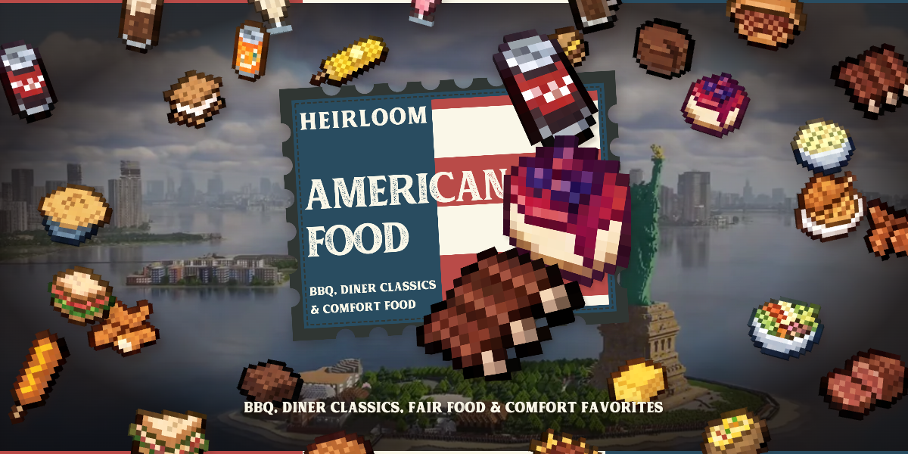
  <figcaption>Heirloom American Food Pack promotional banner.</figcaption>
</figure>

<figure class="hl-figure">
  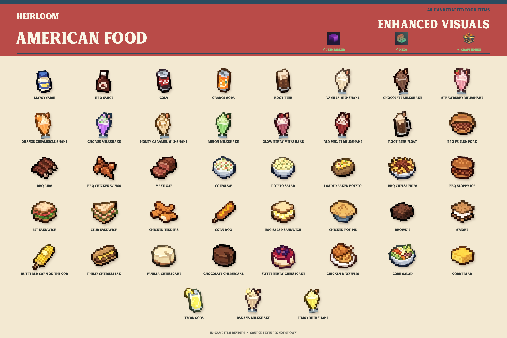
  <figcaption>Heirloom American Food Pack protected catalog preview; source textures are not published.</figcaption>
</figure>

Heirloom American Food Pack 1.0.1 contains **40 base custom items** and **30 base recipe entries**, plus **3 optional custom items** and **4 optional recipe entries**. The PNG sprites can be used as a visual pack without Heirloom. Heirloom 2.10.1+ (shared Soda Water build) adds the cooking stations, recipe matching, food behavior, dynamic variants, and placeable feasts.

| Field | Value |
| --- | --- |
| Pack ID | `heirloom_american_food` |
| Version | `1.0.1` |
| Status | release |
| Requires Heirloom | 2.10.1+ (shared Soda Water build) |
| Recipe override strength | 100 |
| Base items | 40 |
| Base recipe entries | 30 |
| Optional compatibility items | 3 |
| Optional compatibility recipe entries | 4 |
| PNG sprites | 43 |
| Bundled provider configuration | Nexo, ItemsAdder, CraftEngine |

## Installation And Visual Providers

Copy the JSON files from `content/` directly into `plugins/Heirloom/`, then run `/hl reload` and check Installed Content. The pack always retains player-head fallbacks.

The release includes **43 raw PNG sprites** and ready-to-install configuration for **Nexo, ItemsAdder, CraftEngine**. Install only the provider used by your server.

## Items

| Icon | Item ID | Name | Behavior |
| --- | --- | --- | --- |
|  | [`AMERICAN_BBQ_CHEESE_FRIES`](../reference/items.md#item-american-bbq-cheese-fries) | BBQ Cheese Fries | 8 hunger / 6 saturation; eat |
|  | [`AMERICAN_BBQ_CHICKEN_WINGS`](../reference/items.md#item-american-bbq-chicken-wings) | BBQ Chicken Wings | 8 hunger / 6 saturation; eat |
| 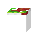 | [`AMERICAN_BBQ_PULLED_PORK`](../reference/items.md#item-american-bbq-pulled-pork) | BBQ Pulled Pork | 10 hunger / 8 saturation; eat |
|  | [`AMERICAN_BBQ_RIBS`](../reference/items.md#item-american-bbq-ribs) | BBQ Ribs | 10 hunger / 8 saturation; eat |
|  | [`AMERICAN_BBQ_SAUCE`](../reference/items.md#item-american-bbq-sauce) | BBQ Sauce | ingredient |
| 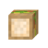 | [`AMERICAN_BBQ_SLOPPY_JOE`](../reference/items.md#item-american-bbq-sloppy-joe) | BBQ Sloppy Joe | 8 hunger / 6 saturation; eat |
|  | [`AMERICAN_BERRY_CHEESECAKE`](../reference/items.md#item-american-berry-cheesecake) | Sweet Berry Cheesecake | 6 hunger / 4 saturation; eat |
| 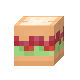 | [`AMERICAN_BLT_SANDWICH`](../reference/items.md#item-american-blt-sandwich) | BLT Sandwich | 8 hunger / 6 saturation; eat |
| 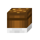 | [`AMERICAN_BROWNIE`](../reference/items.md#item-american-brownie) | Brownie | 5 hunger / 3 saturation; eat |
|  | [`AMERICAN_BUTTERED_CORN_ON_THE_COB`](../reference/items.md#item-american-buttered-corn-on-the-cob) | Buttered Corn on the Cob | 6 hunger / 4 saturation; eat; returns stick |
|  | [`AMERICAN_CHICKEN_AND_WAFFLES`](../reference/items.md#item-american-chicken-and-waffles) | Chicken & Waffles | 12 hunger / 10 saturation; eat |
| 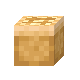 | [`AMERICAN_CHICKEN_POT_PIE`](../reference/items.md#item-american-chicken-pot-pie) | Chicken Pot Pie | 10 hunger / 8 saturation; eat |
|  | [`AMERICAN_CHICKEN_TENDERS`](../reference/items.md#item-american-chicken-tenders) | Chicken Tenders | 7 hunger / 5 saturation; eat |
| 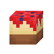 | [`AMERICAN_CHOCOLATE_CHEESECAKE`](../reference/items.md#item-american-chocolate-cheesecake) | Chocolate Cheesecake | 6 hunger / 4 saturation; eat |
| 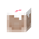 | [`AMERICAN_CHOCOLATE_MILKSHAKE`](../reference/items.md#item-american-chocolate-milkshake) | Chocolate Milkshake | 6 hunger / 4 saturation; drink |
|  | [`AMERICAN_CHORUS_MILKSHAKE`](../reference/items.md#item-american-chorus-milkshake) | Chorus Milkshake | 6 hunger / 4 saturation; drink |
|  | [`AMERICAN_CLUB_SANDWICH`](../reference/items.md#item-american-club-sandwich) | Club Sandwich | 12 hunger / 10 saturation; eat |
|  | [`AMERICAN_COBB_SALAD`](../reference/items.md#item-american-cobb-salad) | Cobb Salad | 12 hunger / 10 saturation; eat; returns bowl |
|  | [`AMERICAN_COLA`](../reference/items.md#item-american-cola) | Cola | 2 hunger / 1 saturation; drink; returns tin can |
| 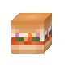 | [`AMERICAN_COLESLAW`](../reference/items.md#item-american-coleslaw) | Coleslaw | 4 hunger / 2 saturation; eat |
|  | [`AMERICAN_CORNBREAD`](../reference/items.md#item-american-cornbread) | Cornbread | 6 hunger / 4 saturation; eat |
| 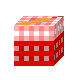 | [`AMERICAN_CORN_DOG`](../reference/items.md#item-american-corn-dog) | Corn Dog | 7 hunger / 5 saturation; eat |
|  | [`AMERICAN_EGG_SALAD_SANDWICH`](../reference/items.md#item-american-egg-salad-sandwich) | Egg Salad Sandwich | 7 hunger / 5 saturation; eat |
| 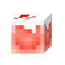 | [`AMERICAN_GLOW_BERRY_MILKSHAKE`](../reference/items.md#item-american-glow-berry-milkshake) | Glow Berry Milkshake | 6 hunger / 4 saturation; drink |
| 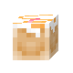 | [`AMERICAN_HONEY_CARAMEL_MILKSHAKE`](../reference/items.md#item-american-honey-caramel-milkshake) | Honey Caramel Milkshake | 6 hunger / 4 saturation; drink |
|  | [`AMERICAN_LOADED_BAKED_POTATO`](../reference/items.md#item-american-loaded-baked-potato) | Loaded Baked Potato | 10 hunger / 8 saturation; eat |
|  | [`AMERICAN_MAYONNAISE`](../reference/items.md#item-american-mayonnaise) | Mayonnaise | 1 hunger / 0 saturation; eat; effects: Nausea |
| 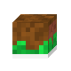 | [`AMERICAN_MEATLOAF`](../reference/items.md#item-american-meatloaf) | Meatloaf | 10 hunger / 8 saturation; eat |
|  | [`AMERICAN_MELON_MILKSHAKE`](../reference/items.md#item-american-melon-milkshake) | Melon Milkshake | 6 hunger / 4 saturation; drink |
| 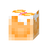 | [`AMERICAN_ORANGE_CREAMSICLE_SHAKE`](../reference/items.md#item-american-orange-creamsicle-shake) | Orange Creamsicle Shake | 6 hunger / 4 saturation; drink |
|  | [`AMERICAN_ORANGE_SODA`](../reference/items.md#item-american-orange-soda) | Orange Soda | 2 hunger / 1 saturation; drink; returns tin can |
| 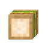 | [`AMERICAN_PHILLY_CHEESESTEAK`](../reference/items.md#item-american-philly-cheesesteak) | Philly Cheesesteak | 8 hunger / 6 saturation; eat |
| 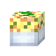 | [`AMERICAN_POTATO_SALAD`](../reference/items.md#item-american-potato-salad) | Potato Salad | 6 hunger / 4 saturation; eat |
|  | [`AMERICAN_RED_VELVET_MILKSHAKE`](../reference/items.md#item-american-red-velvet-milkshake) | Red Velvet Milkshake | 6 hunger / 4 saturation; drink |
|  | [`AMERICAN_ROOT_BEER`](../reference/items.md#item-american-root-beer) | Root Beer | 2 hunger / 1 saturation; drink; returns tin can |
| 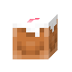 | [`AMERICAN_ROOT_BEER_FLOAT`](../reference/items.md#item-american-root-beer-float) | Root Beer Float | 7 hunger / 5 saturation; drink |
| 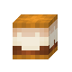 | [`AMERICAN_SMORE`](../reference/items.md#item-american-smore) | S'more | 4 hunger / 2 saturation; eat |
|  | [`AMERICAN_STRAWBERRY_MILKSHAKE`](../reference/items.md#item-american-strawberry-milkshake) | Strawberry Milkshake | 6 hunger / 4 saturation; drink |
| 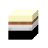 | [`AMERICAN_VANILLA_CHEESECAKE`](../reference/items.md#item-american-vanilla-cheesecake) | Vanilla Cheesecake | 6 hunger / 4 saturation; eat |
| 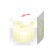 | [`AMERICAN_VANILLA_MILKSHAKE`](../reference/items.md#item-american-vanilla-milkshake) | Vanilla Milkshake | 6 hunger / 4 saturation; drink |

## Recipes

### Cutting Board

| Recipe | Output | Inputs | Ingredient rules | Time |
| --- | --- | --- | --- | --- |
| [`AMERICAN_CHICKEN_AND_WAFFLES`](../recipes/default-recipes.md#recipe-american-chicken-and-waffles) | <a class="hl-output-item" href="../../recipes/default-recipes/#recipe-american-chicken-and-waffles">AMERICAN_CHICKEN_AND_WAFFLES</a> | <a class="hl-icon-link" href="../../reference/items/#item-waffles">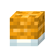</a> | required: 1 x [`FRIED_CHICKEN`](../reference/items.md#item-fried-chicken) required: 1 x [`WAFFLES`](../reference/items.md#item-waffles) required: 1 x [`BUTTER`](../reference/items.md#item-butter) | 0 ticks |
| [`AMERICAN_CLUB_SANDWICH`](../recipes/default-recipes.md#recipe-american-club-sandwich) | <a class="hl-output-item" href="../../recipes/default-recipes/#recipe-american-club-sandwich">AMERICAN_CLUB_SANDWICH</a> | or | required: 1 x [`BREAD`](../reference/items.md#item-bread) or [`BREAD`](../reference/items.md#item-bread) required: 1 x [`COOKED_CHICKEN`](../reference/vanilla-items.md#vanilla-item-cooked-chicken) required: 1 x [`BACON`](../reference/items.md#item-bacon) required: 1 x [`LETTUCE`](../reference/items.md#item-lettuce) required: 1 x [`TOMATO`](../reference/items.md#item-tomato) required: 1 x [`AMERICAN_MAYONNAISE`](../reference/items.md#item-american-mayonnaise) | 0 ticks |
| [`AMERICAN_EGG_SALAD_SANDWICH`](../recipes/default-recipes.md#recipe-american-egg-salad-sandwich) | <a class="hl-output-item" href="../../recipes/default-recipes/#recipe-american-egg-salad-sandwich">AMERICAN_EGG_SALAD_SANDWICH</a> | ororor | required: 1 x [`BREAD`](../reference/items.md#item-bread) or [`BREAD`](../reference/items.md#item-bread) required: 1 x [`EGG`](../reference/vanilla-items.md#vanilla-item-egg) or [`BLUE_EGG`](../reference/vanilla-items.md#vanilla-item-blue-egg) or [`BROWN_EGG`](../reference/vanilla-items.md#vanilla-item-brown-egg) required: 1 x [`AMERICAN_MAYONNAISE`](../reference/items.md#item-american-mayonnaise) | 0 ticks |
| [`BLT`](../recipes/default-recipes.md#recipe-blt) | <a class="hl-output-item" href="../../recipes/default-recipes/#recipe-blt">BLT</a> | or | required: 1 x [`BREAD`](../reference/items.md#item-bread) or [`BREAD`](../reference/items.md#item-bread) required: 1 x [`BACON`](../reference/items.md#item-bacon) required: 1 x [`LETTUCE`](../reference/items.md#item-lettuce) required: 1 x [`TOMATO`](../reference/items.md#item-tomato) | 0 ticks |

### Frying Pan

| Recipe | Output | Inputs | Ingredient rules | Time |
| --- | --- | --- | --- | --- |
| [`AMERICAN_BBQ_CHEESE_FRIES`](../recipes/default-recipes.md#recipe-american-bbq-cheese-fries) | <a class="hl-output-item" href="../../recipes/default-recipes/#recipe-american-bbq-cheese-fries">AMERICAN_BBQ_CHEESE_FRIES</a> |  | required: 1 x [`FRIES`](../reference/items.md#item-fries) required: 1 x [`CHEESE`](../reference/items.md#item-cheese) required: 1 x [`AMERICAN_BBQ_SAUCE`](../reference/items.md#item-american-bbq-sauce) | 100 ticks |
| [`AMERICAN_BBQ_SLOPPY_JOE`](../recipes/default-recipes.md#recipe-american-bbq-sloppy-joe) | <a class="hl-output-item" href="../../recipes/default-recipes/#recipe-american-bbq-sloppy-joe">AMERICAN_BBQ_SLOPPY_JOE</a> | <a class="hl-icon-link" href="../../reference/items/#item-minced-meat">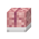</a>or | required: 1 x [`MINCED_MEAT`](../reference/items.md#item-minced-meat) required: 1 x [`AMERICAN_BBQ_SAUCE`](../reference/items.md#item-american-bbq-sauce) required: 1 x [`BREAD`](../reference/items.md#item-bread) or [`BREAD`](../reference/items.md#item-bread) | 120 ticks |
| [`AMERICAN_BUTTERED_CORN_ON_THE_COB`](../recipes/default-recipes.md#recipe-american-buttered-corn-on-the-cob) | <a class="hl-output-item" href="../../recipes/default-recipes/#recipe-american-buttered-corn-on-the-cob">AMERICAN_BUTTERED_CORN_ON_THE_COB</a> |  | required: 1 x [`STICK`](../reference/vanilla-items.md#vanilla-item-stick) required: 1 x [`CORN`](../reference/items.md#item-corn) required: 1 x [`BUTTER`](../reference/items.md#item-butter) | 80 ticks |
| [`AMERICAN_CHICKEN_TENDERS`](../recipes/default-recipes.md#recipe-american-chicken-tenders) | <a class="hl-output-item" href="../../recipes/default-recipes/#recipe-american-chicken-tenders">AMERICAN_CHICKEN_TENDERS</a> | ororor | required: 1 x [`CHICKEN`](../reference/vanilla-items.md#vanilla-item-chicken) required: 1 x [`BAG_OF_FLOUR`](../reference/items.md#item-bag-of-flour) or [`DOUGH`](../reference/items.md#item-dough) required: 1 x [`EGG`](../reference/vanilla-items.md#vanilla-item-egg) or [`BLUE_EGG`](../reference/vanilla-items.md#vanilla-item-blue-egg) or [`BROWN_EGG`](../reference/vanilla-items.md#vanilla-item-brown-egg) | 100 ticks |
| [`AMERICAN_CORN_DOG`](../recipes/default-recipes.md#recipe-american-corn-dog) | <a class="hl-output-item" href="../../recipes/default-recipes/#recipe-american-corn-dog">AMERICAN_CORN_DOG</a> |  | required: 1 x [`DOUGH`](../reference/items.md#item-dough) carrying `CORNMEAL` required: 1 x [`COOKED_PORKCHOP`](../reference/vanilla-items.md#vanilla-item-cooked-porkchop) | 100 ticks |
| [`AMERICAN_PHILLY_CHEESESTEAK`](../recipes/default-recipes.md#recipe-american-philly-cheesesteak) | <a class="hl-output-item" href="../../recipes/default-recipes/#recipe-american-philly-cheesesteak">AMERICAN_PHILLY_CHEESESTEAK</a> | oror | required: 1 x [`BREAD`](../reference/items.md#item-bread) or [`BREAD`](../reference/items.md#item-bread) required: 1 x [`MINCED_MEAT`](../reference/items.md#item-minced-meat) or [`BEEF`](../reference/vanilla-items.md#vanilla-item-beef) required: 1 x [`CHEESE`](../reference/items.md#item-cheese) required: 1 x [`ONION`](../reference/items.md#item-onion) | 120 ticks |

### Mixing Bowl

| Recipe | Output | Inputs | Ingredient rules | Time |
| --- | --- | --- | --- | --- |
| [`AMERICAN_BBQ_SAUCE`](../recipes/default-recipes.md#recipe-american-bbq-sauce) | <a class="hl-output-item" href="../../recipes/default-recipes/#recipe-american-bbq-sauce">AMERICAN_BBQ_SAUCE</a> |  | required: 1 x [`CANNED_TOMATOES`](../reference/items.md#item-canned-tomatoes) required: 1 x [`VINEGAR`](../reference/items.md#item-vinegar) required: 1 x [`HONEY_BOTTLE`](../reference/vanilla-items.md#vanilla-item-honey-bottle) required: 1 x [`ONION`](../reference/items.md#item-onion) | 0 ticks |
| [`AMERICAN_COBB_SALAD`](../recipes/default-recipes.md#recipe-american-cobb-salad) | <a class="hl-output-item" href="../../recipes/default-recipes/#recipe-american-cobb-salad">AMERICAN_COBB_SALAD</a> | oror | required: 1 x [`BOWL`](../reference/vanilla-items.md#vanilla-item-bowl) required: 1 x [`COOKED_CHICKEN`](../reference/vanilla-items.md#vanilla-item-cooked-chicken) required: 1 x [`BACON`](../reference/items.md#item-bacon) required: 1 x [`EGG`](../reference/vanilla-items.md#vanilla-item-egg) or [`BLUE_EGG`](../reference/vanilla-items.md#vanilla-item-blue-egg) or [`BROWN_EGG`](../reference/vanilla-items.md#vanilla-item-brown-egg) required: 1 x [`LETTUCE`](../reference/items.md#item-lettuce) required: 1 x [`TOMATO`](../reference/items.md#item-tomato) required: 1 x [`CHEESE`](../reference/items.md#item-cheese) | 0 ticks |
| [`AMERICAN_COLESLAW`](../recipes/default-recipes.md#recipe-american-coleslaw) | <a class="hl-output-item" href="../../recipes/default-recipes/#recipe-american-coleslaw">AMERICAN_COLESLAW</a> |  | required: 1 x [`LETTUCE`](../reference/items.md#item-lettuce) required: 1 x [`CARROT`](../reference/vanilla-items.md#vanilla-item-carrot) required: 1 x [`AMERICAN_MAYONNAISE`](../reference/items.md#item-american-mayonnaise) | 0 ticks |
| [`AMERICAN_MAYONNAISE`](../recipes/default-recipes.md#recipe-american-mayonnaise) | <a class="hl-output-item" href="../../recipes/default-recipes/#recipe-american-mayonnaise">AMERICAN_MAYONNAISE</a> | oror | required: 1 x [`EGG`](../reference/vanilla-items.md#vanilla-item-egg) or [`BLUE_EGG`](../reference/vanilla-items.md#vanilla-item-blue-egg) or [`BROWN_EGG`](../reference/vanilla-items.md#vanilla-item-brown-egg) required: 1 x [`COOKING_OIL`](../reference/items.md#item-cooking-oil) required: 1 x [`SALT`](../reference/items.md#item-salt) required: 1 x [`VINEGAR`](../reference/items.md#item-vinegar) | 0 ticks |
| [`AMERICAN_MILKSHAKE`](../recipes/default-recipes.md#recipe-american-milkshake) | <a class="hl-output-item" href="../../recipes/default-recipes/#recipe-american-milkshake">AMERICAN_VANILLA_MILKSHAKE</a>Default Vanilla MilkshakeChocolate MilkshakeStrawberry MilkshakeOrange Creamsicle ShakeChorus MilkshakeHoney Caramel MilkshakeMelon MilkshakeGlow Berry MilkshakeRed Velvet Milkshake | orororororor0-10-1 | required: 1 x [`ICE_CREAM`](../reference/items.md#item-ice-cream) required: 1 x [`MILK_BUCKET`](../reference/vanilla-items.md#vanilla-item-milk-bucket) optional: 0-1 x [`CHOCOLATE`](../reference/items.md#item-chocolate) or [`SWEET_BERRIES`](../reference/vanilla-items.md#vanilla-item-sweet-berries) or [`CARROT`](../reference/vanilla-items.md#vanilla-item-carrot) or [`CHORUS_FRUIT`](../reference/vanilla-items.md#vanilla-item-chorus-fruit) or [`HONEY_BOTTLE`](../reference/vanilla-items.md#vanilla-item-honey-bottle) or [`MELON_SLICE`](../reference/vanilla-items.md#vanilla-item-melon-slice) or [`GLOW_BERRIES`](../reference/vanilla-items.md#vanilla-item-glow-berries) optional: 0-1 x [`BEETROOT`](../reference/vanilla-items.md#vanilla-item-beetroot) | 0 ticks |
| [`AMERICAN_POTATO_SALAD`](../recipes/default-recipes.md#recipe-american-potato-salad) | <a class="hl-output-item" href="../../recipes/default-recipes/#recipe-american-potato-salad">AMERICAN_POTATO_SALAD</a> | oror | required: 1 x [`POTATO`](../reference/vanilla-items.md#vanilla-item-potato) required: 1 x [`EGG`](../reference/vanilla-items.md#vanilla-item-egg) or [`BLUE_EGG`](../reference/vanilla-items.md#vanilla-item-blue-egg) or [`BROWN_EGG`](../reference/vanilla-items.md#vanilla-item-brown-egg) required: 1 x [`AMERICAN_MAYONNAISE`](../reference/items.md#item-american-mayonnaise) required: 1 x [`VINEGAR`](../reference/items.md#item-vinegar) | 0 ticks |
| [`AMERICAN_ROOT_BEER_FLOAT`](../recipes/default-recipes.md#recipe-american-root-beer-float) | <a class="hl-output-item" href="../../recipes/default-recipes/#recipe-american-root-beer-float">AMERICAN_ROOT_BEER_FLOAT</a> |  | required: 1 x [`ICE_CREAM`](../reference/items.md#item-ice-cream) required: 1 x [`AMERICAN_COLA`](../reference/items.md#item-american-cola) carrying `ROOT_BEER` | 0 ticks |
| [`AMERICAN_SODA`](../recipes/default-recipes.md#recipe-american-soda) | <a class="hl-output-item" href="../../recipes/default-recipes/#recipe-american-soda">AMERICAN_COLA</a>Default ColaOrange SodaRoot Beer | <a class="hl-icon-link" href="../../reference/items/#item-tin-can">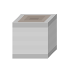</a>oror | required: 1 x [`TIN_CAN`](../reference/items.md#item-tin-can) required: 1 x [`ORCHARD_SODA_WATER`](../reference/items.md#item-orchard-soda-water) required: 1 x [`SUGAR`](../reference/vanilla-items.md#vanilla-item-sugar) required: 1 x [`COCOA_BEANS`](../reference/vanilla-items.md#vanilla-item-cocoa-beans) or [`CARROT`](../reference/vanilla-items.md#vanilla-item-carrot) or [`BEETROOT`](../reference/vanilla-items.md#vanilla-item-beetroot) | 0 ticks |

### Oven

| Recipe | Output | Inputs | Ingredient rules | Time |
| --- | --- | --- | --- | --- |
| [`AMERICAN_BBQ_CHICKEN_WINGS`](../recipes/default-recipes.md#recipe-american-bbq-chicken-wings) | <a class="hl-output-item" href="../../recipes/default-recipes/#recipe-american-bbq-chicken-wings">AMERICAN_BBQ_CHICKEN_WINGS</a> |  | required: 1 x [`CHICKEN`](../reference/vanilla-items.md#vanilla-item-chicken) required: 1 x [`AMERICAN_BBQ_SAUCE`](../reference/items.md#item-american-bbq-sauce) | 140 ticks |
| [`AMERICAN_BBQ_PULLED_PORK`](../recipes/default-recipes.md#recipe-american-bbq-pulled-pork) | <a class="hl-output-item" href="../../recipes/default-recipes/#recipe-american-bbq-pulled-pork">AMERICAN_BBQ_PULLED_PORK</a> |  | required: 1 x [`MINCED_MEAT`](../reference/items.md#item-minced-meat) required: 1 x [`AMERICAN_BBQ_SAUCE`](../reference/items.md#item-american-bbq-sauce) | 160 ticks |
| [`AMERICAN_BBQ_RIBS`](../recipes/default-recipes.md#recipe-american-bbq-ribs) | <a class="hl-output-item" href="../../recipes/default-recipes/#recipe-american-bbq-ribs">AMERICAN_BBQ_RIBS</a> |  | required: 1 x [`PORKCHOP`](../reference/vanilla-items.md#vanilla-item-porkchop) required: 1 x [`AMERICAN_BBQ_SAUCE`](../reference/items.md#item-american-bbq-sauce) | 160 ticks |
| [`AMERICAN_BERRY_CHEESECAKE`](../recipes/default-recipes.md#recipe-american-berry-cheesecake) | <a class="hl-output-item" href="../../recipes/default-recipes/#recipe-american-berry-cheesecake">AMERICAN_BERRY_CHEESECAKE</a> | oror | required: 1 x [`CHEESE`](../reference/items.md#item-cheese) required: 1 x [`HEAVY_CREAM`](../reference/items.md#item-heavy-cream) required: 1 x [`EGG`](../reference/vanilla-items.md#vanilla-item-egg) or [`BLUE_EGG`](../reference/vanilla-items.md#vanilla-item-blue-egg) or [`BROWN_EGG`](../reference/vanilla-items.md#vanilla-item-brown-egg) required: 1 x [`SUGAR`](../reference/vanilla-items.md#vanilla-item-sugar) required: 1 x [`SWEET_BERRIES`](../reference/vanilla-items.md#vanilla-item-sweet-berries) | 180 ticks |
| [`AMERICAN_BROWNIE`](../recipes/default-recipes.md#recipe-american-brownie) | <a class="hl-output-item" href="../../recipes/default-recipes/#recipe-american-brownie">AMERICAN_BROWNIE</a> | oror | required: 1 x [`CHOCOLATE`](../reference/items.md#item-chocolate) required: 1 x [`EGG`](../reference/vanilla-items.md#vanilla-item-egg) or [`BLUE_EGG`](../reference/vanilla-items.md#vanilla-item-blue-egg) or [`BROWN_EGG`](../reference/vanilla-items.md#vanilla-item-brown-egg) required: 1 x [`BUTTER`](../reference/items.md#item-butter) required: 1 x [`SUGAR`](../reference/vanilla-items.md#vanilla-item-sugar) | 120 ticks |
| [`AMERICAN_CHICKEN_POT_PIE`](../recipes/default-recipes.md#recipe-american-chicken-pot-pie) | <a class="hl-output-item" href="../../recipes/default-recipes/#recipe-american-chicken-pot-pie">AMERICAN_CHICKEN_POT_PIE</a> |  | required: 1 x [`CHICKEN`](../reference/vanilla-items.md#vanilla-item-chicken) required: 1 x [`CARROT`](../reference/vanilla-items.md#vanilla-item-carrot) required: 1 x [`DOUGH`](../reference/items.md#item-dough) required: 1 x [`HEAVY_CREAM`](../reference/items.md#item-heavy-cream) | 180 ticks |
| [`AMERICAN_CHOCOLATE_CHEESECAKE`](../recipes/default-recipes.md#recipe-american-chocolate-cheesecake) | <a class="hl-output-item" href="../../recipes/default-recipes/#recipe-american-chocolate-cheesecake">AMERICAN_CHOCOLATE_CHEESECAKE</a> | oror | required: 1 x [`CHEESE`](../reference/items.md#item-cheese) required: 1 x [`HEAVY_CREAM`](../reference/items.md#item-heavy-cream) required: 1 x [`EGG`](../reference/vanilla-items.md#vanilla-item-egg) or [`BLUE_EGG`](../reference/vanilla-items.md#vanilla-item-blue-egg) or [`BROWN_EGG`](../reference/vanilla-items.md#vanilla-item-brown-egg) required: 1 x [`SUGAR`](../reference/vanilla-items.md#vanilla-item-sugar) required: 1 x [`CHOCOLATE`](../reference/items.md#item-chocolate) | 180 ticks |
| [`AMERICAN_LOADED_BAKED_POTATO`](../recipes/default-recipes.md#recipe-american-loaded-baked-potato) | <a class="hl-output-item" href="../../recipes/default-recipes/#recipe-american-loaded-baked-potato">AMERICAN_LOADED_BAKED_POTATO</a> |  | required: 1 x [`POTATO`](../reference/vanilla-items.md#vanilla-item-potato) required: 1 x [`CHEESE`](../reference/items.md#item-cheese) required: 1 x [`BACON`](../reference/items.md#item-bacon) required: 1 x [`HEAVY_CREAM`](../reference/items.md#item-heavy-cream) | 140 ticks |
| [`AMERICAN_MEATLOAF`](../recipes/default-recipes.md#recipe-american-meatloaf) | <a class="hl-output-item" href="../../recipes/default-recipes/#recipe-american-meatloaf">AMERICAN_MEATLOAF</a> | ororor | required: 1 x [`MINCED_MEAT`](../reference/items.md#item-minced-meat) required: 1 x [`BREAD`](../reference/items.md#item-bread) or [`BREAD`](../reference/items.md#item-bread) required: 1 x [`EGG`](../reference/vanilla-items.md#vanilla-item-egg) or [`BLUE_EGG`](../reference/vanilla-items.md#vanilla-item-blue-egg) or [`BROWN_EGG`](../reference/vanilla-items.md#vanilla-item-brown-egg) required: 1 x [`AMERICAN_BBQ_SAUCE`](../reference/items.md#item-american-bbq-sauce) | 180 ticks |
| [`AMERICAN_SMORE`](../recipes/default-recipes.md#recipe-american-smore) | <a class="hl-output-item" href="../../recipes/default-recipes/#recipe-american-smore">AMERICAN_SMORE</a> | or | required: 1 x [`BREAD`](../reference/items.md#item-bread) or [`BREAD`](../reference/items.md#item-bread) required: 1 x [`CHOCOLATE`](../reference/items.md#item-chocolate) required: 1 x [`SUGAR`](../reference/vanilla-items.md#vanilla-item-sugar) | 80 ticks |
| [`AMERICAN_VANILLA_CHEESECAKE`](../recipes/default-recipes.md#recipe-american-vanilla-cheesecake) | <a class="hl-output-item" href="../../recipes/default-recipes/#recipe-american-vanilla-cheesecake">AMERICAN_VANILLA_CHEESECAKE</a> | oror | required: 1 x [`CHEESE`](../reference/items.md#item-cheese) required: 1 x [`HEAVY_CREAM`](../reference/items.md#item-heavy-cream) required: 1 x [`EGG`](../reference/vanilla-items.md#vanilla-item-egg) or [`BLUE_EGG`](../reference/vanilla-items.md#vanilla-item-blue-egg) or [`BROWN_EGG`](../reference/vanilla-items.md#vanilla-item-brown-egg) required: 1 x [`SUGAR`](../reference/vanilla-items.md#vanilla-item-sugar) | 180 ticks |
| [`BREAD`](../recipes/default-recipes.md#recipe-bread) | <a class="hl-output-item" href="../../recipes/default-recipes/#recipe-bread">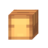BREAD</a>Default Bread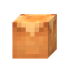Brioche BreadCornbread |  | required: 1 x [`DOUGH`](../reference/items.md#item-dough) | 120 ticks |

## Core Recipe Overrides

This pack intentionally supplies stronger definitions for: `BLT`, `BREAD`.

## Optional Compatibility

- **Orchard:** Optional overlay; adds seven routes and three visuals without requiring Orchard for the base pack

### Orchard Overlay

Install only when Orchard is active: **3 custom items** and **4 recipe entries**.

| Icon | Optional item ID | Name | Behavior |
| --- | --- | --- | --- |
| 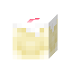 | [`AMERICAN_BANANA_MILKSHAKE`](../reference/items.md#item-american-banana-milkshake) | Banana Milkshake | 6 hunger / 4 saturation; drink |
|  | [`AMERICAN_LEMON_MILKSHAKE`](../reference/items.md#item-american-lemon-milkshake) | Lemon Milkshake | 6 hunger / 4 saturation; drink |
|  | [`AMERICAN_LEMON_SODA`](../reference/items.md#item-american-lemon-soda) | Lemon Soda | 2 hunger / 1 saturation; drink; returns tin can |

| Optional recipe | Station | Output | Ingredient rules |
| --- | --- | --- | --- |
| [`AMERICAN_BANANA_SPLIT`](../recipes/default-recipes.md#recipe-american-banana-split) | Mixing Bowl | <a class="hl-output-item" href="../../recipes/default-recipes/#recipe-american-banana-split">BANANA_SPLIT_SUNDAE</a> | required: 1 x [`BANANAS`](../reference/items.md#item-bananas) required: 1 x [`ICE_CREAM`](../reference/items.md#item-ice-cream) required: 1 x [`CHOCOLATE`](../reference/items.md#item-chocolate) required: 1 x [`SWEET_BERRIES`](../reference/vanilla-items.md#vanilla-item-sweet-berries) |
| [`AMERICAN_LEMON_MAYONNAISE`](../recipes/default-recipes.md#recipe-american-lemon-mayonnaise) | Mixing Bowl | <a class="hl-output-item" href="../../recipes/default-recipes/#recipe-american-lemon-mayonnaise">AMERICAN_MAYONNAISE</a> | required: 1 x [`EGG`](../reference/vanilla-items.md#vanilla-item-egg) or [`BLUE_EGG`](../reference/vanilla-items.md#vanilla-item-blue-egg) or [`BROWN_EGG`](../reference/vanilla-items.md#vanilla-item-brown-egg) required: 1 x [`COOKING_OIL`](../reference/items.md#item-cooking-oil) required: 1 x [`SALT`](../reference/items.md#item-salt) required: 1 x [`LEMON`](../reference/items.md#item-lemon) |
| [`AMERICAN_MILKSHAKE`](../recipes/default-recipes.md#recipe-american-milkshake) | Mixing Bowl | <a class="hl-output-item" href="../../recipes/default-recipes/#recipe-american-milkshake">AMERICAN_VANILLA_MILKSHAKE</a>Default Vanilla MilkshakeChocolate MilkshakeStrawberry MilkshakeOrange Creamsicle ShakeChorus MilkshakeHoney Caramel MilkshakeMelon MilkshakeGlow Berry MilkshakeBanana MilkshakeLemon MilkshakeRed Velvet Milkshake | required: 1 x [`ICE_CREAM`](../reference/items.md#item-ice-cream) required: 1 x [`MILK_BUCKET`](../reference/vanilla-items.md#vanilla-item-milk-bucket) optional: 0-1 x [`CHOCOLATE`](../reference/items.md#item-chocolate) or [`SWEET_BERRIES`](../reference/vanilla-items.md#vanilla-item-sweet-berries) or [`ORANGE`](../reference/items.md#item-orange) or [`CHORUS_FRUIT`](../reference/vanilla-items.md#vanilla-item-chorus-fruit) or [`HONEY_BOTTLE`](../reference/vanilla-items.md#vanilla-item-honey-bottle) or [`MELON_SLICE`](../reference/vanilla-items.md#vanilla-item-melon-slice) or [`GLOW_BERRIES`](../reference/vanilla-items.md#vanilla-item-glow-berries) or [`BANANAS`](../reference/items.md#item-bananas) or [`LEMON`](../reference/items.md#item-lemon) optional: 0-1 x [`BEETROOT`](../reference/vanilla-items.md#vanilla-item-beetroot) |
| [`AMERICAN_SODA`](../recipes/default-recipes.md#recipe-american-soda) | Mixing Bowl | <a class="hl-output-item" href="../../recipes/default-recipes/#recipe-american-soda">AMERICAN_COLA</a>Default ColaOrange SodaRoot BeerLemon Soda | required: 1 x [`TIN_CAN`](../reference/items.md#item-tin-can) required: 1 x [`ORCHARD_SODA_WATER`](../reference/items.md#item-orchard-soda-water) required: 1 x [`SUGAR`](../reference/vanilla-items.md#vanilla-item-sugar) required: 1 x [`COCOA_BEANS`](../reference/vanilla-items.md#vanilla-item-cocoa-beans) or [`ORANGE`](../reference/items.md#item-orange) or [`BEETROOT`](../reference/vanilla-items.md#vanilla-item-beetroot) or [`LEMON`](../reference/items.md#item-lemon) |

## Dynamic Variants

These recipes select their output visual from the matched ingredient or carried food property.

| Recipe | Generated variants |
| --- | --- |
| [`AMERICAN_SODA`](../recipes/default-recipes.md#recipe-american-soda) | Default Cola, Orange Soda, Root Beer |
| [`AMERICAN_MILKSHAKE`](../recipes/default-recipes.md#recipe-american-milkshake) | Default Vanilla Milkshake, Chocolate Milkshake, Strawberry Milkshake, Orange Creamsicle Shake, Chorus Milkshake, Honey Caramel Milkshake, Melon Milkshake, Glow Berry Milkshake, Red Velvet Milkshake |
| [`BREAD`](../recipes/default-recipes.md#recipe-bread) | Default Bread, Brioche Bread, Cornbread |

## Removing The Pack

Remove both JSON files together and run `/hl reload`. Heirloom will restore any weaker built-in recipe definitions that this pack overrode.
