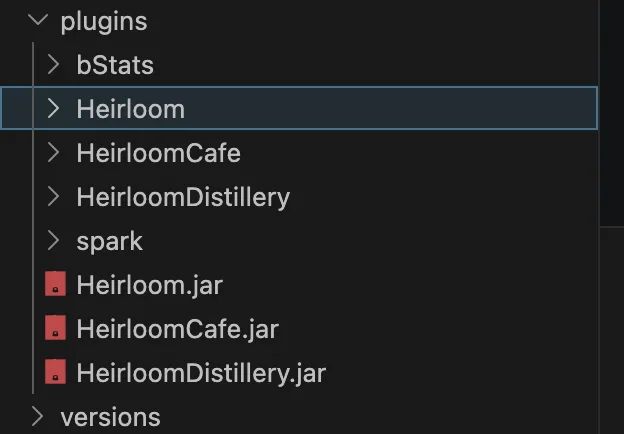
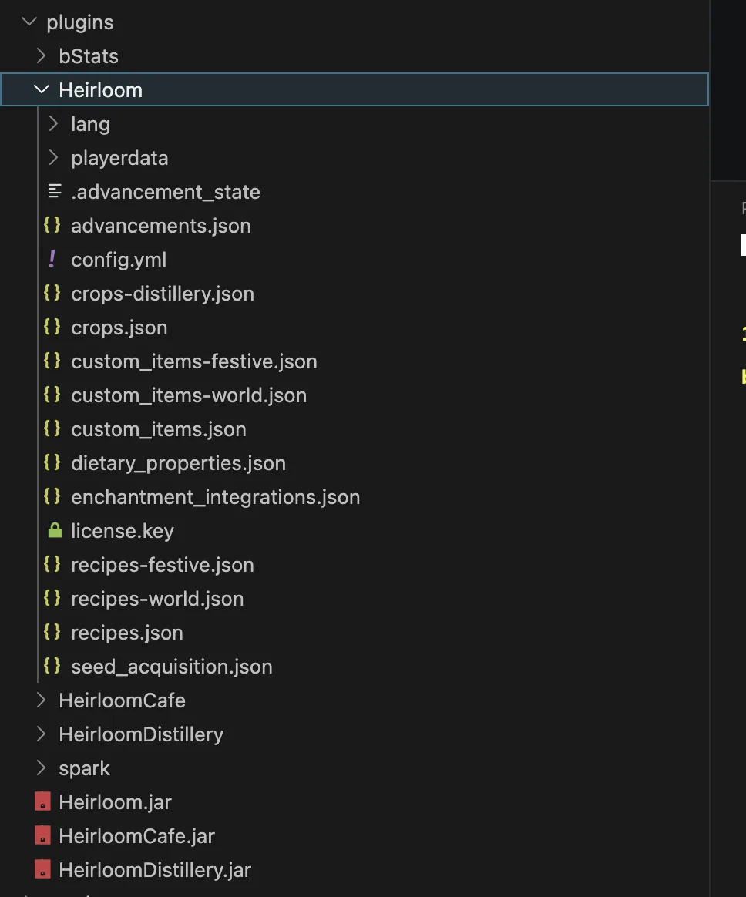

# Installation

Install Heirloom Core first, then add optional gameplay addons or food packs. Cafe, Distillery, Mixology and Pasture each require Core; Cafe and Distillery are optional integrations for Mixology.

## Install Layout

<div class="hl-media-grid">
  <figure class="hl-media-card"><figcaption>Core and addon jars beside their generated plugin folders.</figcaption></figure>
  <figure class="hl-media-card"><figcaption>Generated Heirloom resource files after the first startup.</figcaption></figure>
</div>

## Requirements

- Paper server; see the compatibility table below.
- Java version matching the server build you run.
- Heirloom core jar.
- Optional: HeirloomDistillery, HeirloomCafe, HeirloomOrchard (Mixology), and HeirloomPasture addon jars.
- Optional: PacketEvents for [interactive station tutorials](../tutorials/station-tutorials.md). Cooking, crops and addons work without it.
- Optional visual plugins: Nexo, ItemsAdder, CraftEngine, or MMOItems.
- Optional protection plugins: WorldGuard, Towny, GriefPrevention, Lands, or similar claim plugins.

## Versions and Dependencies

| Product | Version | Dependency |
| --- | --- | --- |
| Heirloom Core | 2.11.0 | Required for Heirloom gameplay |
| [Cafe](../addons/cafe/index.md) | 2.11.0 | Use with Core 2.11.0 |
| [Distillery](../addons/distillery/index.md) | 2.11.0 | Use with Core 2.11.0 |
| [Mixology](../addons/orchard/index.md) | 1.0.1 | Core 2.10.1 or newer; Core 2.11.0 recommended |
| [Pasture](../addons/pasture/dairy.md) | 2.11.0 | Java 21; Paper 1.21.11; Heirloom 2.10.0; matching Core candidate required |
| [Heirloom American Food Pack](../content-packs/heirloom-american-food-pack.md) | 1.0.1 | Heirloom 2.10.1+ (shared Soda Water build) for cooking; standalone sprites need no Heirloom |
| [Heirloom Asian Food Pack](../content-packs/heirloom-asian-food-pack.md) | 1.0.0 | Heirloom 2.9+ for cooking; standalone sprites need no Heirloom |

Install matching Core, Cafe and Distillery updates together. Mixology keeps the internal name `HeirloomOrchard`, its `/hlo` command and the `plugins/HeirloomOrchard/` data folder. Addons do not require separate license keys when Core is active.

The current private **Pasture 2.11.0 candidate requires Java 25, Paper 26.2 and its matching Core 2.11.0 candidate**. Install both jars from the same candidate archive; earlier private builds can share the version label. This Pasture acceptance scope does not include Paper 1.21.11 or 26.1.2. Public Pasture publication remains gated on the candidate's release checks.

## Server Compatibility

| Java | Paper | Release verification |
| --- | --- | --- |
| Java 21 | Paper 1.21.11 | Compilation and automated tests |
| Java 25 | Paper 26.2 | API compilation and automated tests |

Heirloom targets Java 21 bytecode. Use the Java runtime required by your Paper build. Automated checks do not establish client-side visual acceptance for optional resource packs.

## Install Core

1. Stop the server.
2. Download Core from your purchasing account and put its jar in `plugins/`, replacing the previous Core jar.
3. Start the server and check that Heirloom enables successfully.
4. Confirm `plugins/Heirloom/` was created.
5. Join and run `/hl help`.

### Voxel Purchases

Voxel Core downloads activate automatically through RIC using the personalized proof included in your download. Existing buyers can re-download the current Core release from their Voxel account and replace the old jar while the server is stopped. No manual license key is needed for the normal Voxel installation.

The standard Voxel Core license is perpetual and allows **three server installations**. Each server creates its own installation identity. Keep that identity for updates and restarts on the same server; do not copy `license-installation-id` or `license-lease.json` into another server installation.

Core renews its signed license shortly after startup and then every two hours. Temporary connection errors allow Core to continue for the remaining validity of its current six-hour signed lease. A definitive refusal or an expired lease disables Heirloom addons and Core through their normal shutdown handlers. Restore connectivity or resolve the reported license issue, then restart the server.

If the console reports an unavailable or invalid Voxel proof, download a fresh Core jar from your Voxel account. The legacy `license-key` setting is not a replacement for a Voxel proof. Contact support if a fresh download still fails, including the error code and request ID from the log, without sharing license files.

### BuiltByBit and MCModels Purchases

BuiltByBit and MCModels downloads continue to use the existing Lukittu licensing flow. Keep the license setup supplied with that marketplace download. The Voxel RIC change does not require moving those installations to a different license system.

## Install Addons

Stop the server, put the Cafe, Distillery, Mixology or Pasture addon jars in `plugins/` beside Core, and start the server. Use the versions listed above. Mixology's downloadable jar is named `HeirloomOrchard`.

For the private Pasture candidate, install `Heirloom-2.10.1.jar` and `HeirloomPasture-2.10.1.jar` together on Java 25 / Paper 26.2. Pasture creates its editable config and content under `plugins/HeirloomPasture/`; do not copy its addon JSON into Core's folder. Check `/hl` → **Animal Care**, `/hl` → **Pasture Cheeses**, or `/hlp menu`. Natural animals stay wild by default; supported directly bred newborns join care. Review `plugins/HeirloomPasture/config.yml` and the [Pasture guide](../addons/pasture/dairy.md). No provider package is required for its head/vanilla visuals.

Use:

```text
/hld help
/hlc help
/hlo info
```

Food-pack JSON goes in `plugins/Heirloom/`; follow the individual pack guide for its exact files and optional provider setup. Use `/hl reload` for supported content edits. Restart after replacing jars or changing license credentials.

## First Files To Review

- `plugins/Heirloom/config.yml`
- `plugins/Heirloom/custom_items.json`
- `plugins/Heirloom/recipes.json`
- `plugins/Heirloom/crops.json`
- `plugins/Heirloom/dietary_properties.json`
- `plugins/Heirloom/seed_acquisition.json`

## Verify The Install

Run `/hl debug test` from an admin account. It checks item registration, recipe matching, crop registration, protection hooks, EcoEnchants detection, and runtime GUI loading.

!!! tip
    If you use a claim plugin, test planting, harvesting, and station use in both allowed and denied regions before opening the server to players.
