# Mixing Bowl Recipes

| Recipe | Output | Inputs | Source |
| --- | --- | --- | --- |
| [`AMERICAN_BANANA_SPLIT`](../recipes/default-recipes.md#recipe-american-banana-split) | 1× <a class="hl-output-item" href="../default-recipes/#recipe-american-banana-split">BANANA_SPLIT_SUNDAE</a> | <a class="hl-icon-link" href="../../reference/items/#item-ice-cream">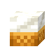</a> | Heirloom American Food Pack (Orchard compatibility) |
| [`AMERICAN_BBQ_SAUCE`](../recipes/default-recipes.md#recipe-american-bbq-sauce) | 3× <a class="hl-output-item" href="../default-recipes/#recipe-american-bbq-sauce">AMERICAN_BBQ_SAUCE</a> |  | 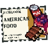 |
| [`AMERICAN_COBB_SALAD`](../recipes/default-recipes.md#recipe-american-cobb-salad) | 1× <a class="hl-output-item" href="../default-recipes/#recipe-american-cobb-salad">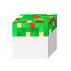AMERICAN_COBB_SALAD</a> | oror |  |
| [`AMERICAN_COLESLAW`](../recipes/default-recipes.md#recipe-american-coleslaw) | 1× <a class="hl-output-item" href="../default-recipes/#recipe-american-coleslaw">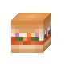AMERICAN_COLESLAW</a> |  |  |
| [`AMERICAN_LEMON_MAYONNAISE`](../recipes/default-recipes.md#recipe-american-lemon-mayonnaise) | 3× <a class="hl-output-item" href="../default-recipes/#recipe-american-lemon-mayonnaise">AMERICAN_MAYONNAISE</a> | oror | Heirloom American Food Pack (Orchard compatibility) |
| [`AMERICAN_MAYONNAISE`](../recipes/default-recipes.md#recipe-american-mayonnaise) | 3× <a class="hl-output-item" href="../default-recipes/#recipe-american-mayonnaise">AMERICAN_MAYONNAISE</a> | oror |  |
| [`AMERICAN_MILKSHAKE`](../recipes/default-recipes.md#recipe-american-milkshake) | 1× <a class="hl-output-item" href="../default-recipes/#recipe-american-milkshake">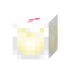AMERICAN_VANILLA_MILKSHAKE</a>Default Vanilla Milkshake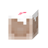Chocolate Milkshake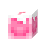Strawberry Milkshake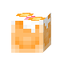Orange Creamsicle Shake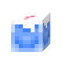Chorus Milkshake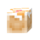Honey Caramel Milkshake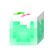Melon Milkshake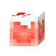Glow Berry Milkshake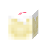Banana MilkshakeLemon Milkshake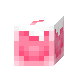Red Velvet Milkshake | orororororororor0-10-1 | Heirloom American Food Pack (Orchard compatibility) |
| [`AMERICAN_POTATO_SALAD`](../recipes/default-recipes.md#recipe-american-potato-salad) | 1× <a class="hl-output-item" href="../default-recipes/#recipe-american-potato-salad">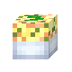AMERICAN_POTATO_SALAD</a> | oror |  |
| [`AMERICAN_ROOT_BEER_FLOAT`](../recipes/default-recipes.md#recipe-american-root-beer-float) | 1× <a class="hl-output-item" href="../default-recipes/#recipe-american-root-beer-float">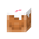AMERICAN_ROOT_BEER_FLOAT</a> |  |  |
| [`AMERICAN_SODA`](../recipes/default-recipes.md#recipe-american-soda) | 1× <a class="hl-output-item" href="../default-recipes/#recipe-american-soda">AMERICAN_COLA</a>Default ColaOrange Soda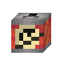Root Beer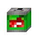Lemon Soda | <a class="hl-icon-link" href="../../reference/items/#item-tin-can">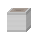</a>ororor | Heirloom American Food Pack (Orchard compatibility) |
| [`ASIAN_BOBA_TEA`](../recipes/default-recipes.md#recipe-asian-boba-tea) | 1× <a class="hl-output-item" href="../default-recipes/#recipe-asian-boba-tea">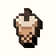ASIAN_BOBA_TEA</a> |  |  |
| [`ASIAN_MATCHA_ICE_CREAM`](../recipes/default-recipes.md#recipe-asian-matcha-ice-cream) | 1× <a class="hl-output-item" href="../default-recipes/#recipe-asian-matcha-ice-cream">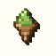ASIAN_MATCHA_ICE_CREAM</a> |  |  |
| [`ASIAN_MOCHI`](../recipes/default-recipes.md#recipe-asian-mochi) | 1× <a class="hl-output-item" href="../default-recipes/#recipe-asian-mochi">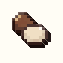ASIAN_MOCHI</a>Default Mochi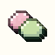Sweet Berry Mochi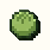Matcha Mochi | or0-1 |  |
| [`ASIAN_POKE_BOWL`](../recipes/default-recipes.md#recipe-asian-poke-bowl) | 1× <a class="hl-output-item" href="../default-recipes/#recipe-asian-poke-bowl">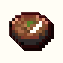ASIAN_POKE_BOWL_SALMON</a>Default Salmon Poke Bowl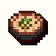Cod Poke Bowl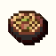Tropical Fish Poke Bowl | <a class="hl-icon-link" href="../../reference/items/#item-asian-sushi-rice">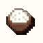</a>or<a class="hl-icon-link" href="../../reference/vanilla-items/#vanilla-item-salmon">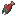</a>or<a class="hl-icon-link" href="../../reference/vanilla-items/#vanilla-item-cod">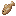</a>or0-10-1 |  |
| [`ASIAN_PORTABLE_BENTO`](../recipes/default-recipes.md#recipe-asian-portable-bento) | 1× <a class="hl-output-item" href="../default-recipes/#recipe-asian-portable-bento">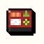ASIAN_PORTABLE_BENTO</a> |  |  |
| [`ASIAN_RICE_FLOUR`](../recipes/default-recipes.md#recipe-asian-rice-flour) | 1× <a class="hl-output-item" href="../default-recipes/#recipe-asian-rice-flour">ASIAN_RICE_FLOUR</a> | <a class="hl-icon-link" href="../../reference/items/#item-rice">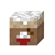</a>1-2 |  |
| [`BANANA_SPLIT_SUNDAE`](../recipes/default-recipes.md#recipe-banana-split-sundae) | 1× <a class="hl-output-item" href="../default-recipes/#recipe-banana-split-sundae">BANANA_SPLIT_SUNDAE</a> |  |  |
| [`BUTTER_RECIPE`](../recipes/default-recipes.md#recipe-butter-recipe) | 1× <a class="hl-output-item" href="../default-recipes/#recipe-butter-recipe">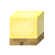BUTTER</a> |  |  |
| [`COOKING_OIL_CORN`](../recipes/default-recipes.md#recipe-cooking-oil-corn) | 1× <a class="hl-output-item" href="../default-recipes/#recipe-cooking-oil-corn">COOKING_OIL</a> | 1-2 |  |
| [`COOKING_OIL_SUNFLOWER`](../recipes/default-recipes.md#recipe-cooking-oil-sunflower) | 1× <a class="hl-output-item" href="../default-recipes/#recipe-cooking-oil-sunflower">COOKING_OIL</a> | 1-4 |  |
| [`DOUGH`](../recipes/default-recipes.md#recipe-dough) | 1× <a class="hl-output-item" href="../default-recipes/#recipe-dough">DOUGH</a> | or<a class="hl-icon-link" href="../../reference/items/#item-cornmeal">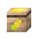</a>ororor0-10-10-10-10-1 |  |
| [`EGGNOG`](../recipes/default-recipes.md#recipe-eggnog) | 1× <a class="hl-output-item" href="../default-recipes/#recipe-eggnog">EGGNOG</a> | 1-2 |  |
| [`FRESH_COCONUT_DRINK`](../recipes/default-recipes.md#recipe-fresh-coconut-drink) | 1× <a class="hl-output-item" href="../default-recipes/#recipe-fresh-coconut-drink">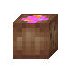COCONUT_DRINK</a> | <a class="hl-icon-link" href="../../reference/items/#item-coconut">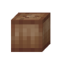</a> |  |
| [`GRIND_BLACK_TEA_LEAVES`](../recipes/default-recipes.md#recipe-grind-black-tea-leaves) | 1× <a class="hl-output-item" href="../default-recipes/#recipe-grind-black-tea-leaves">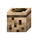BLACK_TEA_LEAVES</a> | <a class="hl-icon-link" href="../../reference/vanilla-items/#vanilla-item-leaf-litter">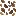</a>1-2 |  |
| [`GRIND_GREEN_TEA_LEAVES`](../recipes/default-recipes.md#recipe-grind-green-tea-leaves) | 1× <a class="hl-output-item" href="../default-recipes/#recipe-grind-green-tea-leaves">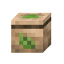DRIED_GREEN_TEA</a> | orororororororor<a class="hl-icon-link" href="../../reference/vanilla-items/#vanilla-item-azalea-leaves">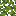</a>or<a class="hl-icon-link" href="../../reference/vanilla-items/#vanilla-item-flowering-azalea-leaves">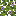</a>1-2 |  |
| [`GRIND_MATCHA_POWDER`](../recipes/default-recipes.md#recipe-grind-matcha-powder) | 1× <a class="hl-output-item" href="../default-recipes/#recipe-grind-matcha-powder">DRIED_GREEN_TEA</a> |  |  |
| [`HEAVY_CREAM_RECIPE`](../recipes/default-recipes.md#recipe-heavy-cream-recipe) | 1× <a class="hl-output-item" href="../default-recipes/#recipe-heavy-cream-recipe">HEAVY_CREAM</a> |  |  |
| [`ICE_CREAM`](../recipes/default-recipes.md#recipe-ice-cream) | 1× <a class="hl-output-item" href="../default-recipes/#recipe-ice-cream">ICE_CREAM</a>Default Ice Cream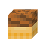Chocolate Ice Cream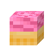Berry Ice Cream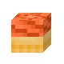Glowing Ice CreamHoney Ice Cream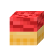Melon Ice Cream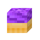Chorus Ice Cream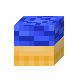Meloi Grape Ice Cream | ororororor0-1ororororororor<a class="hl-icon-link" href="../../reference/items/#item-renoit-grape">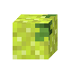</a>or<a class="hl-icon-link" href="../../reference/items/#item-cherimola-blan-grape">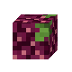</a>or<a class="hl-icon-link" href="../../reference/items/#item-meloire-grape">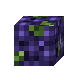</a>ororororororororor0-1 |  |
| [`MAKE_BRINE`](../recipes/default-recipes.md#recipe-make-brine) | 1× <a class="hl-output-item" href="../default-recipes/#recipe-make-brine">BRINE</a> |  |  |
| [`MAKE_OAT_MILK`](../recipes/default-recipes.md#recipe-make-oat-milk) | 1× <a class="hl-output-item" href="../default-recipes/#recipe-make-oat-milk">OAT_MILK</a> | 1-2 |  |
| [`MAKE_YOGURT`](../recipes/default-recipes.md#recipe-make-yogurt) | 1× <a class="hl-output-item" href="../default-recipes/#recipe-make-yogurt">YOGURT</a> | 3 |  |
| [`ORCHARD_GUACAMOLE`](../recipes/default-recipes.md#recipe-orchard-guacamole) | 1× <a class="hl-output-item" href="../default-recipes/#recipe-orchard-guacamole">ORCHARD_GUACAMOLE</a> |  |  All Mixology modes |
| [`PINA_COLADA`](../recipes/default-recipes.md#recipe-pina-colada) | 1× <a class="hl-output-item" href="../default-recipes/#recipe-pina-colada">PINA_COLADA</a> |  |  |
| [`PLANT_PROTEIN`](../recipes/default-recipes.md#recipe-plant-protein) | 1× <a class="hl-output-item" href="../default-recipes/#recipe-plant-protein">PLANT_PROTEIN</a> | ororor |  |
| [`PREPARE_BRINED_CHEESE`](../recipes/default-recipes.md#recipe-prepare-brined-cheese) | 1× <a class="hl-output-item" href="../default-recipes/#recipe-prepare-brined-cheese">PREPARED_CHEESE</a> | 0-1 |  |
| [`PREPARE_SALTED_CHEESE`](../recipes/default-recipes.md#recipe-prepare-salted-cheese) | 1× <a class="hl-output-item" href="../default-recipes/#recipe-prepare-salted-cheese">PREPARED_CHEESE</a> | 0-1 |  |
| [`SALAD`](../recipes/default-recipes.md#recipe-salad) | 1× <a class="hl-output-item" href="../default-recipes/#recipe-salad">SALAD</a> | 1-2ororororororororor0-4orororor0-1or0-1 |  |
| [`TROPICAL_FRUIT_SALAD`](../recipes/default-recipes.md#recipe-tropical-fruit-salad) | 1× <a class="hl-output-item" href="../default-recipes/#recipe-tropical-fruit-salad">TROPICAL_FRUIT_SALAD</a> |  |  |
| [`VINEGAR`](../recipes/default-recipes.md#recipe-vinegar) | 1× <a class="hl-output-item" href="../default-recipes/#recipe-vinegar">VINEGAR</a> |  |  |
