# Item ID Reference

Source-derived reference for bundled Heirloom custom items. Use these IDs in commands, recipes, visual mappings, and config files.

## Core Items

| Icon | ID | Name | Base | Edible | Visual ID |
| --- | --- | --- | --- | --- | --- |
|  | `BACON` | Bacon | PLAYER_HEAD | yes | BACON |
| 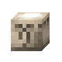 | `BAG_OF_FLOUR` | Bag of Flour | PLAYER_HEAD | no | BAG_OF_FLOUR |
|  | `BAKING_POWDER` | Baking Powder | SUGAR | no | BAKING_POWDER |
| 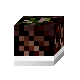 | `BEEF_WELLINGTON` | Beef Wellington | PLAYER_HEAD | yes | BEEF_WELLINGTON |
| 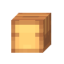 | `BLT` | BLT Sandwich | PLAYER_HEAD | yes | BLT |
|  | `BREAD` | Bread | PLAYER_HEAD | yes | BREAD |
|  | `BUTTER` | Butter | PLAYER_HEAD | yes | BUTTER |
|  | `CANNED_TOMATOES` | Canned Tomatoes | PLAYER_HEAD | no | CANNED_TOMATOES |
|  | `CARBONARA` | Carbonara | PLAYER_HEAD | yes | CARBONARA |
|  | `CHEESE` | Cheese | PLAYER_HEAD | yes | CHEESE |
|  | `CHOCOLATE` | Chocolate | PLAYER_HEAD | yes | CHOCOLATE |
| 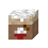 | `COOKED_RICE` | Cooked Rice | PLAYER_HEAD | yes | COOKED_RICE |
|  | `COOKING_OIL` | Oil | PLAYER_HEAD | no | COOKING_OIL |
|  | `CORN` | Corn | PLAYER_HEAD | yes | CORN |
| 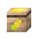 | `CORNMEAL` | Cornmeal | PLAYER_HEAD | no | CORNMEAL |
|  | `DOUGH` | Dough | PLAYER_HEAD | no | DOUGH |
| 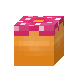 | `DOUGHNUT` | Doughnut | PLAYER_HEAD | yes | DOUGHNUT |
|  | `DRY_PASTA` | Dry Pasta | PLAYER_HEAD | no | DRY_PASTA |
|  | `EGGS_AND_BACON` | Eggs and Bacon | PLAYER_HEAD | yes | EGGS_AND_BACON |
|  | `FARMERS_HOE` | Farmer's Hoe | IRON_HOE | no | FARMERS_HOE |
|  | `FISH_AND_CHIPS` | Fish and Chips | PLAYER_HEAD | yes | FISH_AND_CHIPS |
| 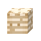 | `FLATBREAD` | Flatbread | PLAYER_HEAD | yes | FLATBREAD |
|  | `FRENCH_ONION_SOUP` | French Onion Soup | PLAYER_HEAD | yes | FRENCH_ONION_SOUP |
| 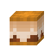 | `FRENCH_TOAST` | French Toast | PLAYER_HEAD | yes | FRENCH_TOAST |
| 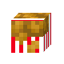 | `FRIED_CHICKEN` | Fried Chicken | PLAYER_HEAD | yes | FRIED_CHICKEN |
|  | `FRIED_EGG` | Fried Egg | PLAYER_HEAD | yes | FRIED_EGG |
|  | `FRIED_RICE` | Fried Rice | PLAYER_HEAD | yes | FRIED_RICE |
|  | `FRIES` | Fries | PLAYER_HEAD | yes | FRIES |
| 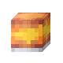 | `GRILLED_CHEESE` | Grilled Cheese | PLAYER_HEAD | yes | GRILLED_CHEESE |
| 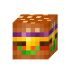 | `HAMBURGER` | Hamburger | PLAYER_HEAD | yes | HAMBURGER |
|  | `HEAVY_CREAM` | Heavy Cream | PLAYER_HEAD | no | HEAVY_CREAM |
| 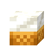 | `ICE_CREAM` | Ice Cream | PLAYER_HEAD | yes | ICE_CREAM |
|  | `JAM` | Jam | PLAYER_HEAD | yes | JAM |
| 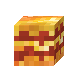 | `LASAGNA` | Lasagna | PLAYER_HEAD | yes | LASAGNA |
|  | `LETTUCE` | Lettuce | PLAYER_HEAD | yes | LETTUCE |
| 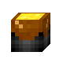 | `MAC_AND_CHEESE` | Mac & Cheese | PLAYER_HEAD | yes | MAC_AND_CHEESE |
| 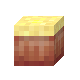 | `MASHED_POTATOES` | Mashed Potatoes | PLAYER_HEAD | yes | MASHED_POTATOES |
|  | `MINCED_MEAT` | Minced Meat | PLAYER_HEAD | no | MINCED_MEAT |
|  | `OMELETTE` | Omelette | PLAYER_HEAD | yes | OMELETTE |
|  | `ONION` | Onion | PLAYER_HEAD | yes | ONION |
|  | `ORCHARD_SODA_WATER` | Soda Water | POTION | yes | ORCHARD_SODA_WATER |
| 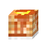 | `PANCAKES` | Pancakes | PLAYER_HEAD | yes | PANCAKES |
| 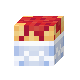 | `PASTA_BOLOGNESE` | Pasta Bolognese | PLAYER_HEAD | yes | PASTA_BOLOGNESE |
| 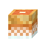 | `PIE` | Pie | PLAYER_HEAD | yes | PIE |
|  | `PIZZA` | Pizza | PLAYER_HEAD | yes | PIZZA |
|  | `PLANT_PROTEIN` | Plant Protein | PLAYER_HEAD | yes | PLANT_PROTEIN |
|  | `POPCORN` | Popcorn | PLAYER_HEAD | yes | POPCORN |
|  | `PUFF_PASTRY` | Puff Pastry | PLAYER_HEAD | no | PUFF_PASTRY |
|  | `RECIPE_BOOK` | Recipe Book | KNOWLEDGE_BOOK | no | RECIPE_BOOK |
|  | `RICE` | Rice | PLAYER_HEAD | yes | RICE |
|  | `SALAD` | Salad | PLAYER_HEAD | yes | SALAD |
|  | `SALT` | Salt | SUGAR | no | SALT |
| 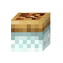 | `SHEPHERDS_PIE` | Shepherd's Pie | PLAYER_HEAD | yes | SHEPHERDS_PIE |
|  | `SUSHI` | Sushi | PLAYER_HEAD | yes | SUSHI |
| 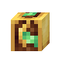 | `TACO` | Taco | PLAYER_HEAD | yes | TACO |
|  | `TEMPERATE_SEED_PACKET` | Temperate Seed Packet | PLAYER_HEAD | no | TEMPERATE_SEED_PACKET |
| 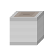 | `TIN_CAN` | Tin Can | PLAYER_HEAD | no | TIN_CAN |
|  | `TOMATO` | Tomato | PLAYER_HEAD | yes | TOMATO |
|  | `TOMATO_SOUP` | Tomato Soup | PLAYER_HEAD | yes | TOMATO_SOUP |
|  | `TROPICAL_SEED_PACKET` | Tropical Seed Packet | PLAYER_HEAD | no | TROPICAL_SEED_PACKET |
|  | `VINEGAR` | Vinegar | POTION | no | VINEGAR |
| 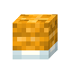 | `WAFFLES` | Waffles | PLAYER_HEAD | yes | WAFFLES |

## World Items

| Icon | ID | Name | Base | Edible | Visual ID |
| --- | --- | --- | --- | --- | --- |
|  | `FALAFEL` | Falafel | PLAYER_HEAD | yes | FALAFEL |
| 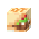 | `KEBAB` | Kebab | PLAYER_HEAD | yes | KEBAB |
|  | `SUSHI_ROLL` | Sushi Roll | PLAYER_HEAD | yes | SUSHI_ROLL |

## Festive Items

| Icon | ID | Name | Base | Edible | Visual ID |
| --- | --- | --- | --- | --- | --- |
| 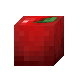 | `CANDY_APPLE` | Candy Apple | PLAYER_HEAD | yes | CANDY_APPLE |
|  | `CANDY_CORN` | Candy Corn | PLAYER_HEAD | yes | CANDY_CORN |
|  | `CHOCOLATE_EGG` | Chocolate Egg | PLAYER_HEAD | yes | CHOCOLATE_EGG |
| 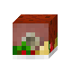 | `CHRISTMAS_HAM` | Christmas Ham | PLAYER_HEAD | yes | CHRISTMAS_HAM |
|  | `EGGNOG` | Eggnog | PLAYER_HEAD | yes | EGGNOG |
| 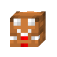 | `GINGERBREAD` | Gingerbread | PLAYER_HEAD | yes | GINGERBREAD |
| 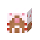 | `GINGERBREAD_HOUSE` | Gingerbread House | PLAYER_HEAD | yes | GINGERBREAD_HOUSE |
| 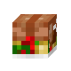 | `ROAST_TURKEY` | Roast Turkey | PLAYER_HEAD | yes | ROAST_TURKEY |
| 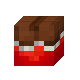 | `VALENTINES_CHOCOLATE` | Valentine's Chocolate | PLAYER_HEAD | yes | VALENTINES_CHOCOLATE |

## Distillery Items

| Icon | ID | Name | Base | Edible | Visual ID |
| --- | --- | --- | --- | --- | --- |
| 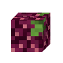 | `CHERIMOLA_BLAN_GRAPE` | ⚗ Cherimola Blan Grape | PLAYER_HEAD | yes | CHERIMOLA_BLAN_GRAPE |
| 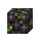 | `CRANERLET_NUALA_GRAPE` | ⚗ Cranerlet Nuala Grape | PLAYER_HEAD | yes | CRANERLET_NUALA_GRAPE |
| 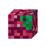 | `GRALLADINA_FRAN_GRAPE` | ⚗ Gralladina Fran Grape | PLAYER_HEAD | yes | GRALLADINA_FRAN_GRAPE |
| 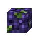 | `MELOIRE_GRAPE` | ⚗ Meloire Grape | PLAYER_HEAD | yes | MELOIRE_GRAPE |
| 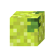 | `RENOIT_GRAPE` | ⚗ Renoit Grape | PLAYER_HEAD | yes | RENOIT_GRAPE |

## Cafe Items

| Icon | ID | Name | Base | Edible | Visual ID |
| --- | --- | --- | --- | --- | --- |
|  | `AMERICANO` | Americano | PLAYER_HEAD | yes | AMERICANO |
| 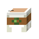 | `BLACK_TEA` | Black Tea | PLAYER_HEAD | yes | BLACK_TEA |
| 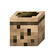 | `BLACK_TEA_LEAVES` | Black Tea Leaves | PLAYER_HEAD | no | BLACK_TEA_LEAVES |
|  | `BOBA_TEA` | Boba Tea | PLAYER_HEAD | yes | BOBA_TEA |
|  | `CAPPUCCINO` | Cappuccino | PLAYER_HEAD | yes | CAPPUCCINO |
| 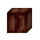 | `COFFEE_BEANS_DARK` | Dark Roast Coffee Beans | PLAYER_HEAD | no | COFFEE_BEANS_DARK |
| 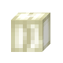 | `COFFEE_BEANS_LIGHT` | Light Roast Coffee Beans | PLAYER_HEAD | no | COFFEE_BEANS_LIGHT |
| 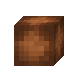 | `COFFEE_BEANS_MEDIUM` | Medium Roast Coffee Beans | PLAYER_HEAD | no | COFFEE_BEANS_MEDIUM |
| 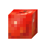 | `COFFEE_CHERRY` | Coffee Cherry | PLAYER_HEAD | no | COFFEE_CHERRY |
|  | `COFFEE_DRINK` | Coffee Drink | PLAYER_HEAD | yes | ESPRESSO |
| 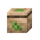 | `DRIED_GREEN_TEA` | Dried Green Tea | PLAYER_HEAD | no | DRIED_GREEN_TEA |
|  | `ESPRESSO` | Espresso | PLAYER_HEAD | yes | ESPRESSO |
|  | `FLAT_WHITE` | Flat White | PLAYER_HEAD | yes | FLAT_WHITE |
|  | `GREEN_TEA` | Green Tea | PLAYER_HEAD | yes | GREEN_TEA |
| 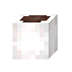 | `HOT_COCOA` | Hot Cocoa | PLAYER_HEAD | yes | HOT_COCOA |
| 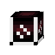 | `ICED_COFFEE` | Iced Coffee | PLAYER_HEAD | yes | ICED_COFFEE |
|  | `LATTE` | Latte | PLAYER_HEAD | yes | LATTE |
|  | `MATCHA_LATTE` | Matcha Latte | PLAYER_HEAD | yes | MATCHA_LATTE |
| 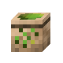 | `MATCHA_POWDER` | Matcha Powder | PLAYER_HEAD | no | MATCHA_POWDER |
|  | `MOCHA` | Mocha | PLAYER_HEAD | yes | MOCHA |
| 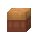 | `MUFFIN` | Muffin | PLAYER_HEAD | yes | MUFFIN |
|  | `OAT_MILK` | Oat Milk | PLAYER_HEAD | yes | OAT_MILK |
|  | `SWEET_TEA` | Sweet Tea | PLAYER_HEAD | yes | SWEET_TEA |
|  | `TEA_DRINK` | Tea Drink | PLAYER_HEAD | yes | GREEN_TEA |

## Pasture Items

| Icon | ID | Name | Base | Edible | Visual ID |
| --- | --- | --- | --- | --- | --- |
| 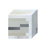 | `BRIE` | Brie | PLAYER_HEAD | yes | BRIE |
|  | `BRINE` | Cheese Brine | PLAYER_HEAD | no | BRINE |
|  | `BRUNOST` | Brunost | PLAYER_HEAD | yes | BRUNOST |
|  | `BUTTERMILK` | Buttermilk | PLAYER_HEAD | yes | BUTTERMILK |
| 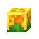 | `CASU_MARTZU` | Casu Martzu | PLAYER_HEAD | yes | CASU_MARTZU |
|  | `CHEDDAR` | Cheddar | PLAYER_HEAD | yes | CHEDDAR |
|  | `CHEESE_SAUSAGE` | Cheese Sausage | PLAYER_HEAD | yes | CHEESE_SAUSAGE |
| 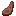 | `COOKED_GOAT_MEAT` | Cooked Goat Meat | COOKED_MUTTON | yes | COOKED_GOAT_MEAT |
|  | `CROTTIN_STYLE_GOAT` | Crottin-Style Goat Cheese | PLAYER_HEAD | yes | CROTTIN_STYLE_GOAT |
|  | `DAIRY_MILK_PAIL` | Dairy Milk | MILK_BUCKET | no | DAIRY_MILK_PAIL |
|  | `EMMENTAL` | Emmental | PLAYER_HEAD | yes | EMMENTAL |
|  | `FETA` | Feta | PLAYER_HEAD | yes | FETA |
| 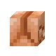 | `FRENCH_FRIED_FROG_LEGS` | French Fried Frog Legs | PLAYER_HEAD | yes | FRENCH_FRIED_FROG_LEGS |
|  | `FRESH_CURDS` | Fresh Curds | PLAYER_HEAD | no | FRESH_CURDS |
|  | `GARLIC` | Garlic | PLAYER_HEAD | no | GARLIC |
|  | `GARLIC_BREAD` | Garlic Bread | PLAYER_HEAD | yes | GARLIC_BREAD |
|  | `GARLIC_PORK_SAUSAGE` | Garlic Pork Sausage | PLAYER_HEAD | yes | GARLIC_PORK_SAUSAGE |
|  | `GHEE` | Ghee | PLAYER_HEAD | yes | GHEE |
|  | `GOAT_MILK_PAIL` | Goat Milk | MILK_BUCKET | no | GOAT_MILK_PAIL |
|  | `GORGONZOLA_STYLE_BLUE` | Gorgonzola-Style Blue | PLAYER_HEAD | yes | GORGONZOLA_STYLE_BLUE |
|  | `GOUDA` | Gouda | PLAYER_HEAD | yes | GOUDA |
|  | `HALLOUMI` | Halloumi | PLAYER_HEAD | yes | HALLOUMI |
|  | `HOT_DOG` | Hot Dog | PLAYER_HEAD | yes | HOT_DOG |
|  | `MANCHEGO` | Manchego | PLAYER_HEAD | yes | MANCHEGO |
|  | `MAROILLES_STYLE_WASHED_RIND` | Maroilles-Style Washed Rind | PLAYER_HEAD | yes | MAROILLES_STYLE_WASHED_RIND |
|  | `MINCED_BEEF` | Minced Beef | PLAYER_HEAD | no | MINCED_BEEF |
|  | `MINCED_GOAT` | Minced Goat | PLAYER_HEAD | no | MINCED_GOAT |
|  | `MINCED_MUTTON` | Minced Mutton | PLAYER_HEAD | no | MINCED_MUTTON |
|  | `MINCED_PORK` | Minced Pork | PLAYER_HEAD | no | MINCED_PORK |
|  | `MOZZARELLA` | Mozzarella | PLAYER_HEAD | yes | MOZZARELLA |
|  | `PANEER` | Paneer | PLAYER_HEAD | yes | PANEER |
|  | `PARMESAN_STYLE` | Parmesan-Style Cheese | PLAYER_HEAD | yes | PARMESAN_STYLE |
|  | `PIG_CASINGS` | Pig Casings | PLAYER_HEAD | no | PIG_CASINGS |
|  | `PLAIN_LINKS` | Plain Sausage Links | PLAYER_HEAD | yes | PLAIN_LINKS |
|  | `PREPARED_CHEESE` | Prepared Cheese | PLAYER_HEAD | no | PREPARED_CHEESE |
|  | `PROVOLONE_STYLE` | Provolone-Style Cheese | PLAYER_HEAD | yes | PROVOLONE_STYLE |
|  | `RAW_FROG_LEGS` | Raw Frog Legs | PLAYER_HEAD | no | RAW_FROG_LEGS |
|  | `RAW_GOAT_MEAT` | Raw Goat Meat | MUTTON | yes | RAW_GOAT_MEAT |
|  | `RICH_MILK_PAIL` | Buffalo Milk | MILK_BUCKET | no | RICH_MILK_PAIL |
|  | `RICOTTA` | Ricotta | PLAYER_HEAD | yes | RICOTTA |
|  | `ROQUEFORT_STYLE_BLUE` | Roquefort-Style Blue | PLAYER_HEAD | yes | ROQUEFORT_STYLE_BLUE |
|  | `SHEEP_MILK_PAIL` | Sheep Milk | MILK_BUCKET | no | SHEEP_MILK_PAIL |
|  | `SWEDISH_POTATO_SAUSAGE` | Swedish Potato Sausage | PLAYER_HEAD | yes | SWEDISH_POTATO_SAUSAGE |
|  | `WARM_CLIMATE_MILK_PAIL` | Zebu Milk | MILK_BUCKET | no | WARM_CLIMATE_MILK_PAIL |
|  | `WHEY` | Whey | PLAYER_HEAD | no | WHEY |
|  | `YOGURT` | Yogurt | PLAYER_HEAD | yes | YOGURT |
|  | `YOUNG_CHEESE_WHEEL` | Young Cheese Wheel | PLAYER_HEAD | no | YOUNG_CHEESE_WHEEL |

## Heirloom Mixology Items

This is the full editable Heirloom Mixology inventory. Optional Cafe and Distillery integrations select the active items; see [Mixology's mode table](../addons/orchard/index.md#active-content). Fallback spirits are absent while Distillery is enabled.

| Icon | ID | Name | Base | Edible | Visual ID |
| --- | --- | --- | --- | --- | --- |
|  | `AVOCADO` | Avocado | PLAYER_HEAD | yes | AVOCADO |
|  | `BANANAS` | Bananas | PLAYER_HEAD | yes | BANANAS |
|  | `BANANA_PANCAKES` | Banana Pancakes | PLAYER_HEAD | yes | BANANA_PANCAKES |
|  | `BANANA_SPLIT_SUNDAE` | Banana Split Sundae | PLAYER_HEAD | yes | BANANA_SPLIT_SUNDAE |
|  | `COCONUT` | Coconut | PLAYER_HEAD | yes | COCONUT |
|  | `COCONUT_DRINK` | Coconut Drink | PLAYER_HEAD | yes | COCONUT_DRINK |
|  | `COCONUT_MILK` | Canned Coconut Milk | PLAYER_HEAD | yes | COCONUT_MILK |
|  | `LEMON` | Lemon | PLAYER_HEAD | yes | LEMON |
|  | `MANGO` | Mango | PLAYER_HEAD | yes | MANGO |
|  | `ORANGE` | Orange | PLAYER_HEAD | yes | ORANGE |
|  | `ORCHARD_ABSINTHE` | Absinthe | PLAYER_HEAD | yes | ORCHARD_ABSINTHE |
|  | `ORCHARD_AMERICANO` | Americano | PLAYER_HEAD | yes | ORCHARD_AMERICANO |
|  | `ORCHARD_APPLE_JUICE` | Apple Juice | POTION | yes | ORCHARD_APPLE_JUICE |
|  | `ORCHARD_AROMATIC_BITTERS` | Aromatic Bitters | PLAYER_HEAD | yes | ORCHARD_AROMATIC_BITTERS |
|  | `ORCHARD_AVOCADO_JUICE` | Avocado Juice | POTION | yes | ORCHARD_AVOCADO_JUICE |
|  | `ORCHARD_B52` | B-52 | PLAYER_HEAD | yes | ORCHARD_B52 |
|  | `ORCHARD_BANANAS_JUICE` | Banana Juice | POTION | yes | ORCHARD_BANANAS_JUICE |
|  | `ORCHARD_BEES_KNEES` | Bee's Knees | PLAYER_HEAD | yes | ORCHARD_BEES_KNEES |
|  | `ORCHARD_BEETROOT_JUICE` | Beetroot Juice | POTION | yes | ORCHARD_BEETROOT_JUICE |
|  | `ORCHARD_BLACK_RUSSIAN` | Black Russian | PLAYER_HEAD | yes | ORCHARD_BLACK_RUSSIAN |
|  | `ORCHARD_BLOODY_MARY` | Bloody Mary | PLAYER_HEAD | yes | ORCHARD_BLOODY_MARY |
|  | `ORCHARD_BOULEVARDIER` | Boulevardier | PLAYER_HEAD | yes | ORCHARD_BOULEVARDIER |
|  | `ORCHARD_CARROT_JUICE` | Carrot Juice | POTION | yes | ORCHARD_CARROT_JUICE |
|  | `ORCHARD_CHERIMOLA_BLAN_GRAPE_JUICE` | Cherimola Blan Grape Juice | POTION | yes | ORCHARD_CHERIMOLA_BLAN_GRAPE_JUICE |
|  | `ORCHARD_CHORUS_FRUIT_JUICE` | Chorus Fruit Juice | POTION | yes | ORCHARD_CHORUS_FRUIT_JUICE |
|  | `ORCHARD_CLASSIC_DAIQUIRI` | Classic Daiquiri | PLAYER_HEAD | yes | ORCHARD_CLASSIC_DAIQUIRI |
|  | `ORCHARD_COCONUT_JUICE` | Coconut Juice | POTION | yes | ORCHARD_COCONUT_JUICE |
|  | `ORCHARD_COFFEE_LIQUEUR` | Coffee Liqueur | PLAYER_HEAD | yes | ORCHARD_COFFEE_LIQUEUR |
|  | `ORCHARD_CORN_JUICE` | Corn Juice | POTION | yes | ORCHARD_CORN_JUICE |
|  | `ORCHARD_CORPSE_REVIVER_NO_2` | Corpse Reviver No. 2 | PLAYER_HEAD | yes | ORCHARD_CORPSE_REVIVER_NO_2 |
|  | `ORCHARD_COSMOPOLITAN` | Cosmopolitan | PLAYER_HEAD | yes | ORCHARD_COSMOPOLITAN |
|  | `ORCHARD_CRANERLET_NUALA_GRAPE_JUICE` | Cranerlet Nuala Grape Juice | POTION | yes | ORCHARD_CRANERLET_NUALA_GRAPE_JUICE |
|  | `ORCHARD_DEATH_IN_THE_AFTERNOON` | Death in the Afternoon | PLAYER_HEAD | yes | ORCHARD_DEATH_IN_THE_AFTERNOON |
|  | `ORCHARD_DRY_MARTINI` | Dry Martini | PLAYER_HEAD | yes | ORCHARD_DRY_MARTINI |
|  | `ORCHARD_ENCHANTED_GOLDEN_APPLE_JUICE` | Enchanted Golden Apple Juice | POTION | yes | ORCHARD_ENCHANTED_GOLDEN_APPLE_JUICE |
|  | `ORCHARD_ESPRESSO_MARTINI` | Espresso Martini | PLAYER_HEAD | yes | ORCHARD_ESPRESSO_MARTINI |
|  | `ORCHARD_GARIBALDI` | Garibaldi | PLAYER_HEAD | yes | ORCHARD_GARIBALDI |
|  | `ORCHARD_GIN` | Gin | PLAYER_HEAD | yes | ORCHARD_GIN |
|  | `ORCHARD_GIN_AND_TONIC` | Gin & Tonic | PLAYER_HEAD | yes | ORCHARD_GIN_AND_TONIC |
|  | `ORCHARD_GLOW_BERRIES_JUICE` | Glow Berries Juice | POTION | yes | ORCHARD_GLOW_BERRIES_JUICE |
|  | `ORCHARD_GOLDEN_APPLE_JUICE` | Golden Apple Juice | POTION | yes | ORCHARD_GOLDEN_APPLE_JUICE |
|  | `ORCHARD_GOLDEN_CARROT_JUICE` | Golden Carrot Juice | POTION | yes | ORCHARD_GOLDEN_CARROT_JUICE |
|  | `ORCHARD_GRALLADINA_FRAN_GRAPE_JUICE` | Gralladina Fran Grape Juice | POTION | yes | ORCHARD_GRALLADINA_FRAN_GRAPE_JUICE |
|  | `ORCHARD_GROVE_STARTER_PACKET` | Grove Starter Packet | PLAYER_HEAD | no | ORCHARD_GROVE_STARTER_PACKET |
|  | `ORCHARD_GUACAMOLE` | Guacamole | PLAYER_HEAD | yes | ORCHARD_GUACAMOLE |
|  | `ORCHARD_IRISH_CREAM_LIQUEUR` | Irish Cream Liqueur | PLAYER_HEAD | yes | ORCHARD_IRISH_CREAM_LIQUEUR |
|  | `ORCHARD_IRISH_CREAM_MILKSHAKE` | Irish Cream Milkshake | PLAYER_HEAD | yes | ORCHARD_IRISH_CREAM_MILKSHAKE |
|  | `ORCHARD_JOHN_COLLINS` | John Collins | PLAYER_HEAD | yes | ORCHARD_JOHN_COLLINS |
|  | `ORCHARD_LEMON_JUICE` | Lemon Juice | POTION | yes | ORCHARD_LEMON_JUICE |
|  | `ORCHARD_LETTUCE_JUICE` | Lettuce Juice | POTION | yes | ORCHARD_LETTUCE_JUICE |
|  | `ORCHARD_LONG_ISLAND_ICED_TEA` | Long Island Iced Tea | PLAYER_HEAD | yes | ORCHARD_LONG_ISLAND_ICED_TEA |
|  | `ORCHARD_MANGO_JUICE` | Mango Juice | POTION | yes | ORCHARD_MANGO_JUICE |
|  | `ORCHARD_MANHATTAN` | Manhattan | PLAYER_HEAD | yes | ORCHARD_MANHATTAN |
|  | `ORCHARD_MARGARITA` | Margarita | PLAYER_HEAD | yes | ORCHARD_MARGARITA |
|  | `ORCHARD_MELOIRE_GRAPE_JUICE` | Meloire Grape Juice | POTION | yes | ORCHARD_MELOIRE_GRAPE_JUICE |
|  | `ORCHARD_MELON_SLICE_JUICE` | Melon Juice | POTION | yes | ORCHARD_MELON_SLICE_JUICE |
|  | `ORCHARD_MIXED_JUICE` | Mixed Juice | POTION | yes | ORCHARD_MIXED_JUICE |
|  | `ORCHARD_MOJITO` | Mojito | PLAYER_HEAD | yes | ORCHARD_MOJITO |
|  | `ORCHARD_MUDSLIDE` | Mudslide | PLAYER_HEAD | yes | ORCHARD_MUDSLIDE |
|  | `ORCHARD_NEGRONI` | Negroni | PLAYER_HEAD | yes | ORCHARD_NEGRONI |
|  | `ORCHARD_OLD_FASHIONED` | Old Fashioned | PLAYER_HEAD | yes | ORCHARD_OLD_FASHIONED |
|  | `ORCHARD_ONION_JUICE` | Onion Juice | POTION | yes | ORCHARD_ONION_JUICE |
|  | `ORCHARD_ORANGE_CHICKEN` | Orange Chicken | PLAYER_HEAD | yes | ORCHARD_ORANGE_CHICKEN |
|  | `ORCHARD_ORANGE_JUICE` | Orange Juice | POTION | yes | ORCHARD_ORANGE_JUICE |
|  | `ORCHARD_ORANGE_LIQUEUR` | Orange Liqueur | PLAYER_HEAD | yes | ORCHARD_ORANGE_LIQUEUR |
|  | `ORCHARD_PINEAPPLE_JUICE` | Pineapple Juice | POTION | yes | ORCHARD_PINEAPPLE_JUICE |
|  | `ORCHARD_POISONOUS_POTATO_JUICE` | Poisonous Potato Juice | POTION | yes | ORCHARD_POISONOUS_POTATO_JUICE |
|  | `ORCHARD_POTATO_JUICE` | Potato Juice | POTION | yes | ORCHARD_POTATO_JUICE |
|  | `ORCHARD_RED_BITTER_APERITIF` | Red Bitter Aperitif | PLAYER_HEAD | yes | ORCHARD_RED_BITTER_APERITIF |
|  | `ORCHARD_RENOIT_GRAPE_JUICE` | Renoit Grape Juice | POTION | yes | ORCHARD_RENOIT_GRAPE_JUICE |
|  | `ORCHARD_RUM` | Rum | PLAYER_HEAD | yes | ORCHARD_RUM |
|  | `ORCHARD_RUM_OLD_FASHIONED` | Rum Old Fashioned | PLAYER_HEAD | yes | ORCHARD_RUM_OLD_FASHIONED |
|  | `ORCHARD_SAZERAC` | Sazerac | PLAYER_HEAD | yes | ORCHARD_SAZERAC |
|  | `ORCHARD_SPARKLING_LEMONADE` | Sparkling Lemonade | PLAYER_HEAD | yes | ORCHARD_SPARKLING_LEMONADE |
|  | `ORCHARD_SWEET_BERRIES_JUICE` | Sweet Berries Juice | POTION | yes | ORCHARD_SWEET_BERRIES_JUICE |
|  | `ORCHARD_SWEET_VERMOUTH` | Vermouth | PLAYER_HEAD | yes | ORCHARD_SWEET_VERMOUTH |
|  | `ORCHARD_TEQUILA` | Tequila | PLAYER_HEAD | yes | ORCHARD_TEQUILA |
|  | `ORCHARD_TOMATO_JUICE` | Tomato Juice | POTION | yes | ORCHARD_TOMATO_JUICE |
|  | `ORCHARD_TROPICAL_STARTER_PACKET` | Tropical Starter Packet | PLAYER_HEAD | no | ORCHARD_TROPICAL_STARTER_PACKET |
|  | `ORCHARD_VIRGIN_BANANA_DAIQUIRI` | Virgin Banana Daiquiri | PLAYER_HEAD | yes | ORCHARD_VIRGIN_BANANA_DAIQUIRI |
|  | `ORCHARD_VIRGIN_MANGO_DAIQUIRI` | Virgin Mango Daiquiri | PLAYER_HEAD | yes | ORCHARD_VIRGIN_MANGO_DAIQUIRI |
|  | `ORCHARD_VIRGIN_MOJITO` | Virgin Mojito | PLAYER_HEAD | yes | ORCHARD_VIRGIN_MOJITO |
|  | `ORCHARD_VODKA` | Vodka | PLAYER_HEAD | yes | ORCHARD_VODKA |
|  | `ORCHARD_WHISKEY` | Whiskey | PLAYER_HEAD | yes | ORCHARD_WHISKEY |
|  | `ORCHARD_WHISKEY_SOUR` | Whiskey Sour | PLAYER_HEAD | yes | ORCHARD_WHISKEY_SOUR |
|  | `ORCHARD_WHITE_LADY` | White Lady | PLAYER_HEAD | yes | ORCHARD_WHITE_LADY |
|  | `ORCHARD_WHITE_RUSSIAN` | White Russian | PLAYER_HEAD | yes | ORCHARD_WHITE_RUSSIAN |
|  | `ORCHARD_YELLOW_COCONUT_CURRY` | Yellow Coconut Curry | PLAYER_HEAD | yes | ORCHARD_YELLOW_COCONUT_CURRY |
|  | `PINA_COLADA` | Piña Colada | PLAYER_HEAD | yes | PINA_COLADA |
|  | `PINEAPPLE` | Pineapple | PLAYER_HEAD | yes | PINEAPPLE |
|  | `TROPICAL_FRUIT_SALAD` | Tropical Fruit Salad | PLAYER_HEAD | yes | TROPICAL_FRUIT_SALAD |

## Heirloom American Food Pack Items

| Icon | ID | Name | Base | Edible | Visual ID |
| --- | --- | --- | --- | --- | --- |
|  | `AMERICAN_BBQ_CHEESE_FRIES` | BBQ Cheese Fries | PLAYER_HEAD | yes | AMERICAN_BBQ_CHEESE_FRIES |
|  | `AMERICAN_BBQ_CHICKEN_WINGS` | BBQ Chicken Wings | PLAYER_HEAD | yes | AMERICAN_BBQ_CHICKEN_WINGS |
|  | `AMERICAN_BBQ_PULLED_PORK` | BBQ Pulled Pork | PLAYER_HEAD | yes | AMERICAN_BBQ_PULLED_PORK |
|  | `AMERICAN_BBQ_RIBS` | BBQ Ribs | PLAYER_HEAD | yes | AMERICAN_BBQ_RIBS |
|  | `AMERICAN_BBQ_SAUCE` | BBQ Sauce | PLAYER_HEAD | no | AMERICAN_BBQ_SAUCE |
|  | `AMERICAN_BBQ_SLOPPY_JOE` | BBQ Sloppy Joe | PLAYER_HEAD | yes | AMERICAN_BBQ_SLOPPY_JOE |
|  | `AMERICAN_BERRY_CHEESECAKE` | Sweet Berry Cheesecake | PLAYER_HEAD | yes | AMERICAN_BERRY_CHEESECAKE |
|  | `AMERICAN_BLT_SANDWICH` | BLT Sandwich | PLAYER_HEAD | yes | AMERICAN_BLT_SANDWICH |
|  | `AMERICAN_BROWNIE` | Brownie | PLAYER_HEAD | yes | AMERICAN_BROWNIE |
|  | `AMERICAN_BUTTERED_CORN_ON_THE_COB` | Buttered Corn on the Cob | PLAYER_HEAD | yes | AMERICAN_BUTTERED_CORN_ON_THE_COB |
|  | `AMERICAN_CHICKEN_AND_WAFFLES` | Chicken & Waffles | PLAYER_HEAD | yes | AMERICAN_CHICKEN_AND_WAFFLES |
|  | `AMERICAN_CHICKEN_POT_PIE` | Chicken Pot Pie | PLAYER_HEAD | yes | AMERICAN_CHICKEN_POT_PIE |
|  | `AMERICAN_CHICKEN_TENDERS` | Chicken Tenders | PLAYER_HEAD | yes | AMERICAN_CHICKEN_TENDERS |
|  | `AMERICAN_CHOCOLATE_CHEESECAKE` | Chocolate Cheesecake | PLAYER_HEAD | yes | AMERICAN_CHOCOLATE_CHEESECAKE |
|  | `AMERICAN_CHOCOLATE_MILKSHAKE` | Chocolate Milkshake | PLAYER_HEAD | yes | AMERICAN_CHOCOLATE_MILKSHAKE |
|  | `AMERICAN_CHORUS_MILKSHAKE` | Chorus Milkshake | PLAYER_HEAD | yes | AMERICAN_CHORUS_MILKSHAKE |
|  | `AMERICAN_CLUB_SANDWICH` | Club Sandwich | PLAYER_HEAD | yes | AMERICAN_CLUB_SANDWICH |
|  | `AMERICAN_COBB_SALAD` | Cobb Salad | PLAYER_HEAD | yes | AMERICAN_COBB_SALAD |
|  | `AMERICAN_COLA` | Cola | PLAYER_HEAD | yes | AMERICAN_COLA |
|  | `AMERICAN_COLESLAW` | Coleslaw | PLAYER_HEAD | yes | AMERICAN_COLESLAW |
|  | `AMERICAN_CORNBREAD` | Cornbread | PLAYER_HEAD | yes | AMERICAN_CORNBREAD |
|  | `AMERICAN_CORN_DOG` | Corn Dog | PLAYER_HEAD | yes | AMERICAN_CORN_DOG |
|  | `AMERICAN_EGG_SALAD_SANDWICH` | Egg Salad Sandwich | PLAYER_HEAD | yes | AMERICAN_EGG_SALAD_SANDWICH |
|  | `AMERICAN_GLOW_BERRY_MILKSHAKE` | Glow Berry Milkshake | PLAYER_HEAD | yes | AMERICAN_GLOW_BERRY_MILKSHAKE |
|  | `AMERICAN_HONEY_CARAMEL_MILKSHAKE` | Honey Caramel Milkshake | PLAYER_HEAD | yes | AMERICAN_HONEY_CARAMEL_MILKSHAKE |
|  | `AMERICAN_LOADED_BAKED_POTATO` | Loaded Baked Potato | PLAYER_HEAD | yes | AMERICAN_LOADED_BAKED_POTATO |
|  | `AMERICAN_MAYONNAISE` | Mayonnaise | PLAYER_HEAD | yes | AMERICAN_MAYONNAISE |
|  | `AMERICAN_MEATLOAF` | Meatloaf | PLAYER_HEAD | yes | AMERICAN_MEATLOAF |
|  | `AMERICAN_MELON_MILKSHAKE` | Melon Milkshake | PLAYER_HEAD | yes | AMERICAN_MELON_MILKSHAKE |
|  | `AMERICAN_ORANGE_CREAMSICLE_SHAKE` | Orange Creamsicle Shake | PLAYER_HEAD | yes | AMERICAN_ORANGE_CREAMSICLE_SHAKE |
|  | `AMERICAN_ORANGE_SODA` | Orange Soda | PLAYER_HEAD | yes | AMERICAN_ORANGE_SODA |
|  | `AMERICAN_PHILLY_CHEESESTEAK` | Philly Cheesesteak | PLAYER_HEAD | yes | AMERICAN_PHILLY_CHEESESTEAK |
|  | `AMERICAN_POTATO_SALAD` | Potato Salad | PLAYER_HEAD | yes | AMERICAN_POTATO_SALAD |
|  | `AMERICAN_RED_VELVET_MILKSHAKE` | Red Velvet Milkshake | PLAYER_HEAD | yes | AMERICAN_RED_VELVET_MILKSHAKE |
|  | `AMERICAN_ROOT_BEER` | Root Beer | PLAYER_HEAD | yes | AMERICAN_ROOT_BEER |
|  | `AMERICAN_ROOT_BEER_FLOAT` | Root Beer Float | PLAYER_HEAD | yes | AMERICAN_ROOT_BEER_FLOAT |
|  | `AMERICAN_SMORE` | S'more | PLAYER_HEAD | yes | AMERICAN_SMORE |
|  | `AMERICAN_STRAWBERRY_MILKSHAKE` | Strawberry Milkshake | PLAYER_HEAD | yes | AMERICAN_STRAWBERRY_MILKSHAKE |
|  | `AMERICAN_VANILLA_CHEESECAKE` | Vanilla Cheesecake | PLAYER_HEAD | yes | AMERICAN_VANILLA_CHEESECAKE |
|  | `AMERICAN_VANILLA_MILKSHAKE` | Vanilla Milkshake | PLAYER_HEAD | yes | AMERICAN_VANILLA_MILKSHAKE |

## Heirloom American Food Pack (Orchard compatibility) Items

| Icon | ID | Name | Base | Edible | Visual ID |
| --- | --- | --- | --- | --- | --- |
|  | `AMERICAN_BANANA_MILKSHAKE` | Banana Milkshake | PLAYER_HEAD | yes | AMERICAN_BANANA_MILKSHAKE |
|  | `AMERICAN_LEMON_MILKSHAKE` | Lemon Milkshake | PLAYER_HEAD | yes | AMERICAN_LEMON_MILKSHAKE |
|  | `AMERICAN_LEMON_SODA` | Lemon Soda | PLAYER_HEAD | yes | AMERICAN_LEMON_SODA |

## Heirloom Asian Food Pack Items

| Icon | ID | Name | Base | Edible | Visual ID |
| --- | --- | --- | --- | --- | --- |
|  | `ASIAN_BOBA_TEA` | Honey Boba Tea | PLAYER_HEAD | yes | ASIAN_BOBA_TEA |
|  | `ASIAN_CHINESE_FRIED_RICE` | Chinese Fried Rice | PLAYER_HEAD | yes | ASIAN_CHINESE_FRIED_RICE |
|  | `ASIAN_DANGO` | Dango | PLAYER_HEAD | yes | ASIAN_DANGO |
|  | `ASIAN_DIM_SUM` | Dim Sum | PLAYER_HEAD | yes | ASIAN_DIM_SUM |
|  | `ASIAN_DUMPLING_MEAT` | Meat Dumplings | PLAYER_HEAD | yes | ASIAN_DUMPLING_MEAT |
|  | `ASIAN_DUMPLING_SEAFOOD` | Seafood Dumplings | PLAYER_HEAD | yes | ASIAN_DUMPLING_SEAFOOD |
|  | `ASIAN_DUMPLING_VEGETABLE` | Vegetable Dumplings | PLAYER_HEAD | yes | ASIAN_DUMPLING_VEGETABLE |
|  | `ASIAN_FEAST_BENTO` | Bento Feast | PLAYER_HEAD | yes | ASIAN_FEAST_BENTO |
|  | `ASIAN_GYOZA` | Gyoza | PLAYER_HEAD | yes | ASIAN_GYOZA |
|  | `ASIAN_HOT_POT` | Hot Pot | PLAYER_HEAD | yes | ASIAN_HOT_POT |
|  | `ASIAN_MAKI_COD` | Cod Maki | PLAYER_HEAD | yes | ASIAN_MAKI_COD |
|  | `ASIAN_MAKI_MUSHROOM` | Mushroom Maki | PLAYER_HEAD | yes | ASIAN_MAKI_MUSHROOM |
|  | `ASIAN_MAKI_RAINBOW` | Tropical Maki | PLAYER_HEAD | yes | ASIAN_MAKI_RAINBOW |
|  | `ASIAN_MAKI_SALMON` | Salmon Maki | PLAYER_HEAD | yes | ASIAN_MAKI_SALMON |
|  | `ASIAN_MAKI_TAMAGO` | Tamago Maki | PLAYER_HEAD | yes | ASIAN_MAKI_TAMAGO |
|  | `ASIAN_MAKI_VEGETABLE` | Vegetable Maki | PLAYER_HEAD | yes | ASIAN_MAKI_VEGETABLE |
|  | `ASIAN_MATCHA_ICE_CREAM` | Matcha Ice Cream | PLAYER_HEAD | yes | ASIAN_MATCHA_ICE_CREAM |
|  | `ASIAN_MISO_SOUP` | Miso Soup | PLAYER_HEAD | yes | ASIAN_MISO_SOUP |
|  | `ASIAN_MOCHI` | Mochi | PLAYER_HEAD | yes | ASIAN_MOCHI |
|  | `ASIAN_MOCHI_BERRY` | Sweet Berry Mochi | PLAYER_HEAD | yes | ASIAN_MOCHI_BERRY |
|  | `ASIAN_MOCHI_MATCHA` | Matcha Mochi | PLAYER_HEAD | yes | ASIAN_MOCHI_MATCHA |
|  | `ASIAN_NIGIRI_COD` | Cod Nigiri | PLAYER_HEAD | yes | ASIAN_NIGIRI_COD |
|  | `ASIAN_NIGIRI_MUSHROOM` | Mushroom Nigiri | PLAYER_HEAD | yes | ASIAN_NIGIRI_MUSHROOM |
|  | `ASIAN_NIGIRI_SALMON` | Salmon Nigiri | PLAYER_HEAD | yes | ASIAN_NIGIRI_SALMON |
|  | `ASIAN_NIGIRI_TAMAGO` | Tamago Nigiri | PLAYER_HEAD | yes | ASIAN_NIGIRI_TAMAGO |
|  | `ASIAN_NIGIRI_TOFU` | Tofu Nigiri | PLAYER_HEAD | yes | ASIAN_NIGIRI_TOFU |
|  | `ASIAN_NIGIRI_TROPICAL` | Tropical Fish Nigiri | PLAYER_HEAD | yes | ASIAN_NIGIRI_TROPICAL |
|  | `ASIAN_NIGIRI_UNAGI` | Unagi Nigiri | PLAYER_HEAD | yes | ASIAN_NIGIRI_UNAGI |
|  | `ASIAN_PEKING_DUCK` | Peking Duck | PLAYER_HEAD | yes | ASIAN_PEKING_DUCK |
|  | `ASIAN_POKE_BOWL_COD` | Cod Poke Bowl | PLAYER_HEAD | yes | ASIAN_POKE_BOWL_COD |
|  | `ASIAN_POKE_BOWL_SALMON` | Salmon Poke Bowl | PLAYER_HEAD | yes | ASIAN_POKE_BOWL_SALMON |
|  | `ASIAN_POKE_BOWL_TROPICAL` | Tropical Fish Poke Bowl | PLAYER_HEAD | yes | ASIAN_POKE_BOWL_TROPICAL |
|  | `ASIAN_PORK_BAO` | Pork Bao | PLAYER_HEAD | yes | ASIAN_PORK_BAO |
|  | `ASIAN_PORTABLE_BENTO` | Bento Box | PLAYER_HEAD | yes | ASIAN_PORTABLE_BENTO |
|  | `ASIAN_RICE_FLOUR` | Rice Flour | PLAYER_HEAD | no | ASIAN_RICE_FLOUR |
|  | `ASIAN_RICE_NOODLES` | Rice Noodles | PLAYER_HEAD | no | ASIAN_RICE_NOODLES |
|  | `ASIAN_SASHIMI_COD` | Cod Sashimi | PLAYER_HEAD | yes | ASIAN_SASHIMI_COD |
|  | `ASIAN_SASHIMI_PUFFERFISH` | Pufferfish Sashimi | PLAYER_HEAD | yes | ASIAN_SASHIMI_PUFFERFISH |
|  | `ASIAN_SASHIMI_SALMON` | Salmon Sashimi | PLAYER_HEAD | yes | ASIAN_SASHIMI_SALMON |
|  | `ASIAN_SASHIMI_TROPICAL` | Tropical Fish Sashimi | PLAYER_HEAD | yes | ASIAN_SASHIMI_TROPICAL |
|  | `ASIAN_SHOYU_RAMEN` | Shoyu Ramen | PLAYER_HEAD | yes | ASIAN_SHOYU_RAMEN |
|  | `ASIAN_SPRING_ROLL` | Spring Rolls | PLAYER_HEAD | yes | ASIAN_SPRING_ROLL |
|  | `ASIAN_SUSHI_RICE` | Sushi Rice | PLAYER_HEAD | no | ASIAN_SUSHI_RICE |
|  | `ASIAN_TAKOYAKI` | Takoyaki | PLAYER_HEAD | yes | ASIAN_TAKOYAKI |
|  | `ASIAN_TERIYAKI_BOWL` | Chicken Teriyaki Bowl | PLAYER_HEAD | yes | ASIAN_TERIYAKI_BOWL |
|  | `ASIAN_TONKOTSU_RAMEN` | Tonkotsu Ramen | PLAYER_HEAD | yes | ASIAN_TONKOTSU_RAMEN |
|  | `ASIAN_UDON` | Udon | PLAYER_HEAD | yes | ASIAN_UDON |
