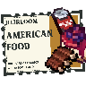

# Visual ID Reference

`visual_id` is the logical name Heirloom asks visual providers to resolve. Nexo, ItemsAdder, CraftEngine, and MMOItems can provide the same logical visual without changing recipes.

| Item | Visual ID | Source |
| --- | --- | --- |
| `AMERICANO` | AMERICANO |  |
| `AMERICAN_BANANA_MILKSHAKE` | AMERICAN_BANANA_MILKSHAKE | Heirloom American Food Pack (Orchard compatibility) |
| `AMERICAN_BBQ_CHEESE_FRIES` | AMERICAN_BBQ_CHEESE_FRIES |  |
| `AMERICAN_BBQ_CHICKEN_WINGS` | AMERICAN_BBQ_CHICKEN_WINGS |  |
| `AMERICAN_BBQ_PULLED_PORK` | AMERICAN_BBQ_PULLED_PORK |  |
| `AMERICAN_BBQ_RIBS` | AMERICAN_BBQ_RIBS |  |
| `AMERICAN_BBQ_SAUCE` | AMERICAN_BBQ_SAUCE |  |
| `AMERICAN_BBQ_SLOPPY_JOE` | AMERICAN_BBQ_SLOPPY_JOE |  |
| `AMERICAN_BERRY_CHEESECAKE` | AMERICAN_BERRY_CHEESECAKE |  |
| `AMERICAN_BLT_SANDWICH` | AMERICAN_BLT_SANDWICH |  |
| `AMERICAN_BROWNIE` | AMERICAN_BROWNIE |  |
| `AMERICAN_BUTTERED_CORN_ON_THE_COB` | AMERICAN_BUTTERED_CORN_ON_THE_COB |  |
| `AMERICAN_CHICKEN_AND_WAFFLES` | AMERICAN_CHICKEN_AND_WAFFLES |  |
| `AMERICAN_CHICKEN_POT_PIE` | AMERICAN_CHICKEN_POT_PIE |  |
| `AMERICAN_CHICKEN_TENDERS` | AMERICAN_CHICKEN_TENDERS |  |
| `AMERICAN_CHOCOLATE_CHEESECAKE` | AMERICAN_CHOCOLATE_CHEESECAKE |  |
| `AMERICAN_CHOCOLATE_MILKSHAKE` | AMERICAN_CHOCOLATE_MILKSHAKE |  |
| `AMERICAN_CHORUS_MILKSHAKE` | AMERICAN_CHORUS_MILKSHAKE |  |
| `AMERICAN_CLUB_SANDWICH` | AMERICAN_CLUB_SANDWICH |  |
| `AMERICAN_COBB_SALAD` | AMERICAN_COBB_SALAD |  |
| `AMERICAN_COLA` | AMERICAN_COLA |  |
| `AMERICAN_COLESLAW` | AMERICAN_COLESLAW |  |
| `AMERICAN_CORNBREAD` | AMERICAN_CORNBREAD |  |
| `AMERICAN_CORN_DOG` | AMERICAN_CORN_DOG |  |
| `AMERICAN_EGG_SALAD_SANDWICH` | AMERICAN_EGG_SALAD_SANDWICH |  |
| `AMERICAN_GLOW_BERRY_MILKSHAKE` | AMERICAN_GLOW_BERRY_MILKSHAKE |  |
| `AMERICAN_HONEY_CARAMEL_MILKSHAKE` | AMERICAN_HONEY_CARAMEL_MILKSHAKE |  |
| `AMERICAN_LEMON_MILKSHAKE` | AMERICAN_LEMON_MILKSHAKE | Heirloom American Food Pack (Orchard compatibility) |
| `AMERICAN_LEMON_SODA` | AMERICAN_LEMON_SODA | Heirloom American Food Pack (Orchard compatibility) |
| `AMERICAN_LOADED_BAKED_POTATO` | AMERICAN_LOADED_BAKED_POTATO |  |
| `AMERICAN_MAYONNAISE` | AMERICAN_MAYONNAISE |  |
| `AMERICAN_MEATLOAF` | AMERICAN_MEATLOAF |  |
| `AMERICAN_MELON_MILKSHAKE` | AMERICAN_MELON_MILKSHAKE |  |
| `AMERICAN_ORANGE_CREAMSICLE_SHAKE` | AMERICAN_ORANGE_CREAMSICLE_SHAKE |  |
| `AMERICAN_ORANGE_SODA` | AMERICAN_ORANGE_SODA |  |
| `AMERICAN_PHILLY_CHEESESTEAK` | AMERICAN_PHILLY_CHEESESTEAK |  |
| `AMERICAN_POTATO_SALAD` | AMERICAN_POTATO_SALAD |  |
| `AMERICAN_RED_VELVET_MILKSHAKE` | AMERICAN_RED_VELVET_MILKSHAKE |  |
| `AMERICAN_ROOT_BEER` | AMERICAN_ROOT_BEER |  |
| `AMERICAN_ROOT_BEER_FLOAT` | AMERICAN_ROOT_BEER_FLOAT |  |
| `AMERICAN_SMORE` | AMERICAN_SMORE |  |
| `AMERICAN_STRAWBERRY_MILKSHAKE` | AMERICAN_STRAWBERRY_MILKSHAKE |  |
| `AMERICAN_VANILLA_CHEESECAKE` | AMERICAN_VANILLA_CHEESECAKE |  |
| `AMERICAN_VANILLA_MILKSHAKE` | AMERICAN_VANILLA_MILKSHAKE |  |
| `ASIAN_BOBA_TEA` | ASIAN_BOBA_TEA |  |
| `ASIAN_CHINESE_FRIED_RICE` | ASIAN_CHINESE_FRIED_RICE |  |
| `ASIAN_DANGO` | ASIAN_DANGO |  |
| `ASIAN_DIM_SUM` | ASIAN_DIM_SUM |  |
| `ASIAN_DUMPLING_MEAT` | ASIAN_DUMPLING_MEAT |  |
| `ASIAN_DUMPLING_SEAFOOD` | ASIAN_DUMPLING_SEAFOOD |  |
| `ASIAN_DUMPLING_VEGETABLE` | ASIAN_DUMPLING_VEGETABLE |  |
| `ASIAN_FEAST_BENTO` | ASIAN_FEAST_BENTO |  |
| `ASIAN_GYOZA` | ASIAN_GYOZA |  |
| `ASIAN_HOT_POT` | ASIAN_HOT_POT |  |
| `ASIAN_MAKI_COD` | ASIAN_MAKI_COD |  |
| `ASIAN_MAKI_MUSHROOM` | ASIAN_MAKI_MUSHROOM |  |
| `ASIAN_MAKI_RAINBOW` | ASIAN_MAKI_RAINBOW |  |
| `ASIAN_MAKI_SALMON` | ASIAN_MAKI_SALMON |  |
| `ASIAN_MAKI_TAMAGO` | ASIAN_MAKI_TAMAGO |  |
| `ASIAN_MAKI_VEGETABLE` | ASIAN_MAKI_VEGETABLE |  |
| `ASIAN_MATCHA_ICE_CREAM` | ASIAN_MATCHA_ICE_CREAM |  |
| `ASIAN_MISO_SOUP` | ASIAN_MISO_SOUP |  |
| `ASIAN_MOCHI` | ASIAN_MOCHI |  |
| `ASIAN_MOCHI_BERRY` | ASIAN_MOCHI_BERRY |  |
| `ASIAN_MOCHI_MATCHA` | ASIAN_MOCHI_MATCHA |  |
| `ASIAN_NIGIRI_COD` | ASIAN_NIGIRI_COD |  |
| `ASIAN_NIGIRI_MUSHROOM` | ASIAN_NIGIRI_MUSHROOM |  |
| `ASIAN_NIGIRI_SALMON` | ASIAN_NIGIRI_SALMON |  |
| `ASIAN_NIGIRI_TAMAGO` | ASIAN_NIGIRI_TAMAGO |  |
| `ASIAN_NIGIRI_TOFU` | ASIAN_NIGIRI_TOFU |  |
| `ASIAN_NIGIRI_TROPICAL` | ASIAN_NIGIRI_TROPICAL |  |
| `ASIAN_NIGIRI_UNAGI` | ASIAN_NIGIRI_UNAGI |  |
| `ASIAN_PEKING_DUCK` | ASIAN_PEKING_DUCK |  |
| `ASIAN_POKE_BOWL_COD` | ASIAN_POKE_BOWL_COD |  |
| `ASIAN_POKE_BOWL_SALMON` | ASIAN_POKE_BOWL_SALMON |  |
| `ASIAN_POKE_BOWL_TROPICAL` | ASIAN_POKE_BOWL_TROPICAL |  |
| `ASIAN_PORK_BAO` | ASIAN_PORK_BAO |  |
| `ASIAN_PORTABLE_BENTO` | ASIAN_PORTABLE_BENTO |  |
| `ASIAN_RICE_FLOUR` | ASIAN_RICE_FLOUR |  |
| `ASIAN_RICE_NOODLES` | ASIAN_RICE_NOODLES |  |
| `ASIAN_SASHIMI_COD` | ASIAN_SASHIMI_COD |  |
| `ASIAN_SASHIMI_PUFFERFISH` | ASIAN_SASHIMI_PUFFERFISH |  |
| `ASIAN_SASHIMI_SALMON` | ASIAN_SASHIMI_SALMON |  |
| `ASIAN_SASHIMI_TROPICAL` | ASIAN_SASHIMI_TROPICAL |  |
| `ASIAN_SHOYU_RAMEN` | ASIAN_SHOYU_RAMEN |  |
| `ASIAN_SPRING_ROLL` | ASIAN_SPRING_ROLL |  |
| `ASIAN_SUSHI_RICE` | ASIAN_SUSHI_RICE |  |
| `ASIAN_TAKOYAKI` | ASIAN_TAKOYAKI |  |
| `ASIAN_TERIYAKI_BOWL` | ASIAN_TERIYAKI_BOWL |  |
| `ASIAN_TONKOTSU_RAMEN` | ASIAN_TONKOTSU_RAMEN |  |
| `ASIAN_UDON` | ASIAN_UDON |  |
| `AVOCADO` | AVOCADO |  |
| `BANANAS` | BANANAS |  |
| `BANANA_PANCAKES` | BANANA_PANCAKES |  |
| `BANANA_SPLIT_SUNDAE` | BANANA_SPLIT_SUNDAE |  |
| `BLACK_TEA` | BLACK_TEA |  |
| `BLACK_TEA_LEAVES` | BLACK_TEA_LEAVES |  |
| `BOBA_TEA` | BOBA_TEA |  |
| `BRIE` | BRIE |  |
| `BRINE` | BRINE |  |
| `BRUNOST` | BRUNOST |  |
| `BUTTERMILK` | BUTTERMILK |  |
| `CAPPUCCINO` | CAPPUCCINO |  |
| `CASU_MARTZU` | CASU_MARTZU |  |
| `CHEDDAR` | CHEDDAR |  |
| `CHEESE_SAUSAGE` | CHEESE_SAUSAGE |  |
| `COCONUT` | COCONUT |  |
| `COCONUT_DRINK` | COCONUT_DRINK |  |
| `COCONUT_MILK` | COCONUT_MILK |  |
| `COFFEE_BEANS_DARK` | COFFEE_BEANS_DARK |  |
| `COFFEE_BEANS_LIGHT` | COFFEE_BEANS_LIGHT |  |
| `COFFEE_BEANS_MEDIUM` | COFFEE_BEANS_MEDIUM |  |
| `COFFEE_CHERRY` | COFFEE_CHERRY |  |
| `COFFEE_DRINK` | ESPRESSO |  |
| `CROTTIN_STYLE_GOAT` | CROTTIN_STYLE_GOAT |  |
| `DRIED_GREEN_TEA` | DRIED_GREEN_TEA |  |
| `EMMENTAL` | EMMENTAL |  |
| `ESPRESSO` | ESPRESSO |  |
| `FETA` | FETA |  |
| `FLAT_WHITE` | FLAT_WHITE |  |
| `FRENCH_FRIED_FROG_LEGS` | FRENCH_FRIED_FROG_LEGS |  |
| `FRESH_CURDS` | FRESH_CURDS |  |
| `GARLIC` | GARLIC |  |
| `GARLIC_BREAD` | GARLIC_BREAD |  |
| `GARLIC_PORK_SAUSAGE` | GARLIC_PORK_SAUSAGE |  |
| `GHEE` | GHEE |  |
| `GORGONZOLA_STYLE_BLUE` | GORGONZOLA_STYLE_BLUE |  |
| `GOUDA` | GOUDA |  |
| `GREEN_TEA` | GREEN_TEA |  |
| `HALLOUMI` | HALLOUMI |  |
| `HOT_COCOA` | HOT_COCOA |  |
| `HOT_DOG` | HOT_DOG |  |
| `ICED_COFFEE` | ICED_COFFEE |  |
| `LATTE` | LATTE |  |
| `LEMON` | LEMON |  |
| `MANCHEGO` | MANCHEGO |  |
| `MANGO` | MANGO |  |
| `MAROILLES_STYLE_WASHED_RIND` | MAROILLES_STYLE_WASHED_RIND |  |
| `MATCHA_LATTE` | MATCHA_LATTE |  |
| `MATCHA_POWDER` | MATCHA_POWDER |  |
| `MINCED_BEEF` | MINCED_BEEF |  |
| `MINCED_GOAT` | MINCED_GOAT |  |
| `MINCED_MUTTON` | MINCED_MUTTON |  |
| `MINCED_PORK` | MINCED_PORK |  |
| `MOCHA` | MOCHA |  |
| `MOZZARELLA` | MOZZARELLA |  |
| `MUFFIN` | MUFFIN |  |
| `OAT_MILK` | OAT_MILK |  |
| `ORANGE` | ORANGE |  |
| `ORCHARD_ABSINTHE` | ORCHARD_ABSINTHE |  |
| `ORCHARD_AMERICANO` | ORCHARD_AMERICANO |  |
| `ORCHARD_AROMATIC_BITTERS` | ORCHARD_AROMATIC_BITTERS |  |
| `ORCHARD_B52` | ORCHARD_B52 |  |
| `ORCHARD_BEES_KNEES` | ORCHARD_BEES_KNEES |  |
| `ORCHARD_BLACK_RUSSIAN` | ORCHARD_BLACK_RUSSIAN |  |
| `ORCHARD_BLOODY_MARY` | ORCHARD_BLOODY_MARY |  |
| `ORCHARD_BOULEVARDIER` | ORCHARD_BOULEVARDIER |  |
| `ORCHARD_CLASSIC_DAIQUIRI` | ORCHARD_CLASSIC_DAIQUIRI |  |
| `ORCHARD_COFFEE_LIQUEUR` | ORCHARD_COFFEE_LIQUEUR |  |
| `ORCHARD_CORPSE_REVIVER_NO_2` | ORCHARD_CORPSE_REVIVER_NO_2 |  |
| `ORCHARD_COSMOPOLITAN` | ORCHARD_COSMOPOLITAN |  |
| `ORCHARD_DEATH_IN_THE_AFTERNOON` | ORCHARD_DEATH_IN_THE_AFTERNOON |  |
| `ORCHARD_DRY_MARTINI` | ORCHARD_DRY_MARTINI |  |
| `ORCHARD_ESPRESSO_MARTINI` | ORCHARD_ESPRESSO_MARTINI |  |
| `ORCHARD_GARIBALDI` | ORCHARD_GARIBALDI |  |
| `ORCHARD_GIN` | ORCHARD_GIN |  |
| `ORCHARD_GIN_AND_TONIC` | ORCHARD_GIN_AND_TONIC |  |
| `ORCHARD_GROVE_STARTER_PACKET` | ORCHARD_GROVE_STARTER_PACKET |  |
| `ORCHARD_GUACAMOLE` | ORCHARD_GUACAMOLE |  |
| `ORCHARD_IRISH_CREAM_LIQUEUR` | ORCHARD_IRISH_CREAM_LIQUEUR |  |
| `ORCHARD_IRISH_CREAM_MILKSHAKE` | ORCHARD_IRISH_CREAM_MILKSHAKE |  |
| `ORCHARD_JOHN_COLLINS` | ORCHARD_JOHN_COLLINS |  |
| `ORCHARD_LONG_ISLAND_ICED_TEA` | ORCHARD_LONG_ISLAND_ICED_TEA |  |
| `ORCHARD_MANHATTAN` | ORCHARD_MANHATTAN |  |
| `ORCHARD_MARGARITA` | ORCHARD_MARGARITA |  |
| `ORCHARD_MOJITO` | ORCHARD_MOJITO |  |
| `ORCHARD_MUDSLIDE` | ORCHARD_MUDSLIDE |  |
| `ORCHARD_NEGRONI` | ORCHARD_NEGRONI |  |
| `ORCHARD_OLD_FASHIONED` | ORCHARD_OLD_FASHIONED |  |
| `ORCHARD_ORANGE_CHICKEN` | ORCHARD_ORANGE_CHICKEN |  |
| `ORCHARD_ORANGE_LIQUEUR` | ORCHARD_ORANGE_LIQUEUR |  |
| `ORCHARD_RED_BITTER_APERITIF` | ORCHARD_RED_BITTER_APERITIF |  |
| `ORCHARD_RUM` | ORCHARD_RUM |  |
| `ORCHARD_RUM_OLD_FASHIONED` | ORCHARD_RUM_OLD_FASHIONED |  |
| `ORCHARD_SAZERAC` | ORCHARD_SAZERAC |  |
| `ORCHARD_SPARKLING_LEMONADE` | ORCHARD_SPARKLING_LEMONADE |  |
| `ORCHARD_SWEET_VERMOUTH` | ORCHARD_SWEET_VERMOUTH |  |
| `ORCHARD_TEQUILA` | ORCHARD_TEQUILA |  |
| `ORCHARD_TROPICAL_STARTER_PACKET` | ORCHARD_TROPICAL_STARTER_PACKET |  |
| `ORCHARD_VIRGIN_BANANA_DAIQUIRI` | ORCHARD_VIRGIN_BANANA_DAIQUIRI |  |
| `ORCHARD_VIRGIN_MANGO_DAIQUIRI` | ORCHARD_VIRGIN_MANGO_DAIQUIRI |  |
| `ORCHARD_VIRGIN_MOJITO` | ORCHARD_VIRGIN_MOJITO |  |
| `ORCHARD_VODKA` | ORCHARD_VODKA |  |
| `ORCHARD_WHISKEY` | ORCHARD_WHISKEY |  |
| `ORCHARD_WHISKEY_SOUR` | ORCHARD_WHISKEY_SOUR |  |
| `ORCHARD_WHITE_LADY` | ORCHARD_WHITE_LADY |  |
| `ORCHARD_WHITE_RUSSIAN` | ORCHARD_WHITE_RUSSIAN |  |
| `ORCHARD_YELLOW_COCONUT_CURRY` | ORCHARD_YELLOW_COCONUT_CURRY |  |
| `PANEER` | PANEER |  |
| `PARMESAN_STYLE` | PARMESAN_STYLE |  |
| `PIG_CASINGS` | PIG_CASINGS |  |
| `PINA_COLADA` | PINA_COLADA |  |
| `PINEAPPLE` | PINEAPPLE |  |
| `PLAIN_LINKS` | PLAIN_LINKS |  |
| `PREPARED_CHEESE` | PREPARED_CHEESE |  |
| `PROVOLONE_STYLE` | PROVOLONE_STYLE |  |
| `RAW_FROG_LEGS` | RAW_FROG_LEGS |  |
| `RICOTTA` | RICOTTA |  |
| `ROQUEFORT_STYLE_BLUE` | ROQUEFORT_STYLE_BLUE |  |
| `SWEDISH_POTATO_SAUSAGE` | SWEDISH_POTATO_SAUSAGE |  |
| `SWEET_TEA` | SWEET_TEA |  |
| `TEA_DRINK` | GREEN_TEA |  |
| `TROPICAL_FRUIT_SALAD` | TROPICAL_FRUIT_SALAD |  |
| `WHEY` | WHEY |  |
| `YOGURT` | YOGURT |  |
| `YOUNG_CHEESE_WHEEL` | YOUNG_CHEESE_WHEEL |  |
