# Boiling Pot

## Build

Build a Boiling Pot with a `CAULDRON` or `WATER_CAULDRON` over a `CAMPFIRE` or `SOUL_CAMPFIRE`.

<figure class="hl-figure">
  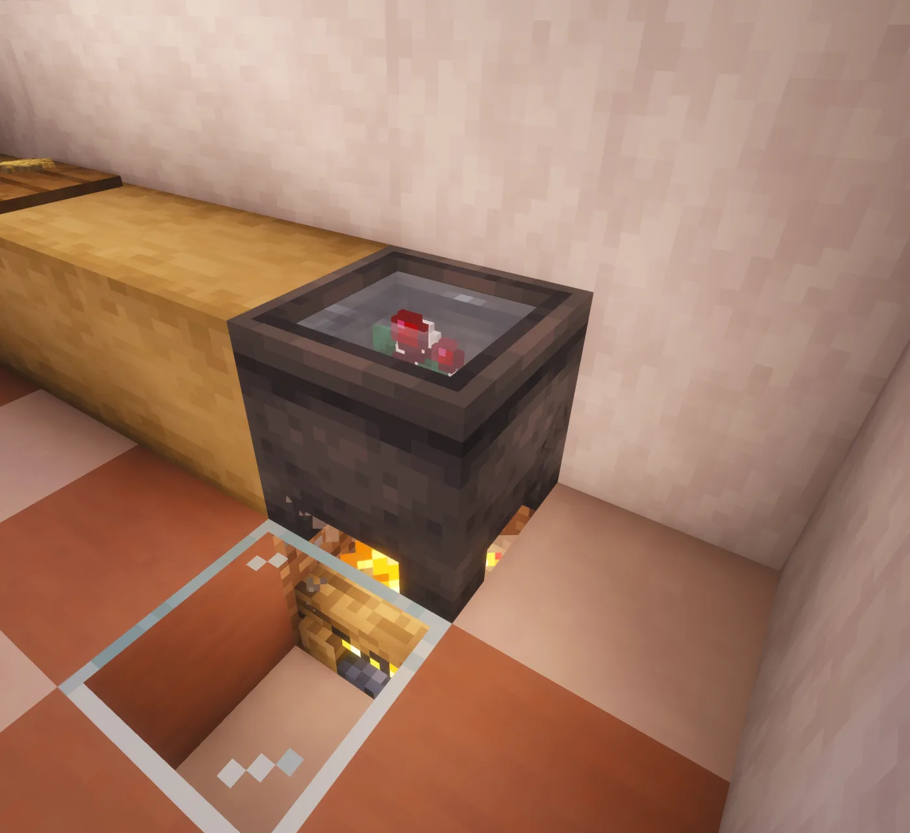
  <figcaption>Boiling Pot station built over a campfire.</figcaption>
</figure>

<figure class="hl-figure">
  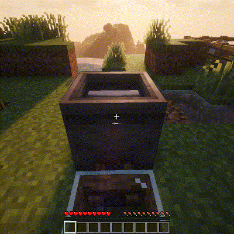
  <figcaption>Boiling Pot cooking flow with visible station effects.</figcaption>
</figure>

## Core Loop

The Boiling Pot handles wet recipes, soups, cheese, rice, pasta, and recipes that return buckets or bottles.

## How Recipes Behave Here

The Boiling Pot is the liquid and simmering station. It handles soups, rice, pasta, cheese, jam, wet ingredient conversions, and recipes that care about buckets or bottles. It is also where property stacking becomes easy to understand: jam can become an ingredient in later foods while keeping the food properties created from its fruit.

## Common Chains

- Fruit + sugar + bottle -> `JAM`; glow berries, golden apples, and chorus fruit can add food properties to the jam.
- `RICE` + water -> `COOKED_RICE`, which then feeds sushi and fried rice chains.
- Milk bucket -> `CHEESE`, and milk plus vinegar can produce the alternate cheese path.
- Distillery grain and rice wort can ferment raw; use the Boiling Pot first for full process-quality credit. Boiling does not change ABV.

## Good First Recipes

Try `COOKED_RICE`, `CHEESE`, then `JAM`. Those three cover water inputs, bucket returns, bottle returns, and property-carrying ingredients.

## What Can Go Wrong

A bucket can be either a normal Minecraft interaction or a recipe ingredient. If you are testing a recipe, interact normally with the station and avoid vanilla cauldron habits. If the output keeps the wrong flavor or property, inspect the recipe rules: properties come from matching ingredient rules and from inherited input data.

## Recipes

| Recipe | Output | Inputs | Source |
| --- | --- | --- | --- |
| [`ACID_SET_FRESH_CHEESE`](../recipes/default-recipes.md#recipe-acid-set-fresh-cheese) | 1× <a class="hl-output-item" href="../../recipes/default-recipes/#recipe-acid-set-fresh-cheese">PANEER</a> | or0-1 |  |
| [`ASIAN_DANGO`](../recipes/default-recipes.md#recipe-asian-dango) | 1× <a class="hl-output-item" href="../../recipes/default-recipes/#recipe-asian-dango">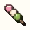ASIAN_DANGO</a> |  |  |
| [`ASIAN_DIM_SUM`](../recipes/default-recipes.md#recipe-asian-dim-sum) | 1× <a class="hl-output-item" href="../../recipes/default-recipes/#recipe-asian-dim-sum">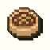ASIAN_DIM_SUM</a> | 1-2<a class="hl-icon-link" href="../../reference/items/#item-minced-meat">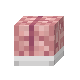</a> |  |
| [`ASIAN_DUMPLINGS`](../recipes/default-recipes.md#recipe-asian-dumplings) | 1× <a class="hl-output-item" href="../../recipes/default-recipes/#recipe-asian-dumplings">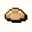ASIAN_DUMPLING_MEAT</a>Default Meat Dumplings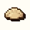Vegetable Dumplings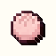Seafood Dumplings | oror<a class="hl-icon-link" href="../../reference/vanilla-items/#vanilla-item-cod">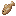</a> |  |
| [`ASIAN_HOT_POT`](../recipes/default-recipes.md#recipe-asian-hot-pot) | 1× <a class="hl-output-item" href="../../recipes/default-recipes/#recipe-asian-hot-pot">ASIAN_HOT_POT</a> | oror<a class="hl-icon-link" href="../../reference/vanilla-items/#vanilla-item-salmon">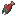</a>or |  |
| [`ASIAN_MISO_SOUP`](../recipes/default-recipes.md#recipe-asian-miso-soup) | 1× <a class="hl-output-item" href="../../recipes/default-recipes/#recipe-asian-miso-soup">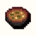ASIAN_MISO_SOUP</a> |  |  |
| [`ASIAN_PORK_BAO`](../recipes/default-recipes.md#recipe-asian-pork-bao) | 1× <a class="hl-output-item" href="../../recipes/default-recipes/#recipe-asian-pork-bao">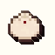ASIAN_PORK_BAO</a> |  |  |
| [`ASIAN_SHOYU_RAMEN`](../recipes/default-recipes.md#recipe-asian-shoyu-ramen) | 1× <a class="hl-output-item" href="../../recipes/default-recipes/#recipe-asian-shoyu-ramen">ASIAN_SHOYU_RAMEN</a> | <a class="hl-icon-link" href="../../reference/items/#item-asian-rice-noodles">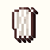</a>or0-1 |  |
| [`ASIAN_SUSHI_RICE`](../recipes/default-recipes.md#recipe-asian-sushi-rice) | 1× <a class="hl-output-item" href="../../recipes/default-recipes/#recipe-asian-sushi-rice">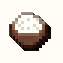ASIAN_SUSHI_RICE</a> | <a class="hl-icon-link" href="../../reference/items/#item-rice">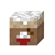</a>1-20-1 |  |
| [`ASIAN_TONKOTSU_RAMEN`](../recipes/default-recipes.md#recipe-asian-tonkotsu-ramen) | 1× <a class="hl-output-item" href="../../recipes/default-recipes/#recipe-asian-tonkotsu-ramen">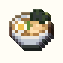ASIAN_TONKOTSU_RAMEN</a> | or0-1 |  |
| [`ASIAN_UDON`](../recipes/default-recipes.md#recipe-asian-udon) | 1× <a class="hl-output-item" href="../../recipes/default-recipes/#recipe-asian-udon">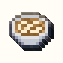ASIAN_UDON</a> | or0-1 |  |
| [`CANDY_APPLE`](../recipes/default-recipes.md#recipe-candy-apple) | 1× <a class="hl-output-item" href="../../recipes/default-recipes/#recipe-candy-apple">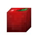CANDY_APPLE</a>Default Candy Apple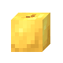Golden Candy Apple | or1-2 |  |
| [`CANDY_CORN`](../recipes/default-recipes.md#recipe-candy-corn) | 1× <a class="hl-output-item" href="../../recipes/default-recipes/#recipe-candy-corn">CANDY_CORN</a> | 1-2 |  |
| [`CANNED_TOMATOES`](../recipes/default-recipes.md#recipe-canned-tomatoes) | 1× <a class="hl-output-item" href="../../recipes/default-recipes/#recipe-canned-tomatoes">CANNED_TOMATOES</a> | <a class="hl-icon-link" href="../../reference/items/#item-tin-can">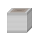</a> |  |
| [`CHEESE`](../recipes/default-recipes.md#recipe-cheese) | 1× <a class="hl-output-item" href="../../recipes/default-recipes/#recipe-cheese">CHEESE</a> |  |  |
| [`CHOCOLATE_EGG`](../recipes/default-recipes.md#recipe-chocolate-egg) | 1× <a class="hl-output-item" href="../../recipes/default-recipes/#recipe-chocolate-egg">CHOCOLATE_EGG</a> |  |  |
| [`COOKED_RICE`](../recipes/default-recipes.md#recipe-cooked-rice) | 1× <a class="hl-output-item" href="../../recipes/default-recipes/#recipe-cooked-rice">COOKED_RICE</a> | 0-1 |  |
| [`CURD_MIXED_MILK`](../recipes/default-recipes.md#recipe-curd-mixed-milk) | 1× <a class="hl-output-item" href="../../recipes/default-recipes/#recipe-curd-mixed-milk">FRESH_CURDS</a> | ororororor3 |  |
| [`DOUGHNUT`](../recipes/default-recipes.md#recipe-doughnut) | 1× <a class="hl-output-item" href="../../recipes/default-recipes/#recipe-doughnut">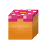DOUGHNUT</a>Default Doughnut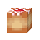Jelly Doughnut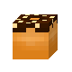Chocolate Doughnut | 0-1oror0-1 |  |
| [`FISH_AND_CHIPS`](../recipes/default-recipes.md#recipe-fish-and-chips) | 1× <a class="hl-output-item" href="../../recipes/default-recipes/#recipe-fish-and-chips">FISH_AND_CHIPS</a> | oror<a class="hl-icon-link" href="../../reference/items/#item-cornmeal">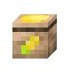</a> |  |
| [`FRIED_CHICKEN`](../recipes/default-recipes.md#recipe-fried-chicken) | 1× <a class="hl-output-item" href="../../recipes/default-recipes/#recipe-fried-chicken">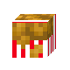FRIED_CHICKEN</a> | or |  |
| [`FRIES`](../recipes/default-recipes.md#recipe-fries) | 1× <a class="hl-output-item" href="../../recipes/default-recipes/#recipe-fries">FRIES</a> | 1-20-1 |  |
| [`JAM`](../recipes/default-recipes.md#recipe-jam) | 1× <a class="hl-output-item" href="../../recipes/default-recipes/#recipe-jam">JAM</a>Default JamApple JamBerry Jam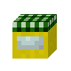Glow Jam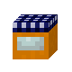Golden JamMelon Jam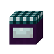Chorus Jam | ororororororororor<a class="hl-icon-link" href="../../reference/items/#item-pineapple">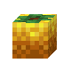</a>1-3 |  |
| [`MAC_AND_CHEESE`](../recipes/default-recipes.md#recipe-mac-and-cheese) | 1× <a class="hl-output-item" href="../../recipes/default-recipes/#recipe-mac-and-cheese">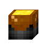MAC_AND_CHEESE</a> | or0-10-1 |  |
| [`MAKE_GHEE`](../recipes/default-recipes.md#recipe-make-ghee) | 1× <a class="hl-output-item" href="../../recipes/default-recipes/#recipe-make-ghee">GHEE</a> |  |  |
| [`MASHED_POTATOES`](../recipes/default-recipes.md#recipe-mashed-potatoes) | 1× <a class="hl-output-item" href="../../recipes/default-recipes/#recipe-mashed-potatoes">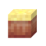MASHED_POTATOES</a> | 20-1 |  |
| [`ORCHARD_RUM`](../recipes/default-recipes.md#recipe-orchard-rum) | 1× <a class="hl-output-item" href="../../recipes/default-recipes/#recipe-orchard-rum">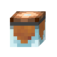ORCHARD_RUM</a> | 3 |  Distillery absent |
| [`ORCHARD_TEQUILA`](../recipes/default-recipes.md#recipe-orchard-tequila) | 1× <a class="hl-output-item" href="../../recipes/default-recipes/#recipe-orchard-tequila">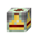ORCHARD_TEQUILA</a> | 3 |  Distillery absent |
| [`ORCHARD_VODKA`](../recipes/default-recipes.md#recipe-orchard-vodka) | 1× <a class="hl-output-item" href="../../recipes/default-recipes/#recipe-orchard-vodka">ORCHARD_VODKA</a> | 4 |  Distillery absent |
| [`ORCHARD_WHISKEY`](../recipes/default-recipes.md#recipe-orchard-whiskey) | 1× <a class="hl-output-item" href="../../recipes/default-recipes/#recipe-orchard-whiskey">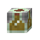ORCHARD_WHISKEY</a> | 3 |  Distillery absent |
| [`ORCHARD_YELLOW_COCONUT_CURRY`](../recipes/default-recipes.md#recipe-orchard-yellow-coconut-curry) | 1× <a class="hl-output-item" href="../../recipes/default-recipes/#recipe-orchard-yellow-coconut-curry">ORCHARD_YELLOW_COCONUT_CURRY</a> |  |  All Mixology modes |
| [`PASTA_BOLOGNESE`](../recipes/default-recipes.md#recipe-pasta-bolognese) | 1× <a class="hl-output-item" href="../../recipes/default-recipes/#recipe-pasta-bolognese">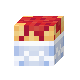PASTA_BOLOGNESE</a> | or |  |
| [`REDUCE_WHEY_BRUNOST`](../recipes/default-recipes.md#recipe-reduce-whey-brunost) | 1× <a class="hl-output-item" href="../../recipes/default-recipes/#recipe-reduce-whey-brunost">BRUNOST</a> | 3 |  |
| [`REHEAT_WHEY_RICOTTA`](../recipes/default-recipes.md#recipe-reheat-whey-ricotta) | 1× <a class="hl-output-item" href="../../recipes/default-recipes/#recipe-reheat-whey-ricotta">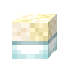RICOTTA</a> | 3or |  |
| [`SECOND_BOIL_CURDS`](../recipes/default-recipes.md#recipe-second-boil-curds) | 1× <a class="hl-output-item" href="../../recipes/default-recipes/#recipe-second-boil-curds">FRESH_CURDS</a> |  |  |
| [`STRETCH_FRESH_CHEESE`](../recipes/default-recipes.md#recipe-stretch-fresh-cheese) | 1× <a class="hl-output-item" href="../../recipes/default-recipes/#recipe-stretch-fresh-cheese">MOZZARELLA</a> | 0-1 |  |
| [`TOMATO_SOUP`](../recipes/default-recipes.md#recipe-tomato-soup) | 1× <a class="hl-output-item" href="../../recipes/default-recipes/#recipe-tomato-soup">TOMATO_SOUP</a> | 0-1 |  |
| [`WATER_WASH_CURDS`](../recipes/default-recipes.md#recipe-water-wash-curds) | 1× <a class="hl-output-item" href="../../recipes/default-recipes/#recipe-water-wash-curds">FRESH_CURDS</a> |  |  |
| [`WHEY_COOK_FRESH_CHEESE`](../recipes/default-recipes.md#recipe-whey-cook-fresh-cheese) | 1× <a class="hl-output-item" href="../../recipes/default-recipes/#recipe-whey-cook-fresh-cheese">HALLOUMI</a> | 0-1 |  |

## Troubleshooting

Water buckets are recipe ingredients for some recipes. Avoid sneak-right-clicking when you mean to add the bucket as an ingredient, because sneak interaction may allow vanilla cauldron behavior.

See the full [recipe index](../recipes/default-recipes.md) for ingredient links, processing time, recipe rules, and output actions.
