# Frying Pan

## Build

Build a Frying Pan with a `HEAVY_WEIGHTED_PRESSURE_PLATE` on top of a `FURNACE`.

<figure class="hl-figure">
  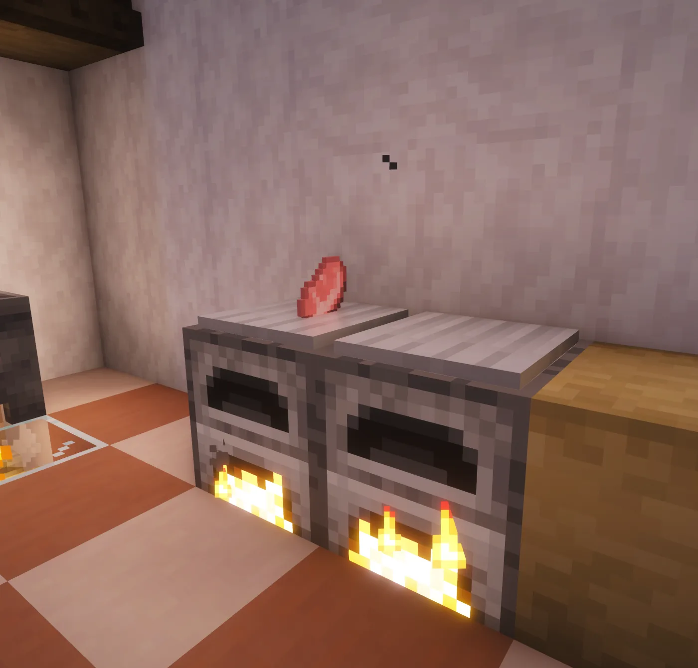
  <figcaption>Frying Pan station built from a heavy weighted pressure plate on a furnace.</figcaption>
</figure>

## Core Loop

The Frying Pan handles eggs, bacon, pancakes, fried rice, and other fast heated foods.

## How Recipes Behave Here

The Frying Pan is fast heat. It handles eggs, bacon, pancakes, fried rice, and other foods where toppings and optional ingredients change the final item. This station is one of the clearest places to see inherited properties: a special jam used as a pancake topping can carry `CHORUS`, `GOLDEN`, or other properties into the finished pancakes.

## Common Chains

- Eggs and bacon prove the station works with simple vanilla inputs.
- `PANCAKES` accept flour/cornmeal, eggs, milk, and optional toppings such as `JAM`, honey, or chocolate.
- `FRIED_RICE` and similar recipes usually depend on rice being cooked first at the Boiling Pot.

## Good First Recipes

Cook a plain egg, then pancakes, then pancakes with a custom jam. Compare the lore: the topping can change name, quality, return behavior, and inherited food properties.

## What Can Go Wrong

The recipe can be valid but still produce a plain-looking result if the optional ingredient did not match the rule you expected. For example, bundled honey pancakes add honey naming, quality, and bottle return behavior; they do not add `SWEET` unless a recipe or custom ingredient explicitly stores that food property.

## Recipes

| Recipe | Output | Inputs | Source |
| --- | --- | --- | --- |
| [`AMERICAN_BBQ_CHEESE_FRIES`](../recipes/default-recipes.md#recipe-american-bbq-cheese-fries) | 1× <a class="hl-output-item" href="../../recipes/default-recipes/#recipe-american-bbq-cheese-fries">AMERICAN_BBQ_CHEESE_FRIES</a> |  | 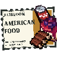 |
| [`AMERICAN_BBQ_SLOPPY_JOE`](../recipes/default-recipes.md#recipe-american-bbq-sloppy-joe) | 1× <a class="hl-output-item" href="../../recipes/default-recipes/#recipe-american-bbq-sloppy-joe">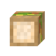AMERICAN_BBQ_SLOPPY_JOE</a> | <a class="hl-icon-link" href="../../reference/items/#item-minced-meat">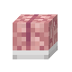</a><a class="hl-icon-link" href="../../reference/items/#item-bread">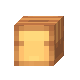</a>or |  |
| [`AMERICAN_BUTTERED_CORN_ON_THE_COB`](../recipes/default-recipes.md#recipe-american-buttered-corn-on-the-cob) | 1× <a class="hl-output-item" href="../../recipes/default-recipes/#recipe-american-buttered-corn-on-the-cob">AMERICAN_BUTTERED_CORN_ON_THE_COB</a> |  |  |
| [`AMERICAN_CHICKEN_TENDERS`](../recipes/default-recipes.md#recipe-american-chicken-tenders) | 1× <a class="hl-output-item" href="../../recipes/default-recipes/#recipe-american-chicken-tenders">AMERICAN_CHICKEN_TENDERS</a> | ororor |  |
| [`AMERICAN_CORN_DOG`](../recipes/default-recipes.md#recipe-american-corn-dog) | 1× <a class="hl-output-item" href="../../recipes/default-recipes/#recipe-american-corn-dog">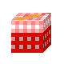AMERICAN_CORN_DOG</a> |  |  |
| [`AMERICAN_PHILLY_CHEESESTEAK`](../recipes/default-recipes.md#recipe-american-philly-cheesesteak) | 1× <a class="hl-output-item" href="../../recipes/default-recipes/#recipe-american-philly-cheesesteak">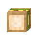AMERICAN_PHILLY_CHEESESTEAK</a> | oror<a class="hl-icon-link" href="../../reference/items/#item-onion">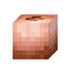</a> |  |
| [`ASIAN_GYOZA`](../recipes/default-recipes.md#recipe-asian-gyoza) | 1× <a class="hl-output-item" href="../../recipes/default-recipes/#recipe-asian-gyoza">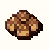ASIAN_GYOZA</a> | <a class="hl-icon-link" href="../../reference/items/#item-asian-dumpling-meat">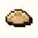</a>or<a class="hl-icon-link" href="../../reference/items/#item-asian-dumpling-vegetable">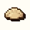</a>or |  |
| [`ASIAN_SPRING_ROLL`](../recipes/default-recipes.md#recipe-asian-spring-roll) | 1× <a class="hl-output-item" href="../../recipes/default-recipes/#recipe-asian-spring-roll">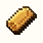ASIAN_SPRING_ROLL</a> | or |  |
| [`ASIAN_TAKOYAKI`](../recipes/default-recipes.md#recipe-asian-takoyaki) | 1× <a class="hl-output-item" href="../../recipes/default-recipes/#recipe-asian-takoyaki">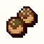ASIAN_TAKOYAKI</a> | <a class="hl-icon-link" href="../../reference/vanilla-items/#vanilla-item-cod">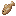</a> |  |
| [`ASIAN_TERIYAKI_BOWL`](../recipes/default-recipes.md#recipe-asian-teriyaki-bowl) | 1× <a class="hl-output-item" href="../../recipes/default-recipes/#recipe-asian-teriyaki-bowl">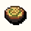ASIAN_TERIYAKI_BOWL</a> | <a class="hl-icon-link" href="../../reference/items/#item-cooked-rice">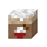</a> |  |
| [`BACON`](../recipes/default-recipes.md#recipe-bacon) | 1× <a class="hl-output-item" href="../../recipes/default-recipes/#recipe-bacon">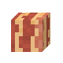BACON</a> |  |  |
| [`COOK_GOAT_MEAT`](../recipes/default-recipes.md#recipe-cook-goat-meat) | 1× <a class="hl-output-item" href="../../recipes/default-recipes/#recipe-cook-goat-meat">COOKED_GOAT_MEAT</a> |  |  |
| [`EGGS_AND_BACON`](../recipes/default-recipes.md#recipe-eggs-and-bacon) | 1× <a class="hl-output-item" href="../../recipes/default-recipes/#recipe-eggs-and-bacon">EGGS_AND_BACON</a> | oror1-2 |  |
| [`FALAFEL`](../recipes/default-recipes.md#recipe-falafel) | 1× <a class="hl-output-item" href="../../recipes/default-recipes/#recipe-falafel">FALAFEL</a> | or1-2<a class="hl-icon-link" href="../../reference/items/#item-cooking-oil">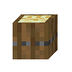</a> |  |
| [`FLATBREAD`](../recipes/default-recipes.md#recipe-flatbread) | 1× <a class="hl-output-item" href="../../recipes/default-recipes/#recipe-flatbread">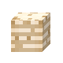FLATBREAD</a> |  |  |
| [`FRENCH_TOAST`](../recipes/default-recipes.md#recipe-french-toast) | 1× <a class="hl-output-item" href="../../recipes/default-recipes/#recipe-french-toast">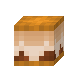FRENCH_TOAST</a> | ororor |  |
| [`FRIED_EGG`](../recipes/default-recipes.md#recipe-fried-egg) | 1× <a class="hl-output-item" href="../../recipes/default-recipes/#recipe-fried-egg">FRIED_EGG</a> | oror1-3 |  |
| [`FRIED_RICE`](../recipes/default-recipes.md#recipe-fried-rice) | 1× <a class="hl-output-item" href="../../recipes/default-recipes/#recipe-fried-rice">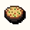FRIED_RICE</a> | oror0-10-10-10-1 |  |
| [`FRY_FRENCH_FROG_LEGS`](../recipes/default-recipes.md#recipe-fry-french-frog-legs) | 1× <a class="hl-output-item" href="../../recipes/default-recipes/#recipe-fry-french-frog-legs">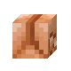FRENCH_FRIED_FROG_LEGS</a> | <a class="hl-icon-link" href="../../reference/items/#item-raw-frog-legs">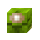</a> |  |
| [`FRY_HOT_DOG`](../recipes/default-recipes.md#recipe-fry-hot-dog) | 1× <a class="hl-output-item" href="../../recipes/default-recipes/#recipe-fry-hot-dog">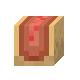HOT_DOG</a> | <a class="hl-icon-link" href="../../reference/items/#item-plain-links">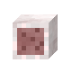</a> |  |
| [`GRILLED_CHEESE`](../recipes/default-recipes.md#recipe-grilled-cheese) | 1× <a class="hl-output-item" href="../../recipes/default-recipes/#recipe-grilled-cheese">GRILLED_CHEESE</a> | oror |  |
| [`HAMBURGER`](../recipes/default-recipes.md#recipe-hamburger) | 1× <a class="hl-output-item" href="../../recipes/default-recipes/#recipe-hamburger">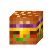HAMBURGER</a>Default Hamburger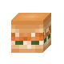Chicken Burger | orororor0-10-10-1 |  |
| [`OMELETTE`](../recipes/default-recipes.md#recipe-omelette) | 1× <a class="hl-output-item" href="../../recipes/default-recipes/#recipe-omelette">OMELETTE</a> | oror1-3or0-10-10-10-1 |  |
| [`ORCHARD_ORANGE_CHICKEN`](../recipes/default-recipes.md#recipe-orchard-orange-chicken) | 1× <a class="hl-output-item" href="../../recipes/default-recipes/#recipe-orchard-orange-chicken">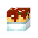ORCHARD_ORANGE_CHICKEN</a> | <a class="hl-icon-link" href="../../reference/items/#item-orange">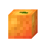</a> |  All Mixology modes |
| [`PANCAKES`](../recipes/default-recipes.md#recipe-pancakes) | 1× <a class="hl-output-item" href="../../recipes/default-recipes/#recipe-pancakes">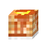PANCAKES</a> | or<a class="hl-icon-link" href="../../reference/items/#item-cornmeal">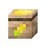</a>orororor0-3 |  |
| [`POPCORN`](../recipes/default-recipes.md#recipe-popcorn) | 1× <a class="hl-output-item" href="../../recipes/default-recipes/#recipe-popcorn">POPCORN</a> |  |  |

## Troubleshooting

If a recipe does not match, use `/hl search <ingredient>` and confirm every ingredient belongs at this station.

See the full [recipe index](../recipes/default-recipes.md) for ingredient links, processing time, recipe rules, and output actions.
