# Juicer

## Build

Build an upward-facing `DROPPER` with `GLASS` above it and any carpet on top.

<figure class="hl-figure">
  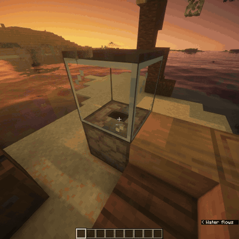
  <figcaption>Insert three produce items, blend, then bottle the juice in two pours.</figcaption>
</figure>

## Core Loop

Blend three fruit or vegetable items for ten seconds, then bottle the juice. Heirloom Mixology must be active.

## Blend And Bottle

Build an upward-facing `DROPPER`, place clear `GLASS` above it, and finish with any carpet. Heirloom Mixology's juice recipe enables the station. Click the glass with fruit or vegetables to insert exactly three items; repetitions and mixed produce are allowed. Empty-hand right-click starts a 200-tick blend (ten seconds). Ingredients keep the same size while resting and tumbling inside shaking glass. The completed batch appears as a low, flat liquid level until bottled. The recipe GUI has three independent ingredient selectors; its live preview reflects the selected mixture. Compare five private sound previews with `/hl debug juicer 1` through `5`, `all`, or `stop`; each lasts ten seconds. Pulsing Motor (5) is the default blending sound. Right-click the finished batch twice with Glass Bottles to collect two juices, one per click. The juice level halves after the first pour. No Water Bottle or earlier bottle insertion is required.

Before the first pour, left-click refunds original ingredients with their quality and provider data. After a pour, left-click discards the remainder and never returns consumed ingredients. Finished juice waits to be bottled. On interruption, unfinished blending resets; ingredients remain recoverable. The real glass stays in place for collision and protection while nearby players see its moving display.

Juice is drinkable and uses the vanilla lingering-potion appearance without a resource pack. It cannot be thrown and has no alcohol or Distillery brewing profile. Drinking returns one Glass Bottle. Food and saturation are half the combined input nutrition: round food down after summing, retain fractional saturation, and do not apply a second quality multiplier.

Juice inherits food properties and edible effects, including enchanted-apple benefits, Chorus teleport and poisonous-potato poison chance. Repeated ingredients do not multiply the same effect. Pure batches receive the fruit or vegetable name; mixed batches list their contents and blend their colors. Pure recipe ingredients require three matching produce items: adding one tomato to mixed juice does not make Tomato Juice.

Twenty-three base produce choices are available without Distillery. Registered Distillery grapes add up to five more. Existing owner-gated fruit remains gated.

## Suggested Blends

Try apple + beetroot + carrot (ABC), apple + carrot + orange, or pineapple + orange + mango. These use the same dynamic recipe and remain Mixed Juice. Each batch yields two bottles with the current per-bottle nutrition and effects. Original ingredients are refundable only before the first pour; saved half-full batches retain one serving after restart. Older saved single-serving batches stay single-serving. Both new stations play the shared completion bell.

## Cook With Juice

| Drink | Exact shaker ingredients |
| --- | --- |
| Bloody Mary | Vodka, pure Tomato Juice, Lemon, Salt |
| Garibaldi | Red Bitter Aperitif, pure Orange Juice |
| Virgin Mango Daiquiri | Pure Mango Juice, Lemon, Sugar |
| Virgin Banana Daiquiri | Pure Banana Juice, Lemon, Sugar |
| Shaken Piña Colada | Pure Pineapple Juice, Canned Coconut Milk, Sugar |

Every listed quantity is one. Juice supplies the bottle, so no extra empty bottle or Water Bottle is needed. Other input containers return once. The original Mixing Bowl Piña Colada recipe remains unchanged.

## Recipes

| Recipe | Output | Inputs | Source |
| --- | --- | --- | --- |
| [`ORCHARD_JUICE`](../recipes/default-recipes.md#recipe-orchard-juice) | 1× <a class="hl-output-item" href="../../recipes/default-recipes/#recipe-orchard-juice">ORCHARD_MIXED_JUICE</a>Default Mixed JuiceApple JuiceGolden Apple JuiceEnchanted Golden Apple JuiceSweet Berries JuiceGlow Berries JuiceMelon JuiceChorus Fruit JuiceCarrot JuiceGolden Carrot JuiceBeetroot JuicePotato JuicePoisonous Potato JuiceTomato JuiceCorn JuiceLettuce JuiceOnion JuiceCoconut JuiceBanana JuiceLemon JuiceMango JuiceAvocado JuiceOrange JuicePineapple JuiceRenoit Grape JuiceCherimola Blan Grape JuiceMeloire Grape JuiceCranerlet Nuala Grape JuiceGralladina Fran Grape Juice | orororor<a class="hl-icon-link" href="../../reference/vanilla-items/#vanilla-item-glow-berries">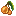</a>orororororororor<a class="hl-icon-link" href="../../reference/items/#item-tomato">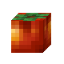</a>orororor<a class="hl-icon-link" href="../../reference/items/#item-coconut">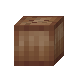</a>orororor<a class="hl-icon-link" href="../../reference/items/#item-avocado">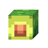</a>oror<a class="hl-icon-link" href="../../reference/items/#item-pineapple">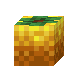</a>or<a class="hl-icon-link" href="../../reference/items/#item-renoit-grape">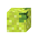</a>or<a class="hl-icon-link" href="../../reference/items/#item-cherimola-blan-grape">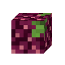</a>or<a class="hl-icon-link" href="../../reference/items/#item-meloire-grape">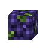</a>or<a class="hl-icon-link" href="../../reference/items/#item-cranerlet-nuala-grape">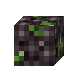</a>or<a class="hl-icon-link" href="../../reference/items/#item-gralladina-fran-grape">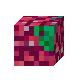</a>3 |  |

## Troubleshooting

Click the glass; use an empty hand to start and a Glass Bottle to collect. Left-click refunds ingredients.

See the full [recipe index](../recipes/default-recipes.md) for ingredient links, processing time, recipe rules, and output actions.
