# Mixology Table

## Build

Place any wooden pressure plate directly on an `IRON_BLOCK`. Interact with the plate. Heirloom Mixology must be installed and registered.

<figure class="hl-figure">
  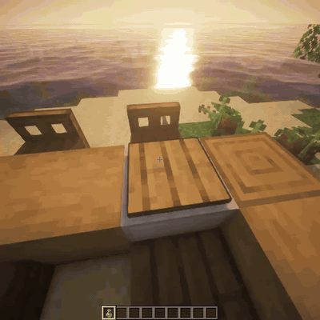
  <figcaption>Watch ingredients become a round of cocktails at the Mixology Table.</figcaption>
</figure>

## Core Loop

Add the exact ingredients; an existing bottled ingredient supplies the drink's container. Juice supplies the bottle for the shaken Piña Colada and Virgin Daiquiris. Start shaking, wait for the eight-second cycle, then collect three drinks from the centered row. Reusable infusions and liqueurs produce one bottle.

## Shake A Drink

Add the exact ingredients, then start the station. Mixology reuses up to three bottles from bottled inputs for finished drinks, or one for reusable precursors. No extra Glass Bottle is required when a bottled ingredient is listed. Other emptied bottles, cans, and cream buckets are returned once. The shaken Piña Colada reuses its Pineapple Juice bottle; the coconut milk can is returned. Drinking returns one Glass Bottle. Chilled cocktails optionally accept one Ice (no quality bonus), Packed Ice (+0.10) or Blue Ice (+0.20); Core quality is capped at Perfect; ice improves the drink's single quality without changing ABV or serving volume. Spirits, liqueur production and B-52 do not accept ice. Each bundled liqueur or cocktail takes eight seconds: the metal shaker closes, shakes with the station sounds, and settles before the drink is ready to collect. The progress highlight travels through the filled part of the bar on a 16-tick cycle.

Begin with a Virgin Mango or Banana Daiquiri, selected by the pure juice in one shared recipe, or the shaken Piña Colada. These are always available. Gin, Sweet Vermouth, Red Bitter Aperitif and Aromatic Bitters join the three liqueurs as reusable ingredients. The authored Mixology catalog includes Negroni/Boulevardier, Old Fashioned/Rum Old Fashioned, Manhattan, White Lady, Bee’s Knees and Garibaldi. Cafe adds Coffee Liqueur and the Espresso Martini, Russian and B52 recipe families.

## Optional Addons

With no Distillery, Mixology provides all four Boiling Pot spirit recipes, including Rum without Cafe. Compatible Distillery replaces those spirits with genuine distilled bottles. Wine capability 2 additionally enables Sweet Vermouth from genuine Wine or Champagne plus Vodka, and its Negroni/Boulevardier and Manhattan recipes. Capability 1 retains the other alcoholic recipes. An enabled Distillery without even the spirit integration hides the alcoholic menu; the four non-alcoholic recipe families still produce five named drinks. Cafe controls the coffee branch independently.

See [Heirloom Mixology](../addons/orchard/index.md) for the complete mode table and source requirements. The existing Mixing Bowl Piña Colada recipe remains available.

## Recipes

| Recipe | Output | Inputs | Source |
| --- | --- | --- | --- |
| [`ORCHARD_ABSINTHE`](../recipes/default-recipes.md#recipe-orchard-absinthe) | 1× <a class="hl-output-item" href="../../recipes/default-recipes/#recipe-orchard-absinthe">ORCHARD_ABSINTHE</a> |  |  Distillery absent or compatible Mixology integration |
| [`ORCHARD_AMERICANO`](../recipes/default-recipes.md#recipe-orchard-americano) | 3× <a class="hl-output-item" href="../../recipes/default-recipes/#recipe-orchard-americano">ORCHARD_AMERICANO</a> | <a class="hl-icon-link" href="../../reference/items/#item-orchard-red-bitter-aperitif">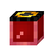</a><a class="hl-icon-link" href="../../reference/items/#item-orchard-sweet-vermouth">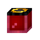</a>oror0-1 |  Distillery absent or wine capability 2 |
| [`ORCHARD_AROMATIC_BITTERS`](../recipes/default-recipes.md#recipe-orchard-aromatic-bitters) | 1× <a class="hl-output-item" href="../../recipes/default-recipes/#recipe-orchard-aromatic-bitters">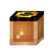ORCHARD_AROMATIC_BITTERS</a> |  |  Distillery absent or compatible Mixology integration |
| [`ORCHARD_B52`](../recipes/default-recipes.md#recipe-orchard-b52) | 3× <a class="hl-output-item" href="../../recipes/default-recipes/#recipe-orchard-b52">ORCHARD_B52</a> | <a class="hl-icon-link" href="../../reference/items/#item-orchard-irish-cream-liqueur">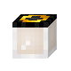</a><a class="hl-icon-link" href="../../reference/items/#item-orchard-orange-liqueur">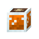</a> |  Distillery absent or compatible Mixology integration; Cafe required |
| [`ORCHARD_BEES_KNEES`](../recipes/default-recipes.md#recipe-orchard-bees-knees) | 3× <a class="hl-output-item" href="../../recipes/default-recipes/#recipe-orchard-bees-knees">ORCHARD_BEES_KNEES</a> | <a class="hl-icon-link" href="../../reference/items/#item-orchard-gin">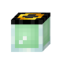</a>oror0-1 |  Distillery absent or compatible Mixology integration |
| [`ORCHARD_BLACK_RUSSIAN`](../recipes/default-recipes.md#recipe-orchard-black-russian) | 3× <a class="hl-output-item" href="../../recipes/default-recipes/#recipe-orchard-black-russian">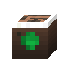ORCHARD_BLACK_RUSSIAN</a>Default Black Russian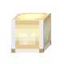White RussianMudslide | or0-1oror0-1 |  Distillery absent or compatible Mixology integration; Cafe required |
| [`ORCHARD_BLOODY_MARY`](../recipes/default-recipes.md#recipe-orchard-bloody-mary) | 3× <a class="hl-output-item" href="../../recipes/default-recipes/#recipe-orchard-bloody-mary">ORCHARD_BLOODY_MARY</a> | oror0-1 |  Distillery absent or compatible Mixology integration |
| [`ORCHARD_CLASSIC_DAIQUIRI`](../recipes/default-recipes.md#recipe-orchard-classic-daiquiri) | 3× <a class="hl-output-item" href="../../recipes/default-recipes/#recipe-orchard-classic-daiquiri">ORCHARD_CLASSIC_DAIQUIRI</a> | <a class="hl-icon-link" href="../../reference/items/#item-orchard-rum">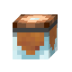</a>oror0-1 |  Distillery absent or compatible Mixology integration |
| [`ORCHARD_COFFEE_LIQUEUR`](../recipes/default-recipes.md#recipe-orchard-coffee-liqueur) | 1× <a class="hl-output-item" href="../../recipes/default-recipes/#recipe-orchard-coffee-liqueur">ORCHARD_COFFEE_LIQUEUR</a> |  |  Distillery absent or compatible Mixology integration; Cafe required |
| [`ORCHARD_CORPSE_REVIVER_NO_2`](../recipes/default-recipes.md#recipe-orchard-corpse-reviver-no-2) | 3× <a class="hl-output-item" href="../../recipes/default-recipes/#recipe-orchard-corpse-reviver-no-2">ORCHARD_CORPSE_REVIVER_NO_2</a> | oror |  Distillery absent or wine capability 2 |
| [`ORCHARD_COSMOPOLITAN`](../recipes/default-recipes.md#recipe-orchard-cosmopolitan) | 3× <a class="hl-output-item" href="../../recipes/default-recipes/#recipe-orchard-cosmopolitan">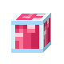ORCHARD_COSMOPOLITAN</a> | oror0-1 |  Distillery absent or compatible Mixology integration |
| [`ORCHARD_DEATH_IN_THE_AFTERNOON`](../recipes/default-recipes.md#recipe-orchard-death-in-the-afternoon) | 3× <a class="hl-output-item" href="../../recipes/default-recipes/#recipe-orchard-death-in-the-afternoon">ORCHARD_DEATH_IN_THE_AFTERNOON</a> |  |  Distillery Sparkling Wine capability 3 required |
| [`ORCHARD_DRY_MARTINI`](../recipes/default-recipes.md#recipe-orchard-dry-martini) | 3× <a class="hl-output-item" href="../../recipes/default-recipes/#recipe-orchard-dry-martini">ORCHARD_DRY_MARTINI</a> | oror0-1 |  Distillery absent or wine capability 2 |
| [`ORCHARD_ESPRESSO_MARTINI`](../recipes/default-recipes.md#recipe-orchard-espresso-martini) | 3× <a class="hl-output-item" href="../../recipes/default-recipes/#recipe-orchard-espresso-martini">ORCHARD_ESPRESSO_MARTINI</a> | oror0-1 |  Distillery absent or compatible Mixology integration; Cafe required |
| [`ORCHARD_GARIBALDI`](../recipes/default-recipes.md#recipe-orchard-garibaldi) | 3× <a class="hl-output-item" href="../../recipes/default-recipes/#recipe-orchard-garibaldi">ORCHARD_GARIBALDI</a> | oror0-1 |  Distillery absent or compatible Mixology integration |
| [`ORCHARD_GIN`](../recipes/default-recipes.md#recipe-orchard-gin) | 1× <a class="hl-output-item" href="../../recipes/default-recipes/#recipe-orchard-gin">ORCHARD_GIN</a> |  |  Distillery absent or compatible Mixology integration |
| [`ORCHARD_GIN_AND_TONIC`](../recipes/default-recipes.md#recipe-orchard-gin-and-tonic) | 3× <a class="hl-output-item" href="../../recipes/default-recipes/#recipe-orchard-gin-and-tonic">ORCHARD_GIN_AND_TONIC</a> | oror0-1 |  Distillery absent or compatible Mixology integration |
| [`ORCHARD_IRISH_CREAM_LIQUEUR`](../recipes/default-recipes.md#recipe-orchard-irish-cream-liqueur) | 1× <a class="hl-output-item" href="../../recipes/default-recipes/#recipe-orchard-irish-cream-liqueur">ORCHARD_IRISH_CREAM_LIQUEUR</a> | <a class="hl-icon-link" href="../../reference/items/#item-orchard-whiskey">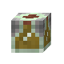</a> |  Distillery absent or compatible Mixology integration |
| [`ORCHARD_IRISH_CREAM_MILKSHAKE`](../recipes/default-recipes.md#recipe-orchard-irish-cream-milkshake) | 3× <a class="hl-output-item" href="../../recipes/default-recipes/#recipe-orchard-irish-cream-milkshake">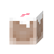ORCHARD_IRISH_CREAM_MILKSHAKE</a> | <a class="hl-icon-link" href="../../reference/items/#item-ice-cream">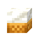</a>oror0-1 |  Distillery absent or compatible Mixology integration |
| [`ORCHARD_LONG_ISLAND_ICED_TEA`](../recipes/default-recipes.md#recipe-orchard-long-island-iced-tea) | 3× <a class="hl-output-item" href="../../recipes/default-recipes/#recipe-orchard-long-island-iced-tea">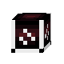ORCHARD_LONG_ISLAND_ICED_TEA</a> | <a class="hl-icon-link" href="../../reference/items/#item-orchard-tequila">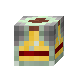</a>oror0-1 |  Distillery absent or compatible Mixology integration |
| [`ORCHARD_MANHATTAN`](../recipes/default-recipes.md#recipe-orchard-manhattan) | 3× <a class="hl-output-item" href="../../recipes/default-recipes/#recipe-orchard-manhattan">ORCHARD_MANHATTAN</a> | oror0-1 |  Distillery absent or wine capability 2 |
| [`ORCHARD_MARGARITA`](../recipes/default-recipes.md#recipe-orchard-margarita) | 3× <a class="hl-output-item" href="../../recipes/default-recipes/#recipe-orchard-margarita">ORCHARD_MARGARITA</a> | oror0-1 |  Distillery absent or compatible Mixology integration |
| [`ORCHARD_NEGRONI`](../recipes/default-recipes.md#recipe-orchard-negroni) | 3× <a class="hl-output-item" href="../../recipes/default-recipes/#recipe-orchard-negroni">ORCHARD_NEGRONI</a>Default Negroni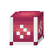Boulevardier | ororor0-1 |  Distillery absent or wine capability 2 |
| [`ORCHARD_OLD_FASHIONED`](../recipes/default-recipes.md#recipe-orchard-old-fashioned) | 3× <a class="hl-output-item" href="../../recipes/default-recipes/#recipe-orchard-old-fashioned">ORCHARD_OLD_FASHIONED</a>Default Old Fashioned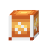Rum Old Fashioned | ororor0-1 |  Distillery absent or compatible Mixology integration |
| [`ORCHARD_ORANGE_LIQUEUR`](../recipes/default-recipes.md#recipe-orchard-orange-liqueur) | 1× <a class="hl-output-item" href="../../recipes/default-recipes/#recipe-orchard-orange-liqueur">ORCHARD_ORANGE_LIQUEUR</a> |  |  Distillery absent or compatible Mixology integration |
| [`ORCHARD_RED_BITTER_APERITIF`](../recipes/default-recipes.md#recipe-orchard-red-bitter-aperitif) | 1× <a class="hl-output-item" href="../../recipes/default-recipes/#recipe-orchard-red-bitter-aperitif">ORCHARD_RED_BITTER_APERITIF</a> |  |  Distillery absent or compatible Mixology integration |
| [`ORCHARD_SAZERAC`](../recipes/default-recipes.md#recipe-orchard-sazerac) | 3× <a class="hl-output-item" href="../../recipes/default-recipes/#recipe-orchard-sazerac">ORCHARD_SAZERAC</a> |  |  Distillery absent or compatible Mixology integration |
| [`ORCHARD_SHAKEN_PINA_COLADA`](../recipes/default-recipes.md#recipe-orchard-shaken-pina-colada) | 3× <a class="hl-output-item" href="../../recipes/default-recipes/#recipe-orchard-shaken-pina-colada">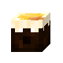PINA_COLADA</a> | oror0-1 |  All Mixology modes; non-alcoholic |
| [`ORCHARD_SPARKLING_LEMONADE`](../recipes/default-recipes.md#recipe-orchard-sparkling-lemonade) | 3× <a class="hl-output-item" href="../../recipes/default-recipes/#recipe-orchard-sparkling-lemonade">ORCHARD_SPARKLING_LEMONADE</a>Default Sparkling LemonadeJohn Collins | 0-1oror0-1 |  Virgin: all Mixology modes; spirit variant: Distillery absent or compatible integration |
| [`ORCHARD_SWEET_VERMOUTH`](../recipes/default-recipes.md#recipe-orchard-sweet-vermouth) | 1× <a class="hl-output-item" href="../../recipes/default-recipes/#recipe-orchard-sweet-vermouth">ORCHARD_SWEET_VERMOUTH</a> |  |  Distillery absent or wine capability 2 |
| [`ORCHARD_VIRGIN_MANGO_DAIQUIRI`](../recipes/default-recipes.md#recipe-orchard-virgin-mango-daiquiri) | 3× <a class="hl-output-item" href="../../recipes/default-recipes/#recipe-orchard-virgin-mango-daiquiri">ORCHARD_VIRGIN_MANGO_DAIQUIRI</a>Default Virgin Mango DaiquiriVirgin Banana Daiquiri | ororor0-1 |  All Mixology modes; non-alcoholic |
| [`ORCHARD_VIRGIN_MOJITO`](../recipes/default-recipes.md#recipe-orchard-virgin-mojito) | 3× <a class="hl-output-item" href="../../recipes/default-recipes/#recipe-orchard-virgin-mojito">ORCHARD_VIRGIN_MOJITO</a>Default Virgin MojitoMojito | 0-1oror0-1 |  Virgin: all Mixology modes; spirit variant: Distillery absent or compatible integration |
| [`ORCHARD_WHISKEY_SOUR`](../recipes/default-recipes.md#recipe-orchard-whiskey-sour) | 3× <a class="hl-output-item" href="../../recipes/default-recipes/#recipe-orchard-whiskey-sour">ORCHARD_WHISKEY_SOUR</a> | oror0-1 |  Distillery absent or compatible Mixology integration |
| [`ORCHARD_WHITE_LADY`](../recipes/default-recipes.md#recipe-orchard-white-lady) | 3× <a class="hl-output-item" href="../../recipes/default-recipes/#recipe-orchard-white-lady">ORCHARD_WHITE_LADY</a> | oror0-1 |  Distillery absent or compatible Mixology integration |

## Troubleshooting

Confirm `/hlo info` shows Heirloom Mixology active. If alcoholic recipes are missing, read the Distillery compatibility diagnostic and check Cafe for coffee recipes. Extra ingredients or old standalone spirit stock do not satisfy integrated recipes.

See the full [recipe index](../recipes/default-recipes.md) for ingredient links, processing time, recipe rules, and output actions.
